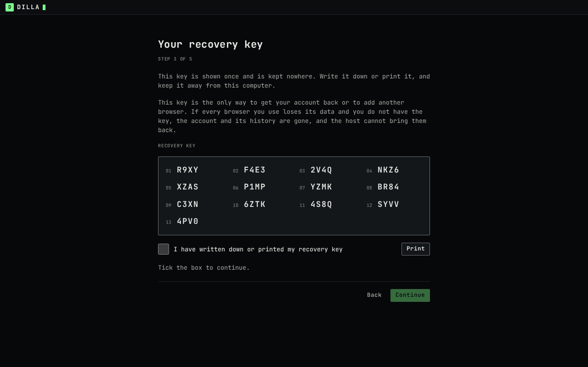
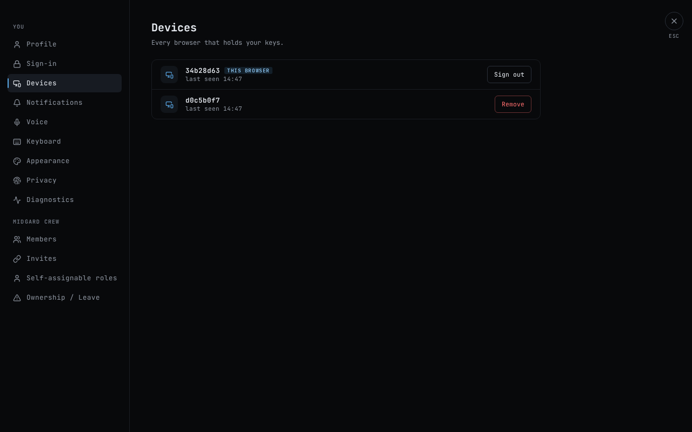
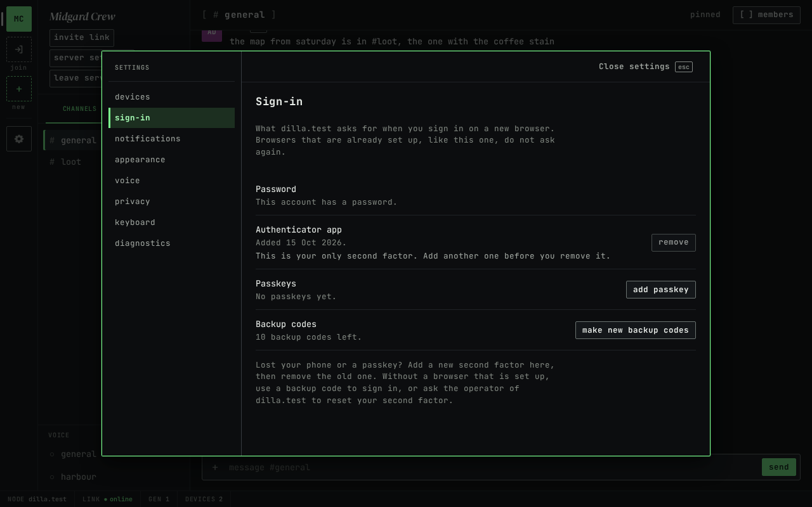
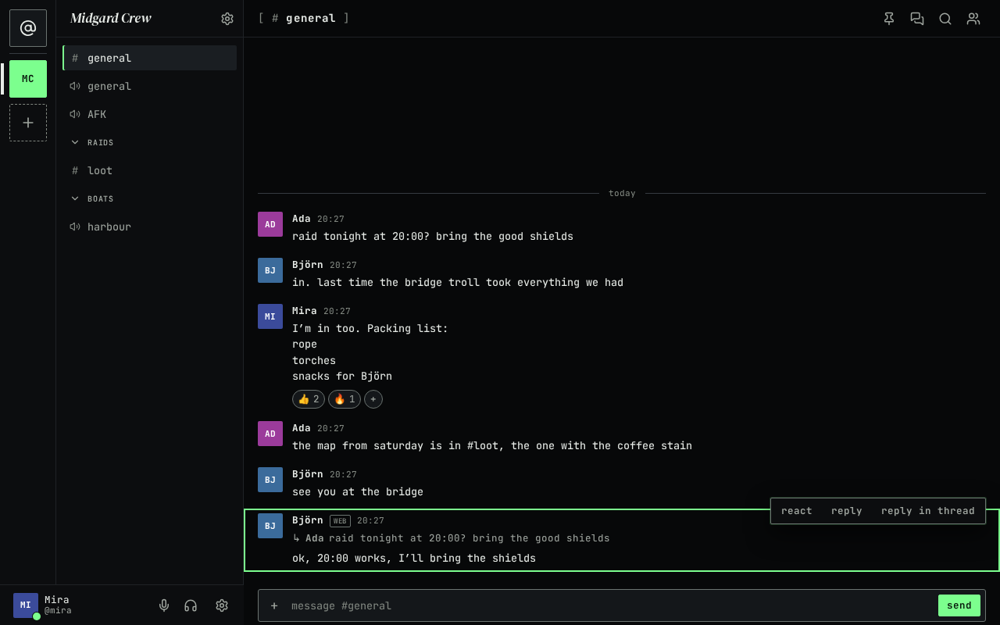
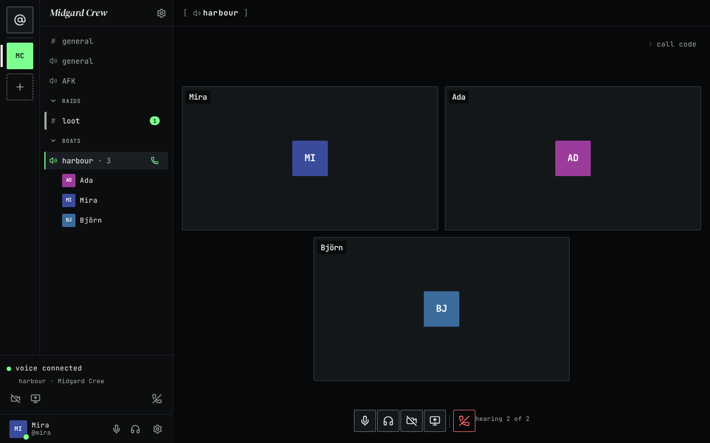
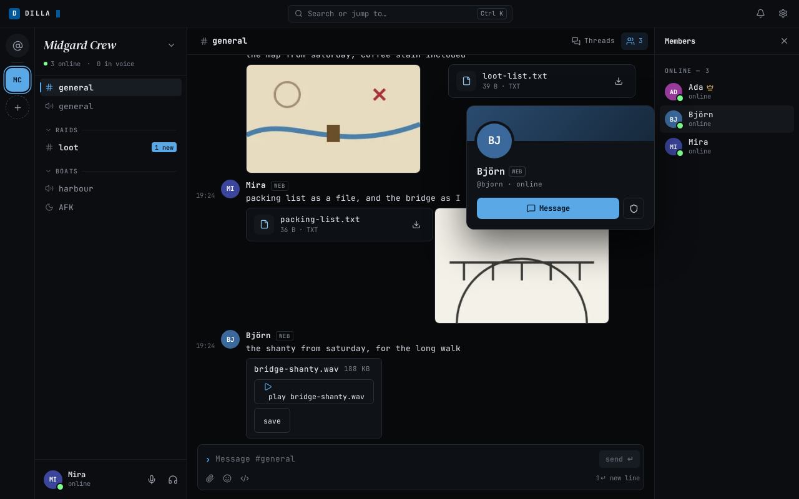
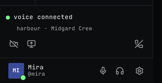
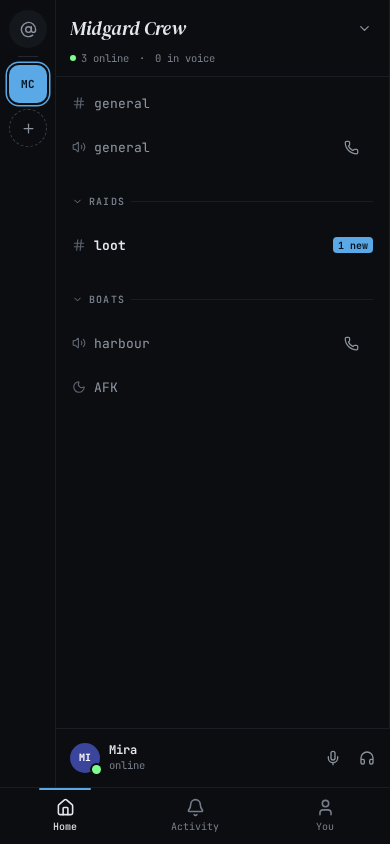

# dilla

> **Not audited. Not for production.** dilla is under construction. Nothing here has had an
> independent security review, and the project makes no end-to-end encryption claim until one is
> published. Run it only to develop it.

dilla is an open-source, self-hosted alternative to Discord, for a group that wants to leave Discord and
host its own place to talk: servers with text channels and drop-in voice, DMs, roles and permissions,
screen share and bots, with end-to-end encryption as the silent default. An instance is one Go binary,
`dillad`, that serves the HTTP API, the WebSocket gateway, the MLS delivery service, the LiveKit media
server, the TURN relay and the web client, on SQLite or Postgres. Anyone who can run one process on a
machine their group can reach can host it.

## What works today

As of web3.10 (2026-10-21).

| Part | State |
|---|---|
| The server, `dillad` | Accounts and devices, servers (communities in the API), text channels, DMs, roles, permissions and channel overwrites, kicks and bans, invites, attachments (blobs), reports, encrypted backup objects; `dillad init`, `serve`, `doctor`, `backup`, `restore` and `admin`; TLS by ACME (TLS-ALPN, DNS or IP) or behind a proxy. Install script (systemd, no Docker), container image, systemd unit and Proxmox helper: see the [operator guide](docs/deploy/README.md). |
| Encrypted calls, at the protocol and media level | Voice, camera and screen share through the in-process LiveKit SFU and TURN relay, with every media frame encrypted end to end (SFrame keys from MLS), driven by the browser package `packages/media` and tested in Chromium and Firefox. The web client uses it for voice channels and calls. |
| The web client ("web3.10") | Served by `dillad` from its own address. On a new instance, the first person signs up with the bootstrap invite and starts a server from the client ("new server"); it comes with a text and a voice channel called general. Whoever manages channels adds text and voice channels (the "+" at the top of the channel list), and every member who may invite makes invite links with a chosen expiry and number of uses (server settings → invites), so a group gets from an empty instance to talking without the HTTP API. Sign up with an invite in six steps, the fifth being a required second factor (below), then use the account in a second browser: username and password, then the second factor (a code, a passkey or a backup code), then the recovery key last, then done. Read and send text in channels and DMs; DMs stay reachable with no server or when a server did not load. Edit and delete your own messages (a delete removes the message and its files for everyone), react with a set of 32 emoji, reply, pin messages for everyone in the conversation (in a server channel, only the owner, administrators and members whose role grants **pin messages** can) and mention people with `@`; attach images and files of up to 25 MB each, shown as previews or file cards and opened full size. Unread and mention badges appear in the channel list, the direct messages list and the server rail. Settings → Devices lists every browser and removes one with the recovery key, signs this browser out and removes it, or forgets it; it works at phone width and high zoom. A persistent warning shows when the instance holds recovery data that is not this account's, and a sign-in that another sign-in pushed out says so. Desktop notifications require opt-in and an open tab. Messages sent before a new browser joins are not shown there. Each contact device is checked against that person's signed device list before its messages are shown; the first key this browser sees for a person is shown as "First seen here — not verified", not as verified. Settings → Privacy compares a 12×5-digit safety number with a contact, read aloud in person or on a call you started yourself; verifications belong to the browser that made them. When a contact's identity changes, sending (and attaching) in the conversations they share with you stops until you compare again or their changed device leaves that conversation, and what they sent under the new key shows once you approve it; a device that fails the checks pauses sending where it is a member. A device that uses your own account but is not on your device list, or under a different identity, raises a warning that stays until it is removed in Settings → Devices. Search (Control/⌘+K) finds text in the messages this browser holds, in this conversation, this community or everywhere; nothing is searched on the instance. Settings → Keyboard lists the search, mute and deafen shortcuts, and Settings → Diagnostics shows the connection, generation, instance name and device count and copies recent error codes. A conversation shows who is typing. One tab at a time per browser: a second tab of the same instance waits, **Use this tab** moves the app there, and the paused tab can take it back the same way. Roles and private channels (web-3.5): the owner and anyone with manage roles makes roles (name, colour, **show separately in the member list**, **anyone can mention this role**, a permission grid), moves and deletes them and gives them from **edit roles** in a member's profile card; a channel can be made **private** when it is created (for at most 98 roles) or later in its permissions, with allow, default and deny for each role or person; `@role` mentions (anyone can mention a role marked mentionable; other roles can be mentioned only by members allowed to mention @everyone); pins follow the pinner's current right to pin, and @everyone and @here notify only when the sender may use them (a direct @you notifies, unless the server or channel is muted or set to nothing); **upgrading from web-3.4:** the default @everyone role has neither **pin messages** nor **mention @everyone and @here**, so in an existing server only the owner, administrators and members whose role grants pin can pin, pins others made earlier stay hidden until the owner grants the right (they come back when it is granted), and @everyone and @here from members without the right do not notify; to keep the old behaviour the owner turns both on under **server settings** → **roles** → **edit** on @everyone (see [Upgrading from an earlier version](docs/user/getting-started.md#upgrading-from-an-earlier-version)); in a channel where you may not send, the message box is read-only with the reason and keeps your draft; Settings → Notifications has a row for each server (all messages, mentions or nothing; mute server; ignore @everyone and @here). Run your server: **server settings** renames the server, adds, edits, moves and deletes channels and categories (name, topic), makes invite links with a chosen expiry and number of uses and revokes them (a link cannot be shown again), lists and lifts bans, and lets a member leave, the owner hand the server over or delete it, the last two after typing the server name. The member list (the **members** button; a panel over the screen on a phone) groups people by role; a row is the avatar and the name, centred, in the colour of the person's highest coloured role, with a crown after the owner, no "owner" or "you" tags, and a small "bot" tag after a bot's name (web3.10). Click a row, press Enter on it, right-click it or press Shift+F10 and it opens a profile card (a popover on a computer, a sheet on a phone) with the avatar, name, @username, status, "owner" and "you", the roles as chips and the actions: message, compare safety numbers, edit roles, and kick and ban with a length and a reason, which follow rank (offered only when the person's highest role is below yours). A user mention in a message, and a message's author name or avatar, open the same card in channels and threads; in direct messages a mention is plain text for now, and a former member's mention opens a name-only card (titled "former member" when no name is known) while one of their messages is held; a person who is removed sees a banner and the server leaves their rail. Voice channels: join and leave, with the voice channels in the one channel list and the people in a call nested under each, marked by small icons (muted, deafened, camera, screen, speaking) that each have a name; a call panel above the user panel keeps where you are (the channel name, your ping and ↑ and ↓ kb/s), camera, share screen and leave while you read other channels; mute and deafen sit in the user panel, in a call and before one, and are enforced from the first frame (Control/⌘+Shift+M, Control/⌘+Shift+D); speaking lights within a beat; the stage shows one tile per camera or screen, with focus, a filmstrip and full screen (a DM call keeps its compact grid); the built-in AFK channel (web-3.9: every server has a listen-only voice channel called "AFK", which a manager can rename and move but not delete, and which is always the very last row of the channel list; after the inactive timeout of 1, 5, 15, 30 minutes or 1 hour in server settings → overview, the server moves a computer that has sat idle in a voice channel there, and a phone is never moved); presence and status (online, idle, do not disturb, invisible: lower case, followed across devices; the member list groups people by status and role, and the headings of roles shown apart carry the role colour); voice activity or push to talk (one key such as F13–F24, Pause, Scroll Lock or Insert, only while the dilla tab is active), input and output devices (the output device in Chrome and Edge, which the dock follows during a call; Firefox plays call sound on the system default device), a "hearing N of M" line in the dock that counts how many audio streams you hear (a shared screen's sound is its own), local noise suppression (Automatic (beta), which ships in every release, Lightweight and Off, with effective processor and fallback shown), a ten-second local microphone test outside calls, and a volume for each person. Existing On preferences retain RNNoise; DeepFilterNet remains an unqualified prototype outside the production bundle, with no Krisp parity claim. People in a call hear each other from v0.1.0-web3.3 (in v0.1.0-web3.2 people saw each other speaking but heard nothing); when the browser holds call audio back, the dock offers one **turn on audio** press. DM and group-DM calls ring the others with an in-app banner, a sound and, while the tab is hidden, a desktop notification; a ring lasts 30 s and can be answered or declined, and a muted DM rings with the banner only. Camera and screen share (sound from a browser tab in Chrome and Edge; from a screen or window on Windows and ChromeOS when "Also share system audio" is ticked, and on macOS 14.2+ with Chrome 141+; from a tab on Linux only; none from Firefox or Safari, where a share without sound can take an audio input picked under **sound from** (web-3.9.2), and the notice names what the browser can do). A call code to read aloud shows whether everyone hears the same set of devices; a contact whose identity changed pauses the call for you, or keeps you from joining, until you compare safety numbers, and a device that fails the checks makes you leave. Join, leave and ring sounds, on by default and switched off in Settings → Notifications. Audio and video attachments of the common types play inline, in the browser's own player. See [Voice, calls and media files](docs/user/voice.md). Required second factor (web-3.6): every account holds an authenticator app or a passkey, plus backup codes. Sign-up ends with choosing one; an account without one (made before web-3.6, left at that step, or reset by the operator with `dillad admin user reset-factors`) meets "Add a second factor" in every browser before the app opens and cannot skip it; signing in on a new browser takes the password and a code, or a passkey on its own, or a backup code; Settings → Sign-in adds an authenticator app or a passkey, makes new backup codes and removes a factor while another remains, after confirming your password or a passkey. The limits: a browser that is already set up is not asked again, the factor guards signing in on a new browser and not message content, backup codes are not the recovery key (a new browser still needs the recovery key), and it cannot be switched off on an instance. Operators: see [Operating a required second factor](docs/deploy/README.md#5-operating-a-required-second-factor), including the passkey settings behind a proxy. **Upgrading from web-3.5:** accounts without a factor are not signed out but must add one; check Settings → Sign-in afterwards. Phone app shell (web-3.7; web-3.9 has three tabs, Home, Activity and You, with the DMs behind the `@` tile of Home): under about 770 px the app shows one thing at a time with tabs; a channel opens over the whole screen with a back, the four tabs stay on every screen (Settings is a page above them) and step aside while you type, tapping the current tab returns to its list (web-3.7.1), the activity tab lists the mentions and DMs since the tab opened, **you** holds this device's connection facts, settings and sign out, a call bar with open, mute and leave sits above the tab bar, there is no status bar, fields do not zoom the page on focus (pinch zoom still works), and every phone control is 44 px. Slow mode (web-3.7): a text channel can make each person wait 5 s to 6 h between messages; the host enforces it with **bypass slow mode**, shows a countdown, and queues a send made too early. Announcement channels: only the roles ticked at creation can post, everyone reads and reacts. Threads: **reply in thread** keeps the replies to one message together, in the side column or as a phone sheet, and **threads** lists them. The host now also refuses posts from people without **send messages**. The limits: tabs open from before web-3.8 must reload ("needs a newer client", with a **reload** that keeps your draft). Desktop layout (web-3.8): no status bar (Settings → Diagnostics holds the node, link, generation and devices, and a line at the top says when the link drops); resizable panes (drag the borders or use the keyboard; widths kept in this browser only); one channel list; invite links under server settings → invites; a user panel at the bottom left with your name and a status dot (click the name for online, idle, do not disturb or invisible), mute and deafen and the gear for user settings; the sidebar header is the server's name with a gear for server settings (leave server is a section in there), and on a phone a search icon beside it. Discord-style layout (web-3.9): the rail is 72 px wide, with an `@` Home tile at the top for your direct messages, your servers and one "+" tile to join or create a server; channels sit in categories that collapse (kept in this browser only; a collapsed category still shows the channel you are in and channels with new messages); a voice channel joins with one click on a computer, and the person who is speaking has a ring around the avatar; the call dock shows the channel name over your ping and data rates (↑ and ↓ kb/s; a ping under 1 ms reads "<1 ms", and ↓ is 0 while nobody sends you anything, a dash only when the reading failed (web3.10.1); coloured by quality: normal under 150 ms, warning to 300 ms, danger above that or with over 5 % loss), with camera, share and leave on the right, with no microphone meter (that is in Settings → Voice) and a PTT tag on the mute button when push to talk is on; the channel header has icons for pins, threads, search, edit channel and members, each with a tooltip on hover or focus; the WEB tag on a message from a browser is always shown, so pointing at a message does not move it; the border between the channel list and the conversation runs the full height of the window, beside the call dock and the user panel; messages from one person group together, with date dividers and a **jump to present** button (Control+End) when you have scrolled up; on a phone, tap a message to show its actions; every settings page uses one layout; search opens as a window and each result shows its #channel, author and time; the invite page is set in the app's type. Phones (web-3.8): a landscape phone gets the phone layout, a Safari private window explains itself, and a phone that cannot share a screen has no share button. The operator side: `dillad init --config` writes the config file where you say, and the data files are owner-only; the invite page is styled. Open tabs check for a newer build and reload it, restoring the view and drafts from an encrypted checkpoint. **Upgrading from web-3.6:** database migration 00018 and browser store schema 5; the store change is one-way (see the [operator guide](docs/deploy/README.md#client-data-version-per-release)). Tested in Chromium and Firefox, and in WebKit for sign-up and reload; the phone shell is tested in Chromium. See [Getting started](docs/user/getting-started.md). |

## What is not there yet

As of 2026-10-21, in the web client:

- Server-checked permissions: who may send is checked only by members' apps in this version, and so are pins and
  @everyone. The role view is not verified by the group: a bad host could hide pins and @everyone or show members
  different role views, though it cannot read or change messages. Six permissions (manage messages, view audit log,
  bypass slow mode, mute members, move members, manage nicknames) have no effect yet.
- People who gain a channel see only messages sent after they join it.
- Enhanced noise suppression comparable to Krisp. DeepFilterNet3 is an unqualified local experiment; see [evaluation findings](experiments/noise/results/FINDINGS.md).
- A native app or phone client. The recovery key adds another browser with the account password; it does not
  restore messages sent before that browser joined.
- Changing the password or naming devices in the web client. There is no dedicated operator command yet to reset an
  account's recovery data, which the recovery-data warning asks for. (`dillad admin user reset-factors` resets a
  person's second factor, not their recovery data.)
- Editable profiles in the web client (a profile card shows a member's name, status, roles and actions, but there is no avatar or bio to edit), a profile card in direct messages, and showing an invite link again after it was made.
- Voice from the desktop app (there is no desktop app yet), and voice in Safari.
- On Windows, Chrome and Edge before version 141 may send the call's own sound back through a shared screen or window (an echo); update the browser.
- Ringing with no open dilla tab, and answering from the notification itself.
- Threads, link previews, markdown and custom emoji; files over 25 MB from a browser.
- Desktop notifications stop when every tab is closed.
- Search on a touch device without a keyboard: search opens only with Control/⌘+K or Control+/ for now.
- Comparing safety numbers by QR code, or with someone you share no conversation with ("Open a conversation with
  this person to compare numbers."). Privacy shows no date for a verification, and a verification made in one browser
  does not carry over to your other browsers. Privacy's note that a changed
  contact left a conversation is lost after a reload (the contact still shows as changed), and the changed-identity
  alert in a conversation opens Privacy, where you pick **Compare with …**, rather than the comparison itself.
- Settings that follow you to your other browsers (each browser keeps its own), and server-readable channels.
- Changing your own identity key keeps the other devices working only if they sign in again: a device left on the
  old key shows the "different identity" warning and must be enrolled again.
- More than one working tab per browser: a second tab waits and shows nothing of the conversation until you move
  the app to it.

Beyond the web client: no desktop app (Electron) or mobile app, no published security review, and no published capacity
figures yet.

## Run it

The [operator guide](docs/deploy/README.md) covers the install script (`deploy/install.sh`, a native systemd install and the one supported way to run dillad, attached to every release), the systemd units and the Proxmox
helper, the TLS modes, the TURN relay and LiveKit settings, backup and restore, and operating the required
second factor (resetting a person's factors, passkey settings behind a proxy).

## Use it

[Getting started](docs/user/getting-started.md) is for the first person on a new instance (starting a server,
inviting people, adding channels) and for a person with an invite: the sign-up, what the
browser keeps, the app and its keyboard, the app on a phone, slow mode, announcement channels and threads, saying more (edits, reactions, replies,
pins, mentions, images and files), comparing safety numbers, search, settings, typing and a second tab, and the
known limits. [Voice, calls and media files](docs/user/voice.md) covers voice channels, the stage, DM calls and ringing,
camera and screen share, push to talk, the call code, AFK channels, sounds, and audio and video files.

## Repository layout

| Path | What |
|---|---|
| `protocol/` | Normative protocol documents and conformance test vectors (Apache-2.0) |
| `packages/protocol-vectors` | TypeScript reference implementation that generates the vectors (Apache-2.0) |
| `docs/superpowers/specs` | Product and system design specifications |
| `docs/superpowers/plans` | Implementation plans |
| `docs/design` | Design brief and the Mesh design reference |
| `docs/deploy` | The operator guide |
| `docs/user` | The user guide and its screenshots |

## Licence

Server and clients: AGPL-3.0-or-later (`LICENSE`). Protocol documents, test vectors and SDK
libraries: Apache-2.0 (`LICENSE-APACHE`). Contributions are accepted under the Developer
Certificate of Origin (`DCO`): sign off every commit with `git commit -s`.
