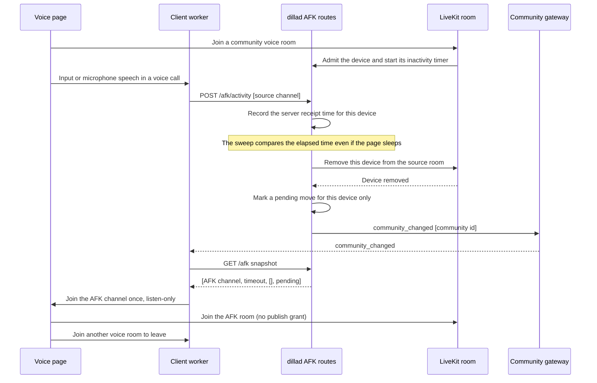

# The AFK channel

Every server has one built-in voice channel called "AFK" (since v0.1.0-web3.9). It is an ordinary
call group: its members are the channel's members and the media keys reach a device through MLS as
in any other voice channel. What makes it the AFK channel is that every grant in it is listen-only:
nobody publishes audio, camera or screen there, and a share request is refused with `403`.

The database stores which channel is the server's AFK channel and the inactive timeout
(`community_afk`, one row per server). Device activity and the pending move live in the server
process with the voice calls; they are short-lived and never contain media keys.

- The server writes the channel when it makes a server (audit detail `afk.builtin`), and once at
  the first start of a new `dillad` for every server that has none. A web-3.8 server keeps its
  timeout; the channel it chose stays as an ordinary voice channel.
- A manager can rename the channel and move it between categories. The server refuses to delete it,
  to change its topic, mode, visibility or slow mode, and to give it permission overwrites. Any
  member who can see the server can join it.
- A phone is never moved. A client on a phone or a coarse pointer reports itself exempt when it
  joins a call, and the server then stops counting that device.

The snapshot is `[channel_id, timeout_seconds, [], pending]`. The third element is always empty (it
held the occupants in web-3.8). `pending` is true only for the device that was removed, and only for
10 minutes or until that device is admitted to any call. Nothing but the sweep sets it: another
member's activity, a settings write or a snapshot read never moves anyone. The client joins on its
own `pending`, once, with no retry loop; if the join fails, the dock shows "Moved to AFK for
inactivity" with a **join** button.

The client never asks for a microphone in the AFK call: the session is listen-only from the start.
Role or overwrite changes that re-push grants during an AFK call push listen-only again. If the
server cannot read the channel's state, it treats the call as AFK and grants nothing to publish.

The routes `POST` and `DELETE /v1/communities/{id}/afk` of web-3.8 (move and leave by hand) answer
`404` with the detail `retired in web3.9`; a web-3.8 tab gets a refusal it can map.
