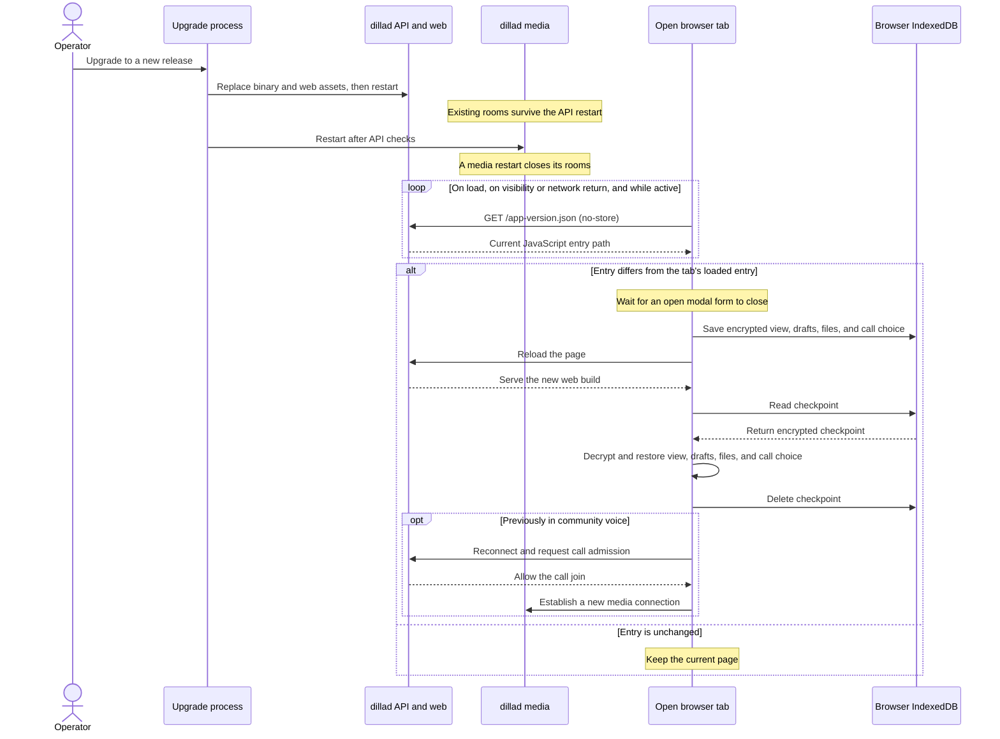

# Deploying dillad

dillad is one static binary (`dillad`) plus one file beside it, `dilla_core_wasi.wasm`, the MLS
core it runs inside wazero. Set `livekit.mode = 'sidecar'` and run `dillad media` as a second
process: the API can restart while the SFU keeps existing rooms. The API owns the `/rtc` join
gate, webhook receiver, TLS and TURN relay. Replacing the media process ends its rooms;
the updated client reopens community voice during the upgrade window. This page covers Compose,
systemd, the install script,
and the Proxmox LXC helper.

### Open tabs during an upgrade

For upgrades already running the media sidecar, the normal path is:



Once a browser has loaded a release with the update watcher, it checks `/app-version.json` when
the page opens or becomes visible, every 30 seconds while visible, and every 3 seconds during a
voice call even if the tab is hidden. A changed entry triggers a per-tab encrypted checkpoint of
the current view, drafts, selected attachments and call choice, followed by a reload and restore.
An open modal form delays the reload until it closes. A browser without working checkpoint storage
offers a manual reload instead. Screen sharing needs another click after rejoining because the
browser requires a user gesture. A tab loaded before this watcher exists cannot update itself;
tell those members to reload once after the first deployment.

The media sidecar keeps the SFU room alive during an API restart, but the API's signalling and TURN
connections reset. The browser attempts to rejoin voice after a lost connection. Restarting the
media process closes its rooms. During the two minutes after an app update is detected or restored,
the browser also reopens a community voice room that closes with `E_CALL_ENDED`. A DM call that
ends stays ended. Outside that window, and on tabs from before this feature, a person must choose
Join again. A network or browser permission refusal can also require a manual join.

`dillad doctor --config=/etc/dilla/dilla.toml` checks the configuration, the database, the data
directory's mode and ownership, the wasi core, the clock, the certificate, the TURN relay, the
blob tree and the passkey settings (`webauthn`), and prints one line per check. By default its `udp` leg reads WARN "not probed": dillad
runs no reflector, so the leg never proves the UDP forward, which can only be checked from outside.
With `doctor.udp_probe = false` the leg reads OK "skipped", and with `livekit.enabled = false` OK
with no media port to reach. Run it after every change.

## 1. The TLS modes

`tls.mode` in `dilla.toml` is the one switch. `dillad init` writes `acme_tls_alpn`.

| Mode | Use it when | What it needs |
|---|---|---|
| `acme_tls_alpn` (default) | dillad is reachable from the internet on 443/tcp at `instance.domain`, and nothing else on the host owns 443. | `instance.domain` resolving to the host, `instance.public_ip`, `tls.agreed = true`. Issuance uses the TLS-ALPN-01 challenge on 443 itself, so no port 80 is needed. |
| `acme_dns` | 443 is not reachable from the internet while the certificate is issued (a home connection, a split-horizon network), or you want a wildcard. | The same, plus `tls.dns.provider` and `tls.dns.credentials_file`. Issuance uses the DNS-01 challenge, which needs no inbound connection. |
| `acme_ip` | The instance has no domain of its own and clients connect to an address. | A public IP the certificate authority can reach on 443/tcp (validation is TLS-ALPN-01). dillad forces the `shortlived` profile, the only one that permits IP names, so certificates are renewed far more often; `tls.renewal_window_ratio` sets when. |
| `behind_proxy` | A reverse proxy you already run terminates TLS. | dillad listens on `server.plain_listen` (`127.0.0.1:8080` by default) and trusts `X-Forwarded-For` only from `server.trusted_proxy_cidrs`, which must be non-empty. `instance.public_ip` and `tls.agreed` are not required. |

In every mode except `behind_proxy`, TURN shares 443 with the web server: a demultiplexer in front
of the TLS listener hands STUN to the relay and everything else to HTTPS. Only 443/tcp and
7882/udp (LiveKit's media port) need to be open.

### What the TURN relay can reach

The relay is restricted to the host's own SFU, by address and by port. It refuses a
`CreatePermission` or `ChannelBind` for any peer address that is not `livekit.node_ip` (plus, with
`livekit.advertise_internal_ip`, the host's interface addresses LiveKit also listens on, minus
`livekit.ips_excludes`), and it refuses all of them when LiveKit is off. On an admitted address the
relay socket then exchanges datagrams only with LiveKit's media port, `livekit.udp_port` (7882; with
`udp_port = 0`, LiveKit's 50000-60000 range), and never with another relay allocation: anything a
client sends elsewhere, and anything that arrives from elsewhere, is dropped and counted in
`dilla_turn_peer_drops_total`. Other UDP services on the admitted addresses, loopback included when
`livekit.node_ip` is unset, are not reachable through the relay, and one member cannot push traffic
into another member's relayed call. With `udp_port = 0` every port of that range on the admitted
addresses is reachable, so keep other services out of 50000-60000 there, or set a fixed `udp_port`.

The relay also bounds what one credential, and the whole instance, can hold: a TURN connection that
has not created an allocation within 30 seconds of connecting is closed, and so is one that has gone
61 minutes without an authenticated request on its allocation (longer than any allocation lives
without a refresh). Unauthenticated bytes, an `Allocate` refused at a quota, and the requests of a
revoked device or an expired credential do not keep a connection open. An `Allocate`
with `EVEN-PORT` or `RESERVATION-TOKEN` is refused with 508 (browsers never send either). At most
8192 relay allocations are live on the instance at once, whatever the devices; past that, an
`Allocate` is refused with 486, counted in `dilla_turn_capacity_refusals_total` and logged at WARN.
This is a fixed backstop until device enrolment per user is capped.

The relay offers UDP relays only. It refuses an RFC 6062 TCP allocation (`REQUESTED-TRANSPORT` TCP)
with STUN error 508, so no `Connect` can open a TCP connection to an admitted address. Browsers never
ask for one. Regression note: before this was fixed, pion's default relay generator served TCP
allocations, and any holder of a call credential could reach every TCP service on the admitted
addresses, loopback included. If you ran an instance built before that fix, check your TCP services
on those addresses.

### The `behind_proxy` TURN consequence

A TLS-terminating proxy cannot forward the TURN traffic that shares 443, so in `behind_proxy` mode
the relay has its own listener, `turn.listen`, and it is required while `turn.enabled` is true.
Either the operator publishes a second TCP port straight to dillad for TURN, or the UI shows the
explicit relay-unavailable dialog and the call is UDP-or-nothing. Decide this when you pick the
mode: a proxy in front of dillad is a convenient way to share 443 with other sites, and the price
is one more port to open, or calls that fail for people behind a UDP-blocking network.

dillad does not terminate TLS on `turn.listen`: the relay there is plain TURN over TCP (a recorded
deviation from the design, which puts TURN/TLS on the relay itself before the first public
release). Media stays DTLS-SRTP with SFrame end to end, but a relay credential's username
(`<expiry>:<device_id>:<issued>`), the allocation requests and the call timing cross the network in the
clear unless you put TLS in front of it: a TCP stream proxy that terminates TLS and forwards to
`turn.listen` (with `turn.proxy_protocol` if it sends a PROXY header). Tell clients where it is with
`turn.public_url`, which they are handed verbatim instead of `turn:<domain>:<turn.listen port>`:

```toml
[turn]
enabled = true
listen = "127.0.0.1:13478"
public_url = "turns:turn.example.org:5349?transport=tcp"
```

Set `turn.public_url` whenever the port the world reaches differs from `turn.listen`'s, TLS or not.

### TURN knobs for long calls

| key | default | what it bounds |
|---|---|---|
| `turn.credential_ttl` | `"1h"` (at least `"1m"`) | how long a relay credential handed out with a call can open a new allocation |
| `turn.max_allocation_age` | `"2h"` | how long one allocation keeps working after its credential was issued; never shorter than `credential_ttl` |
| `turn.allocations_per_device` | `4` (1–16) | live allocations per device; a browser needs about two per network it gathers on |

The credential's expiry is checked when an allocation is made, not on every refresh, so a relayed
call outlives its credential; `turn.max_allocation_age` is measured from the issue time each
credential carries, so changing `turn.credential_ttl` never lengthens an old credential's life, and
after it the browser re-allocates with the servers it re-fetched. A revoked, quarantined or
logged-out device loses its relay allocations at once. A user disabled by the running instance loses
them as soon as the call cut queue handles the user (at once while the SFU runs and the queue has
room), otherwise like a revocation written by `dillad admin`, which reaches a device holding an
allocation within about a minute (62 seconds at worst) while the database answers; the relay's own
lookup of a device on its next authenticated request can be up to 30 seconds late, as a "not barred"
answer is trusted for 30 seconds. The relay holds
its revocations in memory, so it refuses every credential issued before it started: after a restart
every client fetches a new one with its next call start. If the host's wall clock steps backwards, a
cut device's call start answers 429 until the clock passes the cut, and a step back past the moment
`dillad serve` started refuses every start until the clock passes it; keep the clock disciplined
(NTP slewing, not stepping). `dillad doctor` run from another host mints its relay probe on that
host's clock, which must be within 2 seconds of the server's. Watch `dilla_turn_allocations`, `dilla_turn_quota_refusals_total`,
`dilla_turn_relay_bytes_total` and the `turn_relay` leg of the admin diagnostics; raise
`turn.allocations_per_device` when refusals appear. `dilla_turn_cut_overflows_total` counts the
revocations that found the relay's revocation table full (65 536 live entries) and refused every
device's earlier credentials instead, each logged at WARN; any value above 0 means a mass relay
reconnect happened and is worth investigating. If `livekit.node_ip` is a public address the
host does not hold (behind NAT) and `livekit.advertise_internal_ip` is on, the relay does not admit
`node_ip` and `dillad serve` logs a warning saying so: relayed media pairs with the host's own
addresses instead.

### Behind a WireGuard tunnel (Pangolin): MTU and UDP 7882

Pangolin's `gerbil` and `newt` both default the tunnel MTU to **1280** (not the 1420 the design
assumed). WebRTC keeps RTP packets at most 1200 bytes, which fits with 36 bytes to spare over IPv4
and 16 over IPv6; raise `MTU` on both ends only together. The raw UDP forward for LiveKit's media
port is Traefik's UDP router in gerbil's network namespace, and Pangolin's installer defines no UDP
entry point, so add one with a session timeout well above LiveKit's 2-second keepalive (Traefik's
default is 3 seconds, and every expiry re-dials with a new source port):

```yaml
# Traefik static configuration
entryPoints:
  udp-7882:
    address: ":7882/udp"
    udp:
      timeout: 30s
```

and publish `7882:7882/udp` on the `gerbil` service. The 30-second value is pending the founder-path
measurement (follow-up card 6); the instance itself still publishes only 443/tcp and 7882/udp.
A UDP entry point that already exists without a `timeout` also falls back to Traefik's 3-second
default, so give it `timeout: 30s` as well.

- **The `udp` leg of `dillad doctor` never proves the forward.** By default it reads WARN
  "not probed", with or without the forward: dillad runs no reflector, so it cannot see the forward
  from inside. `ss -ulpn` on the Pangolin host should show a socket on `:7882` (the docker-proxy
  socket for gerbil's published port), but what settles it is the SFU's log line during a call:
  `participant active … connectionType: udp`.
- **Give the raw UDP resource exactly one target:** the node the container runs on. With one target
  per site, as HTTP resources have, the stream reaches the SFU from several source addresses and
  ICE re-validates without end.
- **Recreating `traefik` and `gerbil` drops every tunnel.** The public hostnames then answer 404
  (not 502) for about 20 seconds until the tunnels recover. Do it when nobody is in a call.

### LiveKit

dillad renders LiveKit's configuration itself from `[livekit]`; there is no LiveKit YAML to edit.
What it fixes, and the keys that change it:

- **Codecs.** Opus (no RED, no PCMU/PCMA), VP8 and H.264; dilla's clients publish H.264 only as
  Constrained Baseline with `packetization-mode=1`. (LiveKit cannot be limited to that profile in
  its own configuration without refusing H.264 altogether, so the restriction lives in the
  clients.) Every call is end-to-end encrypted frame by frame, so nothing else could be decrypted
  on the other side anyway. `livekit.vp9 = true` is refused at start: VP9 has no frame test vector
  yet and has not been measured through LiveKit. AV1 and H.265 are never offered.
- **Loopback only.** `livekit.bind_address` (default `127.0.0.1`) must be a loopback IP literal
  (`127.0.0.1`, `::1`); a hostname such as `localhost`, `0.0.0.0` or a LAN address is refused at
  start. Clients reach LiveKit only through dillad's `/rtc` proxy, which checks every join. A
  direct LiveKit client on another host reaches signalling through an ssh tunnel to loopback
  (`ssh -L 7880:127.0.0.1:7880 <host>`), with media direct on UDP — never by binding LiveKit to a
  LAN address. The capacity load rig cannot use a production dillad at all: its call routes delete
  every LiveKit room no call opened within 30 s, and `/metrics` needs the scrape token. The rig
  runs against a `dilla-testhost -sfu` on the host instead (`docs/spikes/2026-10-capacity.md`).
- **No TCP fallback.** LiveKit's own TCP fallback is off and `livekit.tcp_port` stays 0: a client
  that cannot reach UDP 7882 relays through TURN/TLS on 443 instead.
- **STUN.** `livekit.stun_servers` defaults to `<instance.domain>:3478` and is never served: it only
  keeps LiveKit from advertising Google's and Twilio's STUN servers to clients, which use the ICE
  servers dillad's calls route hands them.
- **Webhooks.** LiveKit reports joins, leaves and publications to dillad on
  `livekit.webhook_listen` (default `127.0.0.1:7883`), which must be a loopback address; it is
  signed with LiveKit's own API key. A non-default value while `livekit.enabled = false` is
  refused: nothing would listen there.
- **Host limits.** `livekit.limit_num_tracks` and `livekit.limit_bytes_per_sec` (bytes, not bits)
  are LiveKit's node-wide join gates, unset by default. They refuse new joins once reached, so size
  them generously: one 25-person voice call is about 600 forwarded tracks.
- **Publish caps.** `livekit.max_audio_bitrate_kbps` (64) and `livekit.max_share_bitrate_kbps`
  (2500) are handed to clients with every call token.
- **Which addresses LiveKit offers, and `ips_excludes`.** LiveKit opens its media socket
  (`udp_port`) on each address of the host's up interfaces (loopback only when `node_ip` is
  loopback, and never `::1`), skipping those inside `livekit.ips_excludes`, and builds its host
  candidates only from those sockets. `node_ip` is then offered for each of them, beside the local address with
  `advertise_internal_ip = true` (the default) or instead of it with `false`. So `ips_excludes` can
  drop an address but never adds one: if it covers every address the SFU has, LiveKit offers no
  candidate at all and every call fails, and `dillad serve` refuses to start (exit 78) with a message
  saying so. Use it with host networking or systemd to keep addresses such as `docker0`, WireGuard or
  Tailscale out of the candidates, and never on the address `node_ip` is, or the only address left.
- **Docker with a bridge network.** Do NOT exclude the bridge range: the container's `172.x`
  address is its only address, and the socket on it is where Docker delivers the published 7882/udp.
  Set `livekit.node_ip` to the public address and leave `ips_excludes` empty. With the default
  `advertise_internal_ip = true` clients also see the `172.x` candidate, which they cannot reach and
  skip after a failed check; the relay, inside the same container, pairs with it on the bridge. With
  `advertise_internal_ip = false` only `node_ip` is offered; the relay then reaches the SFU through
  the host's port mapping (a hairpin through `node_ip`), which works only if the host lets a
  container reach its own published port on the public address. This recipe is derived from
  LiveKit's source (mediatransportutil `rtcconfig/webrtc_config.go`, `transport/createmux.go`,
  livekit/ice `gather.go`) and has not been measured on a real bridge network. Check it on yours:
  open `chrome://webrtc-internals` during a call and confirm a remote `host` candidate on
  `node_ip:7882` and a connected pair, then repeat with the browser forced to the relay
  (`iceTransportPolicy: "relay"`, or UDP to 7882 blocked) and confirm the call still connects.
- **Logs and metrics.** LiveKit's and pion's logs appear in the media process log (pion's only at
  ERROR) with a fixed set of fields — no SDP, no addresses, ids cut to eight characters — at most
  20 lines in a burst and 5 a second per message, with one "LiveKit log lines suppressed" line
  every 10 seconds counting the rest. In the older `in_process` mode, LiveKit's `livekit_*`
  metrics appear on dillad's `/metrics` beside `dilla_*`, without protocol version, country or
  other client-written values. The sidecar keeps its metrics in its own process; its registry is
  not exposed on the API's `/metrics` endpoint.
- **If LiveKit stops.** In sidecar mode, the API's `livekit` readiness gate turns red until the
  `media` process returns. The API stays up. In the older `in_process` mode, dillad exits with
  status 69 (`EX_UNAVAILABLE`) and its supervisor restarts the whole process.

## 2. Compose

The image is `ghcr.io/jonasthim/dilla/dillad`, built for linux/amd64 and linux/arm64 on distroless
`static-debian13:nonroot`. It runs as UID/GID 65532, has no shell and no package manager, and
exposes exactly 443/tcp and 7882/udp. `deploy/compose.yaml` is the reference file.

```sh
mkdir dilla && cd dilla
mkdir data
# The data directory must be owned 65532:65532 on the host. distroless has no shell, so nothing
# can chown it at start, and a root-owned directory makes the container exit with a permission error.
sudo chown -R 65532:65532 ./data
cp /path/to/deploy/compose.yaml .

# One-shot init: creates the database, the instance keys, the TURN and LiveKit secrets and
# the config file named by --config, then prints the bootstrap invite link. It is printed once and
# stored nowhere. Without --config, init writes /etc/dilla/dilla.toml, which the image does not have.
docker run --rm -v "$PWD/data:/var/lib/dilla" ghcr.io/jonasthim/dilla/dillad:latest \
  init --config=/var/lib/dilla/dilla.toml --data-dir=/var/lib/dilla \
  --domain=chat.example.org --public-ip=203.0.113.10 --agree-tos

# compose.yaml mounts ./dilla.toml; init wrote it into the data directory, owned 65532.
sudo mv ./data/dilla.toml ./dilla.toml
# init defaults to the all-in-one mode. Compose runs media as a separate process.
sudo sed -i "s/mode = 'in_process'/mode = 'sidecar'/" ./dilla.toml

docker compose up -d
docker compose ps
docker compose logs -f dillad media
```

`netns` owns the published ports and stays running while the API and media containers are
replaced. After pinning the next image version or digest in `compose.yaml`, upgrade in order:

```sh
docker compose pull
docker compose up -d --no-deps dillad
# Wait for /readyz and check the API log before moving active rooms.
docker compose up -d --no-deps media
```

Keep `netns` on its existing container during this sequence. Recreating it tears down the shared
network namespace, including current calls. `media` and `dillad` share only that namespace and
the instance configuration; the media process does not open the database.

The traps, in the order people meet them:

- **Bind-mount ownership.** `sudo chown -R 65532:65532 ./data` before the first start, as above.
  The same goes for a directory restored from a backup.
- **`network_mode: host` cannot bind 443.** Docker sets `net.ipv4.ip_unprivileged_port_start`
  only for private networks, so a host-networked container running as UID 65532 fails with
  "permission denied" on 443. Keep the bridged network and the `ports:` mapping, or, if you must use
  host networking, add `sysctls: { net.ipv4.ip_unprivileged_port_start: "0" }`.
- **Only 443/tcp and 7882/udp are published.** A firewall in front of the host must allow both.
- **Keep `turn.relay_ip = "auto"`.** init writes it, and serve binds the relay on the container's
  own address. The public IP is not an address of a bridged container, so setting it there makes
  every relay allocation fail; `dillad doctor` then shows the `turn` leg red with a fix naming
  `turn.relay_ip`.
- **Update deliberately.** The CA bundle in the image is fixed when the image is built; pin the
  image by digest and pull a new build rather than floating `:latest`.

### Build dillad with the web client from source

The committed `internal/web/dist/index.html` is a placeholder. Build the browser client before
compiling dillad from source, then place the built files in the directory that `go:embed` reads.
These are the build and manifest-check commands used by CI's `web-build` and `go-release` jobs,
run from the repository root:

```sh
wasm-pack build core/dilla-core-wasm --target web --profile wasm-release --mode no-install --out-dir ../../packages/core-wasm/pkg
node scripts/check-wasm-size.mjs packages/core-wasm/pkg/dilla_core_wasm_bg.wasm
npm ci
npm run typecheck -w @dilla/core-wasm
npm run typecheck -w @dilla/client-core
npm run typecheck -w @dilla/web
npm run build -w @dilla/web
npm run build:harness -w @dilla/client-core
go test -tags webdist ./internal/web/...
rm -rf internal/web/dist
cp -a packages/web/dist internal/web/dist
test -f internal/web/dist/index.html
if grep -q 'content="placeholder"' internal/web/dist/index.html; then echo "internal/web/dist still holds the placeholder client"; exit 1; fi
DILLA_WEB_DIST="$PWD/internal/web/dist" go test -tags webdist ./internal/web/...
CGO_ENABLED=0 GOOS=linux GOARCH=amd64 go build -trimpath -ldflags='-s -w' -o dist/dillad-linux-amd64 ./cmd/dillad
CGO_ENABLED=0 GOOS=linux GOARCH=arm64 go build -trimpath -ldflags='-s -w' -o dist/dillad-linux-arm64 ./cmd/dillad
```

CI downloads the `dilla-web-dist` artifact into `internal/web/dist` in place of the local `cp`.
The `DILLA_WEB_DIST` test checks those exact bytes before either release binary is compiled.

## 3. systemd

`deploy/dilla.service` is a `Type=notify` unit: dillad sends `READY=1` once it is listening, so
`systemctl start` returns when the instance is up, and `TimeoutStartSec=300s` leaves room for
certificate issuance and a migration. It runs as the `dillad` user with only
`CAP_NET_BIND_SERVICE`, keeps its state in `/var/lib/dillad` (mode 0700) and reads
`/etc/dilla/dilla.toml`.
`deploy/dilla-media.service` runs the SFU as a separate `Type=simple` service. It has `PartOf=dilla.service`, so
stopping or restarting `dilla` stops or restarts the media sidecar with it; run `systemctl daemon-reload` after copying
the unit by hand (`install.sh --upgrade` does). `dillad media --rooms --config=/etc/dilla/dilla.toml` lists the live
rooms and their participants (`no live rooms` when the SFU is empty), and `dillad media --probe` prints the room count.

```sh
sudo install -m 0755 dillad-linux-amd64 /usr/local/bin/dillad
# Beside the binary: dillad looks for the wasi core in the directory its own executable is in.
sudo install -m 0644 dilla_core_wasi.wasm /usr/local/bin/dilla_core_wasi.wasm
sudo install -m 0644 deploy/dilla.service /etc/systemd/system/dilla.service
sudo install -m 0644 deploy/dilla-media.service /etc/systemd/system/dilla-media.service
sudo useradd --system --user-group --no-create-home --home-dir /var/lib/dillad --shell /usr/sbin/nologin dillad

sudo install -d -m 0755 /etc/dilla
sudo /usr/local/bin/dillad init --config=/etc/dilla/dilla.toml --data-dir=/var/lib/dillad \
  --domain=chat.example.org --public-ip=203.0.113.10 --agree-tos
# init wrote /etc/dilla/dilla.toml, which the unit reads (0600, owned by root until the next lines).
sudo chown root:dillad /etc/dilla/dilla.toml
sudo chmod 0640 /etc/dilla/dilla.toml
sudo sed -i "s/mode = 'in_process'/mode = 'sidecar'/" /etc/dilla/dilla.toml
sudo chown -R dillad:dillad /var/lib/dillad

sudo systemctl daemon-reload
sudo systemctl enable --now dilla-media
sudo systemctl enable --now dilla
sudo -u dillad /usr/local/bin/dillad doctor --config=/etc/dilla/dilla.toml
journalctl -o cat -u dilla | jq .
```

`init` writes the config to the path in `--config` (default `/etc/dilla/dilla.toml`) and nowhere else. It refuses an
existing config file unless you pass `--overwrite-config`, which replaces the file and never an instance: it always
refuses a data directory that holds `dilla.db` (or a `dilla.toml` left by an older init). Every file `dillad` creates in
the data directory is readable by its owner only (0600) and the directory is 0700, whatever the caller's umask; `serve`
also tightens the modes of an existing install at its next start.

Two directives are absent on purpose, and each has a comment in the unit:

- `MemoryDenyWriteExecute` is not set. wazero's compiler back end writes and then executes
  generated machine code, so the option would make the MLS path fail at runtime, not at start.
  Do not add it from a generic hardening template.
- `WatchdogSec` is not set. dillad reports readiness and nothing more over the notify socket, so a
  watchdog would make systemd abort a healthy service.

Exit status 78 means `dilla.toml` is wrong; the unit does not restart on it
(`RestartPreventExitStatus=78`), so read `journalctl -u dilla`, fix the file and start it again.

### Install script

`deploy/install.sh` does everything in this section on a Debian 13 machine, LXC container or VM, as
root, with no Docker: it runs the static `dillad` binary as the two systemd services above. Every
release attaches it beside `dillad-linux-amd64`, `dillad-linux-arm64`, `dilla_core_wasi.wasm` and
`SHA256SUMS`, with the release's own tag stamped into it. So the `install.sh` of a release installs
that release, and there is no "latest". Download it from the release you want, read it, then run it
in one of two modes. The examples use the tag `v0.1.0-web3`; take yours from the
[releases page](https://github.com/jonasthim/dilla/releases).

Behind a reverse proxy that terminates TLS (Pangolin, Traefik, Caddy, nginx):

```sh
curl -fsSLO https://github.com/jonasthim/dilla/releases/download/v0.1.0-web3/install.sh
link=$(sh install.sh --behind-proxy --domain chat.example.org \
  --listen 10.0.0.20:8080 --trusted-proxy 10.0.0.5/32 --public-ip 203.0.113.10)
```

With dillad terminating TLS itself on 443/tcp:

```sh
curl -fsSLO https://github.com/jonasthim/dilla/releases/download/v0.1.0-web3/install.sh
link=$(sh install.sh --public --domain chat.example.org --public-ip 203.0.113.10 --agree-tos)
```

What it does, in order:

1. It checks every argument against what dillad accepts. It refuses to run as anyone but root, and
   refuses if `/etc/dilla/dilla.toml` or a non-empty `/var/lib/dillad` already holds an instance.
2. It downloads `dillad-linux-<amd64|arm64>` (by `uname -m`), `dilla_core_wasi.wasm` and
   `SHA256SUMS` from `releases/download/<tag>/`. It uses curl, else wget, and apt installs only
   what is missing of `curl` and `ca-certificates`. Every downloaded file is checked with
   `sha256sum -c` before anything is installed. Any of these stops it: a mismatch, an empty
   `SHA256SUMS`, or one without a line for either asset.
3. It installs the binary, the core beside it and the unit, and creates the `dillad` user.
4. It runs `dillad init --config=/etc/dilla/dilla.toml` and edits that file for the mode. In both modes it sets
   `livekit.udp_port` (`--udp-port`, 7882) and `livekit.node_ip` (`--node-ip`, when given).
   - `--behind-proxy` sets:
     - `tls.mode = "behind_proxy"` and `tls.agreed = false`;
     - `server.plain_listen` from `--listen`;
     - `server.trusted_proxy_cidrs` from every `--trusted-proxy` (the flag is repeatable);
     - `turn.enabled = false`.

     It also needs `--public-ip` or `--node-ip`: the address clients send UDP 7882 to (with
     Pangolin, the Pangolin server's). `--public-ip` sets `instance.public_ip` and, without
     `--node-ip`, `livekit.node_ip`. `--no-media-ip` installs without either, but then calls cannot
     reach the SFU from outside the host until you set `livekit.node_ip`.
   - `--public`: init's `acme_tls_alpn`, as in the manual steps above.
5. It sets `/etc/dilla/dilla.toml` to 0640 root:dillad and `/var/lib/dillad` to
   0700. Then it checks the file with dillad's own config check (`dillad doctor`'s `config` leg)
   and refuses to start a file dillad would refuse.
6. It runs `systemctl enable --now dilla` and then `dillad doctor`, whose report goes to stderr.
   The `clock`, `certificate` and `turn` legs need DNS or the proxy, so they are shown as pending,
   not as a failed install. The `udp` leg reads WARN "not probed" by default and never proves the
   UDP forward, because dillad cannot see it from inside; check the forward from outside instead.
   Any other red leg fails the install.
7. It prints the next steps on stderr (the DNS record and forwards for `--public`; the Pangolin
   resource and the UDP forward for `--behind-proxy`). Then it prints the bootstrap invite link
   alone on stdout.

The link is printed on every exit after init, even a failed one, because it cannot be shown again.
It is valid for 24 hours and one sign-up: open it in a browser to make the first account, then start a server and
invite people from the web client ([Start a server](../user/getting-started.md#start-a-server)).
If a step after init fails, the script says how to start over:
`systemctl disable --now dilla; rm -rf /var/lib/dillad /etc/dilla/dilla.toml`, then run it again.

The instance keys and the TURN and LiveKit secrets stay in the files init writes; the script never
prints them. More flags:

- `--version <tag>` installs another release.
- `--release-url` points at another download location.
- `--binary`, `--core` and `--sums` install from local files, checked against that `SHA256SUMS`.
  Without `--sums`, local files are refused unless you pass `--insecure-skip-verify`.
- `--check-args` validates the arguments and changes nothing.

A copy of `install.sh` taken straight from git has no tag stamped in, so it needs `--version` or
`--release-url`.

To upgrade, download the new release's `install.sh` and run it with `--upgrade`. With an older
copy, pass the new tag with `--version`:

```sh
curl -fsSLO https://github.com/jonasthim/dilla/releases/download/v0.1.1/install.sh
sh install.sh --upgrade
```

Add `--check-args` to the same command first: it checks the arguments and changes nothing, and exits 0 without output when they are valid.

It checks the new binary and core against `SHA256SUMS`, restarts the API while the sidecar SFU
stays up, runs doctor, then restarts the media service. The previous pair stays as `dillad.prev`
and `dilla_core_wasi.wasm.prev`. For a first upgrade from `in_process`, it saves `dilla.toml.prev`,
stops the old combined process, changes `livekit.mode` to `sidecar`, and starts the two services.
That one-time migration briefly interrupts calls. Later API restarts leave the SFU running;
media restarts end their rooms; updated community voice clients try to rejoin during the upgrade
window. The installer writes
`dilla-media.service`; it leaves an existing `dilla.service` untouched, so compare that unit with
the release copy after an upgrade.

Before it replaces anything, it reads the database's schema version with the installed binary
(`dillad migrate status`) and refuses the upgrade if it cannot. If the restart fails, it rolls
back:

1. It stops `dilla`, which systemd would otherwise keep restarting.
2. It reads the schema version again with the **previous** binary. That binary loaded this
   `dilla.toml` before the upgrade, and it reports a newer schema without refusing it. The new
   binary may have failed on the config itself, before it migrated anything.
3. If the new binary migrated the database before it failed, it takes the database back to the
   version it read first, with the **new** binary:
   `dillad migrate down --to=<that version> --i-know-what-i-am-doing`. This is the only time it
   writes to the database.
4. It puts the previous pair back and restarts.

A `dillad` refuses to start on a database newer than its own migrations. So if the second read
fails, if `dilla` cannot be stopped before a down migration, or if the down migration fails, it
does not start the previous binary. It leaves the new binary in place, says whether `dilla` is
stopped, and prints the ways out, which are the manual rollback below.

#### Rolling back by hand

`dillad.prev` alone does not start on a database that the newer binary has migrated: it exits
with "database schema N is newer than this binary's highest migration M: refusing to start". To
go back one release:

1. Stop the service: `systemctl stop dilla`.
2. Find the schema the previous binary reads. `runuser -u dillad -- /usr/local/bin/dillad.prev migrate status --config=/etc/dilla/dilla.toml`
   prints `current N, target M`. `M` is that version.
3. Take the database down to `M` with the **new** binary, which is the only one that knows the
   way down:
   `runuser -u dillad -- /usr/local/bin/dillad migrate down --to=M --i-know-what-i-am-doing --config=/etc/dilla/dilla.toml`.
   Skip this step when `N` is already `M`.
4. Put the previous pair back:
   `cp -p /usr/local/bin/dillad.prev /usr/local/bin/dillad` and
   `cp -p /usr/local/bin/dilla_core_wasi.wasm.prev /usr/local/bin/dilla_core_wasi.wasm`.
5. Start it again: `systemctl start dilla`.

Always do step 3 before step 4. An older `dillad doctor` does not catch a database left too new: the web-3.5 doctor
reports `OK database schema version 17` on a web-3.6 database. Only `serve` refuses it.

If step 3 fails on SQLite, there is a fallback: the copy `dillad serve` takes before it migrates,
`<db.path>.pre-migration-<unix time>` beside the database (`db.pre_migration_backup`, on by
default). With `dilla` stopped, remove the database's `-wal`, `-shm` and `-journal` files and
move that copy over the database file. Then do steps 4 and 5. Everything written since the upgrade is lost.

What a down migration removes is listed per release under "Client data version per release" in §5.

#### Behind Pangolin

Behind Pangolin, `--listen` is the address newt reaches in the container, and `--trusted-proxy` is
newt's own address as a `/32`. With newt in the same container, use
`--listen 127.0.0.1:8080 --trusted-proxy 127.0.0.1/32`. Any host in the trusted range can set
`X-Forwarded-For` and choose the address dillad rate-limits it by, so keep the range to the proxy
itself.

`--trusted-proxy` is repeatable: give it once per newt host, each as its own `/32`, rather than one
range that also covers other hosts. A wide range such as `10.0.0.0/8` is unsafe: anyone in it can forge
`X-Forwarded-For` and choose the client address dillad sees and rate-limits it by. With two newt
hosts, at 10.0.0.5 and 10.0.0.6:

```sh
link=$(sh install.sh --behind-proxy --domain chat.example.org --listen 10.0.0.20:8080 \
  --trusted-proxy 10.0.0.5/32 --trusted-proxy 10.0.0.6/32 --public-ip 203.0.113.10)
```

Each one becomes an entry of `server.trusted_proxy_cidrs`. Then, in Pangolin:

- Create an HTTPS resource for the domain that targets `http://<container address>:<listen port>`.
  Turn Pangolin SSO (resource authentication) off for it, because dilla signs its users in itself.
  WebSocket upgrades must pass through: Traefik passes them by default, so add no middleware that
  strips `Upgrade` or `Connection`.
- Add the raw UDP forward for 7882 described in
  [Behind a WireGuard tunnel (Pangolin)](#behind-a-wireguard-tunnel-pangolin-mtu-and-udp-7882):
  a Traefik UDP entry point with a 30-second timeout (an existing one without a `timeout` falls
  back to 3 seconds), `7882:7882/udp` published on `gerbil`, and a raw UDP resource with exactly
  one target: the container's 7882/udp on the node it runs on. The same section says how to check
  the forward (doctor's `udp` leg never proves it) and when not to recreate `traefik` and `gerbil`.

TURN is off in this mode (see [the `behind_proxy` TURN consequence](#the-behind_proxy-turn-consequence)),
so a member on a network that blocks UDP cannot join calls.

### Proxmox

`deploy/proxmox-lxc.sh` creates a new unprivileged Debian 13 container on the Proxmox host (nesting
on, 2 GiB of memory, an 8 GiB disk), pushes `install.sh` into it and runs it there. Run it as root on
the Proxmox host, from a directory that also holds a release's `install.sh`:

```sh
curl -fsSLO https://github.com/jonasthim/dilla/releases/download/v0.1.0-web3/install.sh
link=$(./proxmox-lxc.sh --domain chat.example.org --public-ip 203.0.113.10 --agree-tos)
link=$(./proxmox-lxc.sh --behind-proxy --domain chat.example.org --listen 10.0.0.20:8080 \
  --trusted-proxy 10.0.0.5/32 --public-ip 203.0.113.10)
```

stdout is the bootstrap invite link and nothing else; every progress line goes to stderr.

- **Checks first.** The arguments are checked with `install.sh --check-args`, and the release's
  `SHA256SUMS` is probed, before any container exists.
- **Release.** It installs the tag stamped into the `install.sh` beside it, or `--version`.
- **Flags.** The container flags (`--ctid`, `--hostname`, `--bridge`, `--storage`,
  `--template-storage`) stay on the host. The mode flags, `--version`, `--release-url`,
  `--udp-port`, `--node-ip` and `--insecure-skip-verify` are passed to `install.sh`.
- **Files.** `--binary`, `--core` and `--sums` are pushed into the container first. Anything not
  given locally is downloaded and checked inside the container.
- **Failures.** If the install fails after the container was created, the helper prints the
  `pct stop`/`pct destroy` commands that remove it.

Without `--behind-proxy`, forward 443/tcp and 7882/udp from the host to the container. A NATed
container does not hold the public IP either, so leave `turn.relay_ip = "auto"` as init wrote it:
the relay binds the container's own address.

On a container that already exists, such as one from the Proxmox community scripts, skip the helper
and run `install.sh` inside it directly.

## 4. Backup and restore

Backups hold no end-to-end-encrypted plaintext: they contain ciphertext, server-readable channel content, revealed report envelopes, TLS material and the instance keys.

That sentence is the whole threat model of the archive. It cannot be read as messages from
end-to-end-encrypted conversations, but it does hold everything that lets someone impersonate the
instance (the TLS material and the instance keys) and the content of every channel the server can
read. Store it like a private key.

```sh
# Take a backup, as the user that owns the data directory. It may run beside `dillad serve`.
sudo -u dillad dillad backup --config=/etc/dilla/dilla.toml --include-blobs --out=/srv/backups/dilla-$(date -u +%F).tar.gz

# Verify it without writing anything: the manifest and every member's size and SHA-256.
dillad backup verify --from=/srv/backups/dilla-2026-10-01.tar.gz

# Restore. Stop the service first: a restore refuses while a serve or a backup holds the directory.
sudo systemctl stop dilla
sudo -u dillad dillad restore --config=/etc/dilla/dilla.toml --from=/srv/backups/dilla-2026-10-01.tar.gz --dry-run
sudo -u dillad dillad restore --config=/etc/dilla/dilla.toml --from=/srv/backups/dilla-2026-10-01.tar.gz
sudo systemctl start dilla
```

`dillad backup verify --from=<archive>` is the integrity check to run on every archive before you rely on it,
and again after copying it off the host. It reads the archive without writing anything, checks each member
against the SHA-256 in the manifest, and on a damaged or truncated archive prints the failure and exits 65
(`dillad restore --dry-run` runs the same check). Put it after the backup in whatever schedules your backups, and
alert on a non-zero exit.

`--include-blobs` is the default; `--include-blobs=false` leaves the attachment files out. A backup
with a missing blob file is refused unless `--allow-gaps` names the gaps in its manifest, and
`restore` refuses such an archive, or one from another instance, without `--force`.

Run `restore --dry-run` first, then without it. The dry run verifies the archive end to end and
prints what the restore would do, writing nothing. The real restore keeps the entries it replaces
in `<data_dir>/.old-<hex>` unless you pass `--remove-old`.

### The 24-hour heal window

A restored database is older than what the clients remember, so every group on it is
epoch-unknown. The restore ends every live call, purges unused KeyPackages, and bumps the
instance generation so each client notices and resyncs. A member then heals a group by uploading
its member-signed GroupInfo and handshake tail. The window for that is 24 hours from the next
`dillad serve` start: a group that has heard from no member by then is closed, and the channel
owner's device re-creates it. Start the instance promptly after a restore and expect clients to
show a resync notice while they catch up.

In Compose, run the same verbs with `docker compose run --rm dillad backup ...` or
`docker compose run --rm dillad restore ...` against the stopped service. Mount a directory for
`--out` and `--from`, and own it 65532:65532.

## 5. Operating a required second factor

From web-3.6 every human account needs a second factor: a confirmed authenticator app (TOTP) or a passkey. The
instance enforces it: an account without one is refused by every route and by the gateway except the ones that set a
factor up, until it adds one. This section is what the operator does about that. What people see is in the
[user guide](../user/getting-started.md#second-factor).

### What happens when you upgrade

- The migration (`00017_second_factor`) adds `users.factor_owed` and marks every live human account that holds no
  confirmed TOTP secret and no passkey. Those people are not signed out; every browser of theirs stops at "Add a
  second factor" until they add one. Tell your members before you upgrade, and ask them to open Settings → Sign-in
  afterwards.
- **Reload every open dilla tab after upgrading to web-3.6.** A tab loaded from web-3.5 does not know the new
  refusal. For an account that owes a factor, it shows "Connection lost. Reconnecting…" indefinitely, and a send shows
  a raw `E_FACTOR_REQUIRED`. A reload loads the web-3.6 client, which shows "Add a second factor". Tell your members.
- At every start, before it serves, `dillad serve` reconciles the flag both ways. It marks any live human account
  that holds no usable factor and logs "accounts without a usable second factor now owe one", and it clears the flag
  from any marked account that holds a usable factor and logs "accounts that hold a usable second factor no longer
  owe one". A usable passkey is one registered under the current `auth.webauthn.rp_id`, so changing `rp_id` (below)
  makes every account whose only factor is a passkey owe a new one, and so does restoring an archive made before
  web-3.6. **If you changed `rp_id` by mistake, put the old value back and restart:** the passkeys count again and
  the flag is cleared. Adding a factor clears the flag at once, and so does a browser reading its factors while the
  account holds one.
- There is no switch that turns the requirement off.
- `dillad admin user list` has a `factors` column between `flags` and `status`. It reads `totp`, `passkey×N` (the
  passkeys registered under the current `rp_id`), `codes:N` (unused backup codes) and `owed`, in that order and
  comma-separated, or `-` for an account with none. An authenticator app that was never confirmed does not count.
  `owed` marks the accounts that meet the forced set-up screen at their next use: `totp,codes:10` is an account in
  good order, `owed` or `codes:10,owed` one that must still add a factor. `dillad admin user show` adds the `totp`,
  `passkeys`, `backup_codes` and `factor_owed` lines.

### The configuration it needs

- **`auth.methods`** must include `totp` or `passkey` (the default is `password`, `totp`, `passkey`). With
  neither, the configuration is refused, because no account could ever hold a factor. `dillad doctor` warns if
  `totp` is missing, since passkeys are then the only factor and a passkey that stops working locks a new browser out.
- **`auth.totp.recovery_codes`** is how many backup codes a person gets, from 1 to 16 (default 10). It is
  checked at start.
- **`auth.webauthn.rp_id`** defaults to `instance.domain`. It must be a domain name, never an IP address, and
  **a passkey is bound to it for good**: change it and the passkeys already registered stop counting.
- **`auth.webauthn.rp_origins`** lists the origins a browser may use, and defaults to `https://<instance.domain>` plus
  `http.trusted_origins`. The browser's origin includes its port, and the host of each `http` or `https` entry
  must be `rp_id` or a subdomain of it.

Behind a proxy (`tls.mode = "behind_proxy"`) the address the browser uses is the proxy's, so set both explicitly when
the public address is not `https://<instance.domain>` on 443. An instance reached at `https://chat.example.org:8443`:

```toml
[auth.webauthn]
rp_id = "chat.example.org"
rp_origins = ["https://chat.example.org:8443"]
```

`rp_id` has no port; the origin has one. If the browser's origin is not in `rp_origins`, passkeys fail and the
client can say "Passkeys do not work at this address of {instance}. Use an authenticator app, and tell the operator."
Authenticator apps keep working.

### The `webauthn` leg of `dillad doctor`

`dillad doctor` reads the passkey settings and contacts nothing. It reads red when `rp_id` is an IP address or an
`rp_origins` entry's host is neither `rp_id` nor a subdomain of it. It reads WARN when `auth.methods` lacks `totp`,
and **with `tls.mode = "behind_proxy"` it reads WARN only when no `rp_origins` entry is the public origin**: an
`https` origin on the instance domain (compared without case) with no port or port 443. Add the origin the browser
shows, and the warning goes. Otherwise it reads OK with the `rp_id` and the number of origins.

The report ends with one summary line, printed after the legs unless you pass `--quiet`:

```text
WARN  summary      9 checks: 7 OK, 1 WARN, 1 FAIL
```

The first word is the worst status of the run (OK, WARN or FAIL) and the counts follow. The exit code does not change,
and a script that compares the legs' text is unaffected, because the line is not part of it.

### A person has lost their factor: `dillad admin user reset-factors`

```sh
sudo -u dillad dillad admin user reset-factors --config=/etc/dilla/dilla.toml --username=mira --yes
```

It takes `--id=ID` or `--username=NAME`, and `--yes` (it refuses without it, because it cannot be undone). It
removes the person's authenticator app, every passkey and every backup code, marks the account as owing a factor and
writes a `user.factors_reset` audit row, all in one transaction. A bot account and a deleted account are refused.

- **Verify the person first, out of band.** The reset removes the check that stands between a stolen password and a
  new browser: whoever signs in next with the password and the recovery key sets up a new factor. Confirm it is
  them in some other way than dilla (a voice call, in person). If the account may be compromised, **disable it
  instead** (`dillad admin user disable`), which deletes its sessions, and sort out the account before you enable it.
- **Sessions are kept.** The person is not signed out, and each of their browsers meets "Add a second factor" before
  it does anything else. Their recovery key still works, so they can also sign in on a new browser with the password
  and the recovery key and set up a factor there.
- **Live connections close within one heartbeat.** `dillad admin` is another process from `dillad serve`, so it
  closes no socket itself; the serving process notices the owed account on its next liveness tick and closes the
  connection. The heartbeat interval is `gateway.heartbeat_interval` (30 s by default).

### Changing the instance domain

Moving an instance to a new address is a configuration change with consequences for people. Read them before you start.

- **Passkeys.** A passkey is bound to `auth.webauthn.rp_id`, so after the change no existing passkey works. Every
  account then signs in with its password plus an authenticator code or a backup code, and can register a new passkey in
  Settings → Sign-in. An account whose only factor was a passkey needs a backup code, or an operator
  `dillad admin user reset-factors` ([above](#a-person-has-lost-their-factor-dillad-admin-user-reset-factors)). At the
  next start `dillad serve` marks such accounts as owing a factor.
- **Browsers.** The browser store is per origin, so every browser starts fresh at the new address. Signing in there
  needs the password, the second factor and the recovery key. Messages from before the move are not shown in a browser
  that joins after it.
- **Invites.** Links on the old domain stop working; make new ones.
- **A disposable instance** can be wiped and initialised again instead.

**The keys to change in `/etc/dilla/dilla.toml`.** `dillad init` writes the values it derives from the domain out
explicitly (`internal/config/defaults.go`), so changing `[instance] domain` alone changes none of them. Edit each:

- `[instance] domain`.
- `[auth.webauthn]`: `rp_id`, `rp_origins` (`https://<new domain>`, plus any `[http] trusted_origins` entry that names the
  old origin) and `rp_display_name`.
- `[auth.totp] issuer`. This is cosmetic: existing authenticator entries keep the old label, and their codes still work.
- `[auth.oidc] redirect_url`, if OIDC is used.
- `[turn] realm` and `[livekit] stun_servers` (`<new domain>:3478`), which init derives from the domain too.
- DNS for the new name. In the `acme_*` modes the certificate follows the new name.

**The check.** Restart, then run `dillad doctor --config=/etc/dilla/dilla.toml`. The `webauthn` leg reads
`rp_id <new domain>, N origins` with status OK. A WARN or FAIL there names the key to fix.

This cannot be undone for passkeys. Moving back to the old domain does not bring back the passkeys registered on the
new one, and putting the old `rp_id` back brings back only the ones registered under it.

### Client data version per release

The web client keeps its data in the browser, in a store with a schema number. A client refuses a store whose number
is newer than the one it knows (web-3.6 onwards) and shows "This version of dilla is too old for the data saved in
this browser" with both numbers: "That data needs data version {found}; this version of dilla reads up to
{supported}. Update to the newer version of dilla, or ask the host of this server."

| Release | Store schema (browser) | Database schema (dillad) | Note |
|---|---|---|---|
| web-3.4 | 4 | 16 | |
| web-3.5 | 4 | 16 | Three additive tables in the browser store |
| web-3.6 | 4 | 17 | A client now refuses a store newer than it knows; migration `00017_second_factor` |
| web-3.7 | 5 | 18 | One-way: a browser that opened web-3.7 shows the "too old" screen if the server is rolled back to web-3.6; redeploy web-3.7, or clear site data and sign in again with the recovery key. Migration `00018_message_class` |
| web-3.8 (`v0.1.0-web3.8`) | 5 | 20 | No change to the browser store. Migrations `00019_presence` and `00020_afk` came in from the noise betas; web-3.8 adds none. Hello offers wire version 2 only |
| web-3.9 (`v0.1.0-web3.9`) | 5 | 20 | No change to the browser store or the server schema. dillad adds an "AFK" voice channel to every server at its first start. |

**The browser side, web-3.4 to web-3.6.** The store schema is the same in all three (4: no change
from web-3.5 to web-3.6), so a browser keeps working across a server rollback between these releases, and a person is
not asked for anything new.

**The browser side, web-3.7 is one-way.** A browser that has opened web-3.7 has moved its store to schema 5. If you
then roll the server back to web-3.6, that browser shows the "too old" screen above, with data version 5 found and 4
supported, and does not open the app. Redeploy web-3.7 and it opens again. If you must stay on web-3.6, each person
clears this site's data in the browser and signs in again with their recovery key: the messages that browser held are
gone from it, and a browser that never opened web-3.7 is not affected. Tell your members before you roll back.

**The server side is not automatic.** `dillad serve` refuses to start on a database schema newer than its own, so
the web-3.5 binary (`dillad.prev`) does not start on a database that web-3.6 has migrated to 17. Migrate down first:
use the procedure in §3, "Rolling back by hand". Stop dilla, run `dillad migrate down --to=16
--i-know-what-i-am-doing` with the web-3.6 binary, put `dillad.prev` back and start it. `install.sh --upgrade` does
the same by itself when the new binary fails to start. Do not rely on the web-3.5 `dillad doctor` to catch a
missed step: it reports `OK database schema version 17` and does not say that the schema is newer than it knows.

Going down from 17 to 16 drops only the `users.factor_owed` column. The second-factor tables (TOTP secrets, passkeys,
backup codes) are older than web-3.6 and are kept with their rows. web-3.5 then runs on the data as it did before,
with these differences:

- It no longer requires a second factor. An account without one signs in and works without one.
- A person who set up an authenticator app is still asked for its code at sign-in.
- It has no backup-code sign-in, so someone who has lost the app cannot sign in with a backup code until you upgrade
  again.

If you upgrade to web-3.6 again, migration 00017 again marks every account that holds no factor.

### Upgrading to web-3.7: migration 00018

Migration `00018_message_class` adds a nullable `class` column to the stored messages and a small table, `slowmode_marks`,
that holds the time of each person's last post in a channel with slow mode. It changes no existing row. From web-3.7 the
host refuses a post from a person without **send messages** and enforces slow mode (a refused post says how long to
wait), in server channels; DMs are not checked. A page that a person loaded before the upgrade keeps working but does
not know slow mode until it reloads (it skips the wait, and the host still checks who may post), so ask people to
reload their tabs.

To go back to web-3.6 run the rollback by hand above with `--to=17`. Going down from 18 to 17 drops the `class` column and
the `slowmode_marks` table and keeps every message. The browser side is one-way, as in the table above.

### Upgrading to web-3.8: wire version 2

web-3.8 adds no migration and no browser-store change. The instance now offers **wire version 2 only**, and the browser
client identifies with it: a client from web-3.7.x or earlier is refused with `E_VERSION` (close 4006), and an upload in the
old two-element form is refused with `400 E_INVALID_REQUEST`. `/v1/instance` lists `wire_versions [2]`.

What people see: a tab left open from before the upgrade shows "needs a newer client" with a **Reload**, which keeps the
draft. Nothing is lost silently, but ask people to reload their tabs, and tell them that any tab loaded from web-3.7 or
earlier cannot work until it does.

When you check that the served client files all load, skip one name: `dilla_core_wasm_bg.js`, which appears inside the
client chunk, is the name of the wasm module's import (`WebAssembly.Module.imports` lists only
`./dilla_core_wasm_bg.js`), not a file. Nothing fetches it, and it is not on the server, so a 404 check for it is a false
alarm.

### Upgrading to web-3.9: the AFK channel

web-3.9 adds no migration and no browser-store change. The first time the new `dillad` starts, it gives every server that
has no built-in AFK channel one: a voice channel called "AFK", listen-only (everyone in it is muted), which a server
manager can rename and move but not delete. The start logs one line, `afk backfill` with the number of servers it made a
channel for, and a second start changes nothing. New servers get the channel when they are made.

A server that chose its own AFK channel in web-3.8 keeps its inactive timeout. That channel stays where it is, with its
name and permissions, and becomes an ordinary voice channel: it no longer moves people and is no longer silent. The
server's AFK channel is the new built-in one, and there is no longer a picker for it (server settings → overview holds
the inactive timeout only). A manager who wants the old channel gone deletes it like any other.

Rolling back to web-3.8 leaves the new "AFK" channel in place, and web-3.8 treats it as the server's chosen AFK channel.

Ask people to reload their tabs after the upgrade, as after any release: a tab from before it does not know the AFK
channel's rules until it reloads.

### Upgrading with profile text: migration 00022

Migration `00022_profile` adds two columns to `users`, `status_msg` (at most 190 characters) and `bio` (at most 500), both
empty for every existing account. The server stores them readable, like the display name: they are not end-to-end
encrypted, and the operator can read them. `PATCH /v1/accounts/me` now writes them (it answered 501 before), and
`GET /v1/accounts/me` and the member list answer them as their last two elements. A client from before this change reads
the extra elements as absent and keeps working; ask people to reload their tabs to see the new Settings → profile.

Migration number 00021 is held by a branch that is not released yet (AFK disconnect). A database that runs 00022 before
00021 reports schema version 22 with 21 absent, and goose then refuses to apply 00021 later ("detected 1 missing
(out-of-order) migration lower than database version"); dillad does not allow out-of-order runs. So release the build
that carries 00021 first, or both together, and never run the 00022 build on a database that must later take a 00021 build
that lacks 00022.

To go back run the rollback by hand above with `--to=20` (or `--to=21` once 00021 exists). Going down from 22 drops `status_msg` and `bio` and
discards every status message and bio; the accounts are kept.

## Capacity

Every figure in this section is a measured cell from `docs/spikes/2026-10-capacity.md` (SP-29), on the
hardware and commit that document names; nothing here is an estimate.

The founder-LXC measurement is pending (NV-7): no LAN figure is published yet. Loopback numbers from a
development machine are not capacity figures and are not quoted here.
