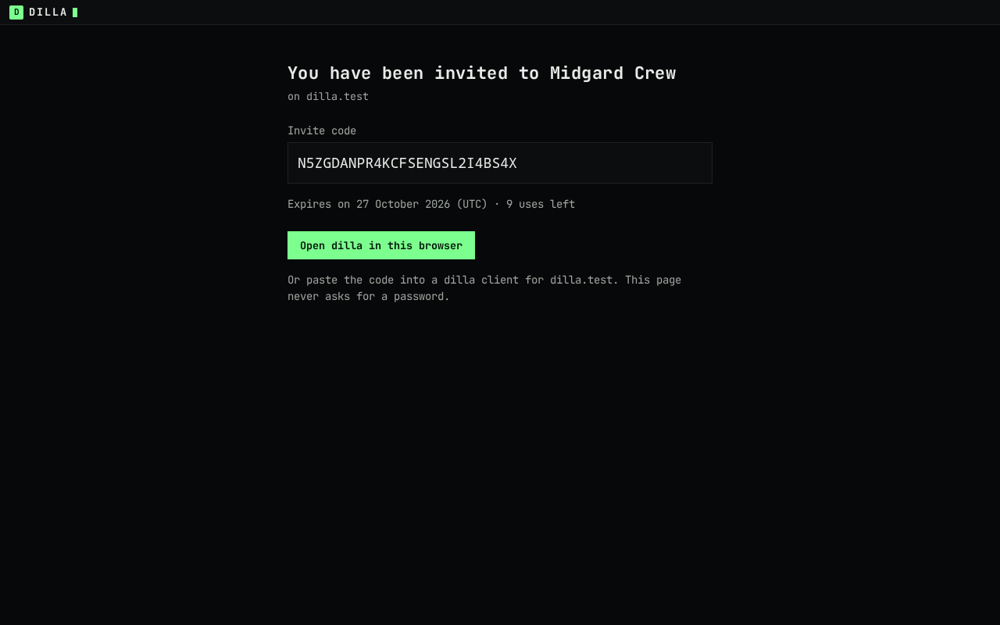

# dilla v0.1.0-web3.9

Released RELEASE-DATE.

## What's new

- **A built-in AFK channel.** Every server has one voice channel called "AFK", at the end of its channel list. A server
  manager can rename it and move it between categories, and nobody can delete it. Everyone in it is muted and can only
  listen. You join it by clicking it. A desktop device that has been idle for the server's inactive timeout is moved
  there; keyboard, pointer, touch and microphone speech count as activity. A phone is never moved. There is one setting,
  the inactive timeout (1, 5, 15, 30 or 60 minutes, 5 by default, no "off"), under server settings → overview. The AFK
  picker and the "Move to AFK" and "Leave AFK" actions are gone. See [voice](../../user/voice.md) and the
  [architecture note](../../afk-architecture.md).
  
- **Direct messages behind the `@` tile**, on desktop and on a phone. The `@` tile at the top of the rail is Home, and it
  holds your conversations. Old `/dm` links still land there.
  
- **Three phone tabs: Home, Activity and You.** Servers and DMs are under Home.
  
- **A 72 px rail with 48 px tiles and one "+" tile.** The "+" opens one dialog, "add a server", with join and create.
  An unread channel shows an edge tick on its tile and a mention shows a badge at the bottom right.
- **Categories that collapse.** A collapsed category still shows the channel you are in and any channel with unread
  messages.
  
- **One-click voice join on desktop.** Click a voice channel to join it. The channel header is a row of icons with
  tooltips.
  
- **Two-line member rows** with Online and Offline sections.
  
- **One row per person in voice.** A person on two devices shows once in a voice channel, in the worst state of the two
  (an unverified device is never hidden behind a verified one).
- **A dock without a meter.** The voice dock drops the level meter. A speaker is shown by a ring. The mic button carries
  a "PTT" tag when push to talk is on, and a ring while you hold the key.
  
- **Messages.** Messages from one author in a row are grouped, date dividers separate days, and a "jump to present"
  button returns you to the newest. On a phone, a tap reveals a message's actions, and the header shows the call dot
  while you type.
  
- **Search is a modal** on desktop, with richer results.
  
- **Settings in one grammar,** the same rows on every page and width, and a keyboard table listing the shortcuts.
- **The invite page in the app's type.** `/i/<code>` uses JetBrains Mono from the bundle.
  
- **No speech lost after a microphone restart** on desktop Chrome and Firefox. The first 100 to 300 ms after you unmute,
  which web3.8 listed as a known limit, are no longer dropped.
- **Audit fixes.** 49 findings from a UX audit were judged, and the open ones fixed: phone targets of 44 px or more, one
  column for names in every list, one right edge for trailing controls, hairlines at the same height, nothing
  overflowing at 1024 px, and a file card's button that reads "save" and wraps under an image on a narrow row.

The user guides are updated, with re-shot screenshots in `docs/user/screenshots/`:
[getting started](../../user/getting-started.md) and [voice](../../user/voice.md).

## Versions

| What | Version | Label |
|---|---|---|
| Server schema | **20, unchanged** | Safe. No migration in this release. |
| Client store | **5, unchanged** | Safe. |
| Wire | **2, unchanged** | Safe. The gateway still offers `[2]` alone. |
| Browser ABI | **11, unchanged** | Safe. |
| WASI ABI | **unchanged** | Safe. The crate is unchanged; the `dilla_core_wasi.wasm` line of `SHA256SUMS` equals web3.8's (WASI-CHECK: the controller compares and states it). |
| Browser core | `dilla_core_wasm_bg-WASM-HASH.wasm`, WASM-SIZE B as served | The source is unchanged since web3.8. |

No file under `internal/store/sqlite/migrations` or `internal/store/postgres/migrations` differs from web3.8, and `core/`
(the MLS core, the WASI crate and the browser wasm crate) has no change since the web3.8 tag. Nothing in this release is
**incomplete** or **refuse-and-restore**: every version above is the one web3.8 already used.

## Operator notes

Upgrade as usual with `install.sh --upgrade`. Open tabs reload themselves on the new build (web3.8 tabs have the
watcher). A tab that does not can be reloaded by hand; until it does, it does not know the AFK rules below.

### Data change at the first start

`dillad serve` gives every server a built-in "AFK" channel. It is the only data change, and needs no migration and no
flag.

- The channel is a voice channel, end-to-end encrypted, private, at the top level, named `AFK`, at **position 2^30**, so
  it sorts last (clients skip positions at or above it when they number a new channel). It carries
  `channels.settings_json` = `{"afk":"builtin"}`: a new value in an existing column, not a schema change.
- Every member can see and join it whatever their roles say. Owners and administrators keep every bit.
- The audit log shows one `channel.create` row per server with **no actor** and the detail `afk.builtin`.
- The start logs one line, `afk backfill`, with the number of channels created. **A second start changes nothing.** A
  server made after the upgrade gets its channel in the transaction that creates it. A server that somehow has none gets
  one when a client first reads its AFK snapshot.
- **A server that chose an AFK channel in web3.8 gets a new one too.** The old channel loses its AFK role and becomes an
  ordinary voice channel: joinable and audible again, its name, permissions and any live call untouched. Its admin may
  delete it. The inactive timeout carries over.
- **Stray overwrites on the AFK channel are removed at start,** one `channel.overwrite.delete` audit row each (no actor).
  This can only happen after a rollback and re-upgrade, because web3.9 refuses to write one.
- The start also restores the AFK channel's position to 2^30 (SRV-POS, landing in this release), which a web3.8
  administrator could have changed.

### Behaviour

- The AFK channel cannot be deleted. Its topic, mode (always end-to-end encrypted), visibility and slow mode cannot be
  changed, it takes no permission overwrites, and its position is fixed at the end (SRV-POS, landing). A manager can
  rename it and move it between categories.
- Everyone in it is **listen-only**: no device publishes there, by token, `/rtc` admission, grant re-push, share or
  resume. If the instance cannot read the AFK setting, the grant fails closed to listen-only.
- The timeout options are 1, 5, 15, 30 and 60 minutes. The default is 5. There is **no "off"**, so a server that had no
  AFK channel in web3.8 now moves idle desktop devices after five minutes. A server that had a timeout keeps it.
- Phones are exempt: they report that once per join and are never moved. Presence in AFK survives a restart like any call.
- The client carries out the move, because the server cannot add a device to an end-to-end encrypted group. The server
  marks a move as pending for that device alone for 10 minutes, and the device joins when it next reads it.

### API and protocol

`protocol/07-versioning.md` and `protocol/09-http-api.md` have a row for each. No version number moves.

- `PUT /v1/communities/{id}/afk/settings` takes `[timeout_seconds]`. The web3.8 two-element body is accepted only with the
  built-in channel's id; any other id, `null` included, is `400 E_INVALID_REQUEST`, as is any timeout other than 60, 300,
  900, 1800 or 3600 seconds.
- `GET /v1/communities/{id}/afk` returns `[channel_id, timeout_seconds, [], pending]`. The third element is always empty
  (web3.8's occupant list, kept so an old parser still reads it).
- `POST /v1/communities/{id}/afk/activity` takes an optional `exempt`.
- **Flags are uint `0` or `1`, never CBOR booleans,** because the dilla CBOR subset has none. `pending` and `exempt`
  follow that, and a boolean for `exempt` is `400`.
- `POST` and `DELETE /v1/communities/{id}/afk` (web3.8's manual move and leave) answer **`404`**. A web3.8 tab that
  calls them after the upgrade gets that answer.
- Deleting the AFK channel, changing its kind, mode, visibility, slow mode or topic, or writing or deleting an overwrite
  on it answers **`403 E_FORBIDDEN`**. A position change answers `403` once SRV-POS lands. Sharing in an AFK call is `403`.
- **Categories (`parent_id`).** `POST /v1/communities/{id}/channels` takes `parent_id`, so a channel is created inside a
  category in one step (web3.8 created it and then moved it). A `parent_id` naming a category the caller cannot view is
  `404`, on create and on patch, ahead of the `400` rules, so a hidden category is never confirmed. `GET /v1/channels/{id}`
  and the channel list **mask a hidden parent as null**: the child is listed at the top level, and the category is not
  listed.

### Deploy

- **`dilla-media.service` gains `PartOf=dilla.service`.** Stopping or restarting `dilla` now stops or restarts the media
  sidecar with it. After copying the unit by hand, run `systemctl daemon-reload`; `install.sh --upgrade` does it.
- **`dillad media --rooms`** (new) lists the live rooms and their participants, or prints `no live rooms`. It gives up
  after 20 seconds if the sidecar does not answer, and needs `livekit.mode = "sidecar"`. `dillad media --probe` still
  prints the room count; the two flags are exclusive.
- **The invite page's CSP** gains `font-src 'self'` and is now
  `default-src 'none'; style-src 'unsafe-inline'; font-src 'self'`. The font comes from the bundle. The page is otherwise
  unchanged: no script, no external reference, no form.
- **LiveKit page leave.** The browser client sets `disconnectOnPageLeave: false`, so a navigation that is cancelled no
  longer drops the call; the client leaves the call itself when the page really goes away. Nothing to configure.
- No new configuration keys, permission bits, gateway operations or error codes. `dillad doctor` is unchanged.

### For operators who build

- CI runs two CSS checks (`npm run test:css-check` and `npm run check:css`, also part of `npm test`) and an extra Postgres
  step that runs the AFK, backfill and hidden-category tests in `internal/api` (`go test -race -run '...'`, timeout
  20 minutes). `scripts/check-ci-workflow.mjs` pins both and fails if a test in the AFK or category files is not matched
  by that `-run` pattern.
- The whole `internal/api` package under `-race` now takes about ten minutes on a developer machine (about six before).
  The CI limit is 20 minutes.
- The browser e2e suites read their ports from `DILLA_E2E_PORT` (`DILLA_E2E_LAYOUT_PORT` for the layout spec), so several
  can run side by side.
- `dilla-testhost` (test only, not shipped) gains `POST /debug/afk/legacy` on its control listener, which writes a web3.8
  administrator's AFK pick.

### Rollback to web3.8

**Safe, and a re-upgrade is clean.** The schema is 20 on both, so there is no `migrate down`. Put `dillad.prev` and
`dilla_core_wasi.wasm.prev` back, restore the previous `dilla-media.service` if you copied it, and start dilla.

- **What web3.8 does with the built-in AFK channel.** web3.8 reads the stored pointer, and web3.9 pointed it at the new
  channel, so web3.8 treats that channel as the server's AFK destination: held and silent, as it treats any chosen AFK
  channel. The channels web3.9 demoted stay ordinary voice channels. web3.8 knows neither the marker nor the position
  reservation: it lists the channel last, as a voice channel, and an administrator can rename, move or delete it, edit its
  overwrites or change its kind.
- **A web3.9 tab left open keeps working until it reloads.** The wire is 2 on both. Saving the inactive timeout from such
  a tab sends the one-element body, which web3.8 refuses with `400` until the tab reloads.
- **Channels created under web3.8** are numbered after the highest position, so they land at 2^30 + 1 or more, beside the
  AFK channel. After a re-upgrade they stay ordinary channels and sort by position, then id.
- **Re-upgrade.** The start looks at each server's pointer under the community lock:
  - the pointer still names the built-in channel (the usual case): nothing is created; stray overwrites are removed, with
    audit rows, and the position is restored;
  - an administrator deleted it under web3.8, which clears the pointer: a **new** built-in channel is created;
  - an administrator picked another channel under web3.8: a **new** built-in channel is created, and the earlier one
    becomes an ordinary voice channel still named "AFK", which they may delete.

  The timeout carries through in every case. No message, call or key is touched.

To go back further, to noise-beta.5 or web3.7.2, follow the web3.8 notes: the schema and wire are web3.8's, so this
release changes none of those steps.

### What the host learns

Nothing new about message content. The host keeps the per-device activity time for the AFK sweep, as in web3.8, and sees
which devices it moved to AFK, as it sees any join.

## Known limits

- **WebKit is verified in CI only,** not locally. A manual check on an iPhone is owed for the microphone restart (join
  muted with noise suppression off, toggle noise, unmute, speak). Outside desktop Chrome and Firefox the microphone still
  restarts the old way, because Safari refuses a second capture while the first is live.
- **The call stage shows one tile per device,** so a person on two devices has two tiles (the voice list shows one row).
- **The phone DM call stage is rough** and is queued for its own pass.
- **Queued for web3.10:** context menus, long-press sheets, gestures, a NEW divider and GIFs; drag to reorder channels
  (up and down buttons stay); a high-contrast invite page; the reveal staying after the composer is tapped on a phone;
  the phone header and gutter times in one format; the second microphone capture that `packages/media` opens while the
  first is live; the "+" on a category header only when categories exist.
- Everything under "Known limits" in the web3.8 notes that this release does not name as fixed still holds.
