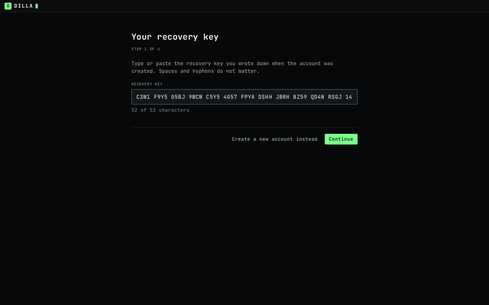
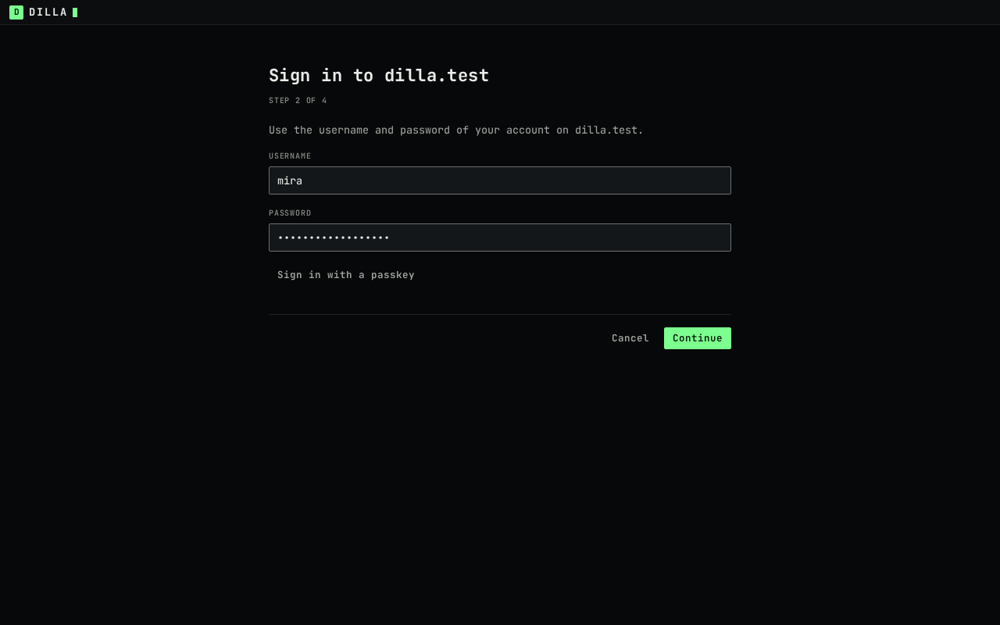

# Getting started with the dilla web client

This page is for a person who has been sent an invite to a dilla instance, and for the first person on a new
one. It describes the web client as it is on 2026-10-14 ("web-3.3"): starting a server, inviting people and adding
channels, signing up, using the account in a second browser, devices, channels,
direct messages, badges and notifications, saying more (edits, deletes, reactions, replies, pins, mentions,
images and files), contacts and safety numbers, search, settings and a second tab, and what the client cannot do
yet. Every quoted line is the text the screen shows;
`{instance}` stands for the instance's address, `{username}` for yours and `{server}` for a server's name.

If you were sent an invite, go to [1. Open the invite](#1-open-the-invite). If you are the first person on a new
instance, start with [Start a server](#start-a-server).

If you run the instance yourself, start with the [operator guide](../deploy/README.md). For voice channels, calls
in direct messages, camera and screen share, push to talk, sounds, and audio and video files, read
[Voice, calls and media files](voice.md) next.

## Start a server

This section is for the first person on a new instance. Whoever installed it got a bootstrap invite link from
`dillad init` (or from the install script), shown once. It looks like `https://chat.example.org/i/<code>`, is valid
for 24 hours and can be used once. It is an invite to the instance, not to a server.

1. Open the bootstrap link and sign up: the same five steps as [an invited person](#2-sign-up-five-steps).
2. **Open dilla** opens the app, which has no server in it yet:

   

   "You are not in a server yet" "Start a server and invite your friends, or join one with an invite someone sent
   you." The sidebar stands on **direct messages**: it says "no direct messages yet" and offers **message someone**.
   Pressing that opens a picker which says "There is no one to message yet: direct messages are with people you share
   a server with. Start a server and invite someone, or join one."
3. Press **Start a server**, or the **new** tile in the server rail. With the keyboard, Tab to the rail, which is one
   stop, then press the Down arrow (or End, then Up) until **new server** has focus, and press Enter. The dialog
   "Start a server" says "You own it: you add its channels and invite people. It starts with a text channel and a
   voice channel, both called general."

   

4. Type a name under "Server name" ("Up to 255 bytes.") and press **Create** or Enter. While it works the button
   says "Creating…"; a second press sends nothing more.
5. The dialog closes, the server is selected and `#general` opens with the cursor in its message field. The server
   also has a voice channel called general. You are its owner.

The server rail now has two dashed tiles under your servers. **join** (an arrow into a bracket) is "join a server",
for an invite someone sent you. **new** (a plus) is "new server". Under the server's name sit its actions:
**+ channel** ("new channel", only for the owner) and **invite link**.


At phone width the empty app and the dialog look like this:


If the server is not created, the name field says why:

| The dialog shows | What to do |
|---|---|
| "Give the server a name." | Type a name; spaces alone are not a name |
| "That name is too long. A server name is up to 255 bytes." | Shorten it. Letters such as å or ü take two bytes each, and an emoji four or more |
| "A name cannot hold control characters such as tabs or line breaks." | Take them out |
| "That name was refused. Try another." | The instance refused it; choose another |
| "Could not start the server ({code}). Try again." | Press **Create** again. After E_NETWORK the server may have been made anyway: the dialog reads your server list again, and if the server is there it carries on with it. **Create** with the same name reads the list again before it makes anything, so it never makes a second server |
| "{server} is ready, but #general was not added ({code}). Try again, or close this and add it from the channel list." | The server exists. **Try again** adds only what is missing; the same message names the voice channel general, or both channels, when those are missing. Closing the dialog keeps the server as it is. If you closed the dialog while the channels were still being added and one of them failed, the next time you open "Start a server" it shows this message once, with **Try again** |

## Invite people

Anyone in a server can make an invite link to it. Press **invite link** under the server's name. The dialog "Invite
people to {server}" says "Making an invite link…", then shows the link and copies it for you:


- "It can be used 10 times and expires in 7 days. Anyone who has it can join {server}." Send it only to the people
  you want in the server.
- "Invite link copied." means it is on your clipboard. If the browser did not let the page copy it, the dialog says
  "This browser did not copy the link. Press copy link to try again, or select the link and copy it yourself."
  Selecting the field selects the whole link. When the instance takes more than about a second to answer, the
  dialog shows the link without copying it, because the browser no longer counts your press: press **copy link**.
- Each person who joins with the link uses it once, whether they sign up through it or already have an account. So
  one link brings in up to ten people.
- Opening the dialog again, or for another server and then back, shows the same link for that server while more than
  a day of it is left; the days in "expires in {days} days" count what is left. After a reload, or with a day or
  less left, the dialog makes a new link.
- "You cannot invite people to this server." or "Could not make an invite link ({code})." means no link was made;
  **Try again** asks again.


Your friend opens the link and sees the instance's invite page ([1. Open the invite](#1-open-the-invite)), signs
up in five steps, and lands in your server with its channels. They can message you from **direct messages**.

**Post your welcome after your friends have joined.** A friend does not see messages sent before their browser
joined: that is how the end-to-end encryption works, since their browser was not yet a member when those messages
were sent. Their `#general` starts at the moment they joined and says "nothing here yet. Messages sent before this
browser joined are not shown." Everything sent after that reaches them.

## Add a channel

Only the server's owner can add channels for now. Press **+ channel** ("new channel") under the server's name.


1. Under "Kind", choose **text** or **voice**. The arrow keys move between them.
2. Type a name under "Channel name". The line under the field shows how it will look: "Shown as #{name}. Up to 100
   bytes." for a text channel. A text channel's name is kept in lower case, with spaces turned into hyphens:
   "Fika på Fredag" becomes `#fika-på-fredag`. A voice channel keeps the name as you typed it.
3. Press **Create** or Enter ("Creating…"). A new text channel opens with the cursor in its message field and says
   "nothing here yet."; a new voice channel is listed under "voice".

The dialog does not add a second channel of the same kind and name. If the name is taken, it says "There
is already a text channel called #{name}. Try another." (or "There is already a voice channel called {name}. Try
another.") and nothing is created.


The others in the server see a new channel within about a second, in any dilla tab they have open; a renamed
server's new name shows the same way. The dialog says "Give the channel a name.", "That name is too long. A channel name is up
to 100 bytes.", "A name cannot hold control characters such as tabs or line breaks.", "You cannot add channels to
this server.", "That name was refused. Try another." or "Could not add the channel ({code}). Try again." when the
channel was not added.

## Run your server

Once a server has people in it, you run it from **server settings** and from the member list. Both are for people
whose roles allow it; the owner can do everything here.

### Server settings

Press **server settings** under the server's name. The dialog "Server settings" has a list of sections
("server settings sections"). A section shows only to someone whose roles allow it: **overview** (manage the server),
**channels** (manage channels), **invites** (create invites) and **bans** (ban members). **leave server** is there for
everyone. **delete server** and **hand over server** are there for everyone too, but only the owner can use them. Tab
stops once on the list and once on the section; Escape closes the dialog and focus goes back to **server settings**.

**Overview** renames the server. Type under "Server name" ("Up to 255 bytes. Everyone in the server, and the host,
can read it.") and press **Save**: "Saving…", then "Saved." The field says why when it did not work: "Give the server
a name.", "That name is too long. A server name is up to 255 bytes.", "That name was refused. Try another.", "You
cannot rename this server." or "Could not save ({code}). Try again." If "Someone else changed the server at the same
time. Check the name and save again.", look at the name that is there now and save again.

**Channels** lists the channels under their categories ("no category" holds the rest). Each row has **edit**, **move
up**, **move down** and **delete**; the screen announces "{name} moved." after a move.

- **new category** asks for a "Category name" ("Up to 100 bytes. A category groups channels in the list; it holds no
  messages.") and **Create**.
- **edit** opens "Edit #{name}" (or "Edit {name}" for a voice channel, "Edit category {name}" for a category). You
  can change the "Channel name" ("Up to 100 bytes."), the "Topic" of a text channel ("Shown under the channel name.
  Up to 1024 bytes. The host can read it.") and its "Category". A category has only a name.
- **delete** asks "Delete #{name}?". A text channel "is removed for everyone, with its messages and files. Copies
  someone already saved stay with them. This cannot be undone." A voice channel is removed too and a call in it
  ends. Deleting a category keeps its channels, without a category. Focus starts on **Cancel**.

**Invites** makes and lists invite links. Choose "Expires after" (30 minutes up to 30 days) and "Max uses" (1 use, or
a number), then **Make link**. "An invite lasts at most 30 days and admits at most 1000 people." The new link shows
as in [Invite people](#invite-people). The list under it has one row per live link: "by {name}, {used} of {max}
uses, expires {date}", with **revoke**. "Invite link revoked." means people can no longer join with it. An empty list
says "No live invite links."

Invite links cannot be shown again. "The server keeps only a fingerprint of each link, so a link cannot be shown
again. Make a new one to share." Copy a link when you make it; if it is lost, revoke it and make another.

**Bans** lists who is banned from the server, with "banned by {name} on {date}", when it ends ("ends {date}" or
"until lifted"), and the reason or "no reason given". A ban that has run out says "ended {date}; can join again". A
moderator who has since left the server shows as "a former member", and an account that was deleted as "a deleted
account". **unban** asks "Unban {name}?": "{name} can join {server} again with an invite. This does not add them
back." An empty list says "Nobody is banned from {server}." If the list does not load, **Try again** loads it
again.

### Members

The **members** button in the channel header opens the list of "members of {server}", grouped by role: one group
for each role shown apart, highest first ("{name} — {count}"), then "members". A row can carry the tags `owner`,
`you` and `bot`. On a wide window the list is a column beside the conversation. On a phone, or any window narrower
than 64 rem, it is a panel over the screen: focus moves into it, and **close members**, Escape or a tap outside it
closes it. Focus goes back to **members**.

Each row has an **actions for {name}** button. Right-click on the row, or Shift+F10 or the ContextMenu key with the
row focused, opens the same menu. In the menu, Down and Up move between the items, Home and End jump to the first and
last, Enter runs one and Escape closes it. The items are **message**, **compare safety numbers**, and, if your roles
allow it and the person's highest role is below yours, **kick** and **ban**.

**kick** asks "Kick {name} from {server}?": "{name} leaves every channel and call of {server} at once. They can
join again with an invite. Messages they already received stay on their devices." Focus starts on **Cancel**. **Kick**
says "Kicking…", then "{name} was kicked."

**ban** asks "Ban {name} from {server}?": "{name} leaves every channel and call of {server} at once and cannot join
again until the ban ends or is lifted. Messages they already received stay on their devices." Choose "Ban length"
(1 hour, 1 day, 7 days, 30 days or until lifted) and, if you like, a "Reason" ("Optional. Shown to moderators in the
ban list, not to {name}. Up to 512 bytes."). **Ban** says "Banning…", then "{name} was banned." A refused kick or ban
says so in the dialog: "You cannot kick {name}. Their highest role is at or above yours, or your roles do not allow
kicking." (and the same for banning), or "{name} is no longer in {server}."

### Leave, hand over and delete

Anyone but the owner can leave: **leave server** asks "Leave {server}?", "You leave every channel and call of
{server}. To come back you need an invite." and says "You left {server}." The owner sees "You own {server}, so you
cannot leave it. Hand it to another member or delete it."

**hand over server** ("Hand {server} to another member") makes someone else the owner. Choose the "New owner", type
the server name under "Type the server name to confirm" and press **Hand over**. The new owner gets every permission
and you stay as a member who can no longer delete the server. You cannot undo it yourself. With nobody else in the
server it says "There is no other member to hand the server to yet." The page says "{name} now owns {server}."

**delete server** ("Delete {server}?") removes every channel, message and file for everyone and ends every call in
it. **Delete server** stays off until you type the server name under "Type the server name to confirm"; "That is not
the server name." shows while it differs. "{server} was deleted." Copies someone already saved stay with them. Only
the owner can do it, and it cannot be undone.

### What a removed person sees

A person who is kicked, banned, or whose server is deleted sees a banner, "You are no longer in {server}.", with
**dismiss**. The server leaves their rail, the page moves to their first other server (or to the start page), and any
dialog open for that server closes. A banned person who tries an invite link again sees "This server does not let your account join."
until the ban ends or is lifted. See also
[You are no longer a member](#you-are-no-longer-a-member).

## 1. Open the invite

An invite is a code or a link. A link to an instance looks like `https://chat.example.org/i/<code>`.
Opening it shows a plain page from the instance:


It names the instance, the server the invite is for (the page calls it a community), the code, how long
the invite is valid and how many more times it can be used. It never asks for a password. Opening the page
does not use the invite. **Open dilla in this browser** starts the sign-up with the code filled in. You can
also go to the instance's address and paste the code or the whole link in the first step.

## 2. Sign up: five steps

All five steps happen in the same tab. **Continue** (or Enter in a field) moves forward, **Back** goes back
one step, and nothing is created on the instance until step 4.

### Step 1 of 5: Join


"You need an invite from someone on {instance}. Paste it below." The field takes "A code or a link, as you
received it." If the invite is refused when the account is created, you are brought back here with "This
invite is expired, used up or unknown. Ask for a new one." An instance that takes no new accounts shows
"{instance} is not taking new accounts" instead of this step.

### Step 2 of 5: Choose your name


"People on {instance} see these next to your messages."

- **Username**: "3 to 32 characters: a–z, 0–9, dot, underscore or hyphen." Capital letters are turned into
  lower case. If someone has it already: "That username is taken. Try another."
- **Display name (optional)**: "Up to 64 characters. Your username is shown when this is empty." This is
  the name shown on your messages.
- **Password**: only when the instance offers passwords. "At least 8 characters." Keep it: a second browser
  asks for this password and your recovery key.

Going forward from this step makes your keys. That can take a moment ("Making your keys").

### Step 3 of 5: Your recovery key


The key is 13 groups of 4 characters. "This key is shown once and is kept nowhere. Write it down or print
it, and keep it away from this computer." **Print** opens the browser's print dialog; the printed page holds
the key and the two paragraphs, not the rest of the screen. There is no copy button, on purpose: the
clipboard is readable by other programs. You can still select the text yourself.

The screen says: "This key is the only way to get your account back or to add another browser. If every browser you use loses its data and you do not have the key, the account and its history are gone, and the host cannot bring them back." It cannot be shown again after you leave this step.

Tick "I have written down or printed my recovery key" to continue ("Tick the box to continue.").

### Step 4 of 5: What this browser keeps


- "This browser now holds the key of this device, in its storage for {instance}. The key never leaves this
  browser."
- "Clearing this site’s data removes the key and the messages kept here, and this browser stops being your
  device."
- "To use this account in another browser, sign in there with your password and this recovery key. Messages sent before that browser joins are not shown in it."
- "A private window forgets all of this when it closes."

**Create account** creates the account on the instance ("Creating your account on {instance}…").

### Step 5 of 5: You’re in


"You are {username} on {instance}." **Open dilla** opens the app.

If the invite was for a server, you land in that server. Creating the account uses the invite once and
joining the server uses it a second time, so an invite that can be used only once creates the account and
then shows the join dialog with "This invite is expired, used up or unknown."; ask for a new server invite.
If the invite was for the instance only, the app shows "You are not in a server yet" with **Start a server**
([Start a server](#start-a-server)) and **Join a server**.

## 3. What "this browser holds your key" means

Each browser you add is a device of your account. When you sign up, the browser makes a key for itself (a
"device" key) and keeps it in its storage for the instance's address. The messages of a text channel are
encrypted end to end with MLS (RFC 9420) between the members' devices, and the instance stores and forwards
them encrypted. This browser decrypts them and keeps a copy in that same storage, itself encrypted with a key
that only this browser can unwrap. The next time you open the instance's address, the browser signs in with
its device key, without a password. (Nothing here has had an independent security review yet. Each device of
a contact is checked against that person's signed device list, but the first key this browser sees for a person
is only "first seen", not verified, until you compare safety numbers; see [section 10](#10-privacy-search-and-settings).)

What follows from that:

- **Clearing the site's data** (the browser's "clear cookies and site data" for the instance, or removing
  the browser profile) deletes that browser's device key and kept messages. You can add a fresh browser with
  your password and recovery key, but messages from before it joins are not shown there.
- **If only the key is gone** and the stored data is still there, the app says "This browser can no longer
  open its saved data" and offers **Reset this browser**, which, after "Reset this browser?", deletes dilla's
  data for this site so you can sign up again.
- **Private windows.** Firefox's private window cannot keep the data at all; the app stops at "This window
  cannot keep dilla’s data" and creates no account. A Chromium incognito window lets you sign up, and the
  account is gone when the window closes. Use a normal window.
- **Browsers that clean up storage.** The app asks the browser once to keep its storage, and some browsers
  decline. Safari removes a site's storage after seven days without interaction, and the account goes with
  it.
- **Another tab.** Only one tab runs dilla at a time. A second tab shows "dilla is open in another tab" and
  takes over when the first one closes, or at once with **Use this tab**; see [Two tabs](#two-tabs).
- **Signed out by the account.** If the account no longer accepts this browser (another browser removed it
  in Settings → Devices), the app says "This browser was signed out". See [Devices](#7-devices).

## 4. The app


From left to right:

- **The server rail.** One tile per server you are in, with its initials, then two dashed tiles. **join** (an
  arrow into a bracket) is "join a server": paste a server invite ("A server invite, as a code or a link.") and
  press **Join**. **new** (a plus) is "new server" ([Start a server](#start-a-server)). The last tile is
  "settings"; a number on a server tile counts its unread channels.
- **The channel list.** The server's name, its actions (**invite link** for everyone, **+ channel** for the
  owner, and **server settings**; see [Invite people](#invite-people), [Add a channel](#add-a-channel) and [Run your
  server](#run-your-server)) and its channels. Text channels
  open here. Voice channels are
  listed under "voice" and open the voice channel ([Voice, calls and media files](voice.md)); while you are in
  a call, its dock sits above your user panel. Channels the server can read ("Readable by this server") are
  listed, and selecting one shows "This channel does not open here yet". The "channels" and "direct messages" tabs switch the list; an unread channel has
  a badge, and mentions have their own count. Opening a channel marks it read.
- **The conversation.** The channel's name and topic at the top, the messages, and the message field
  ("message #general") with **send**. Each message shows the author's display name, a small `web` tag when it
  was sent from a browser, and the time. A message is at most 4000 bytes; in the last 400 the field shows
  how many are left. While a message is on its way it shows "sending…"; one that could not be sent shows "not sent" with
  **retry** and **discard**.
- **The status bar.** `node` is the instance, `link` is the connection (online, connecting or offline) and
  `gen` is the instance's generation number. When the connection drops, a banner says "Connection lost.
  Reconnecting…".

At phone width the channel list sits above the conversation:


### Keyboard

| Key | What it does |
|---|---|
| Enter | Sends the message |
| Shift+Enter | Starts a new line in the message |
| Alt+Arrow Up, Alt+Arrow Down | Opens the previous or next channel, from anywhere in the app |
| Escape | In the message list: back to the message field. In a dialog: closes it |
| Tab, Shift+Tab | Moves between the regions: "skip to messages", the server rail, the server's actions (each its own stop), the channel list, the channel header, the messages, the message field, the status bar |
| Arrow keys | Move within the server rail (your servers, then join, then new server, then settings) and the channel list, which are one Tab stop each |
| Control+K (⌘+K on a Mac) | Opens search across everything this browser holds |
| Control+/ | With a conversation open: opens search in this conversation (Control on a Mac too) |
| Control/⌘+Shift+M, Control/⌘+Shift+D | In a call: mute or unmute, deafen or undeafen ([Voice, calls and media files](voice.md#mute-deafen-and-push-to-talk)) |

The sidebar tabs are one more Tab stop. Arrow Left and Arrow Right switch between "channels" and "direct messages".
Settings uses Arrow Up, Arrow Down, Home and End to move between sections; Escape closes it.

Every step of the sign-up works with the keyboard alone: Tab to a field or button, Space ticks the
recovery-key box, Enter submits a step.

### Reloading

Reload the page, or close the browser and come back: the app opens without the sign-up, with your servers,
your channels and the messages this browser has received. They are read back from this browser's storage,
not from the instance, and the newest 100 messages of a channel are shown first; **load earlier** shows more.
"nothing here yet. Messages sent before this browser joined are not shown." is what an empty channel says:
a channel's history starts when this browser joined it.

## 5. When something is wrong

### You are no longer a member


If you were removed from the server while the tab was open, the next message you send is
"not sent" and the message field is blocked with "you cannot post in this channel and new messages will not
arrive. Reload, or ask the host." Ask whoever runs the server for a new invite. Once you have joined again,
reload the page: the channel opens again and new messages arrive. Messages sent while you were out are not
shown.

### A message could not be read

A message this browser could not decrypt is shown as "This message could not be read on this device." with
a short code (for example `E_CORE_MLS`) instead of its text. Nothing in this version can recover it.

### Other messages

| The app shows | What to do |
|---|---|
| "This channel did not open" | **try again**; the code in brackets says what failed |
| "This server did not load ({code})." | **try again** in the channel list |
| "That did not work ({code}). Try again, or reload the page." | Dismiss it and try again, or reload |
| "This server needs a newer client. Reload the page." | Reload, which loads the instance's current client |
| "dilla could not start" | **Reload** |
| "Too many attempts from this network." | Wait as long as it says, then try again |

## 6. Use your account in a second browser

You need three things: your username, your password and the recovery key you wrote down at sign-up. The
sign-in has four steps, in this order: the recovery key, then your username and password, then the code of
your second factor (only if the account has one), then done. Nothing is sent to the instance until the
second step, and the key is never written to the browser's storage.


On the new browser, open the instance's address and choose **Use an existing account** under the invite
field. The instance offers it only when it takes password logins. An instance that takes no new accounts
still shows the button.

### Step 1 of 4: Your recovery key



"Type or paste the recovery key you wrote down when the account was created. Spaces and hyphens do not
matter." The line under the field counts what you typed ("{n} of 52 characters"); **Continue** works once
it reads 52 ("A recovery key has 52 characters."). This step sends nothing: the page holds the key until
step 2. A key that cannot be a recovery key is refused when you continue from step 2, before your password
is sent, and a key of another account once the instance has answered; either way this step shows again with
what you typed and "This is not the recovery key of this account. Check every character." (after the
instance has answered, its button reads **Add this browser** and you do not sign in again). **Create a new
account instead** goes back to the sign-up.

### Step 2 of 4: Sign in to {instance}



"Use the username and password of your account on {instance}." **Continue** checks them ("Checking…"). A
wrong pair says "That username and password did not work." and empties the password field. **Cancel** goes
back to the sign-up.

If the account has no second factor, this same step adds the browser to the account ("Adding this browser to
your account…") and goes straight to step 4.

### Step 3 of 4: Your second factor

Only for an account with a second factor: "Enter the six-digit code from your authenticator app." A wrong
code sends you back to step 2 with "That code did not work. Sign in again with a fresh code.", because the
instance has used up that login; type the password again and then a new code. A right code adds the
browser and goes on to step 4.

### Step 4 of 4: You’re in


"This browser is now a device of {username} on {instance}. Messages sent before now are not shown here."
**Open dilla** opens the app. The new browser sees new messages, not what was said before it joined.

### If the sign-in stops

| The page shows | What it means and what to do |
|---|---|
| "This is not the recovery key of this account. Check every character." | The key is wrong (a typo, or another account's key). Correct it and continue |
| "Someone else is signing in to this account. Change your password from a device you still have, or ask the operator." | Another sign-in with your password took this browser's place before it was added. If that was not you, someone else has your password. The web client cannot change a password yet, so tell whoever runs the instance; meanwhile your other browsers keep working, and a device that signed in with the password alone cannot read anything. You land on step 2 or on the first page; sign in again once it is sorted out |
| "The account’s devices changed while you were signing in. Sign in again." | Another of your browsers changed the account's devices meanwhile. This browser's data was cleared; start again from **Use an existing account** |
| "This account already has as many devices as {instance} allows. Remove one in Settings on another device first." | Remove a device in Settings → Devices on a browser you still have, then continue |
| "Too many sign-in attempts. Try again in {seconds} s." | Wait that long, then continue |
| "This account has no backup to recover from on {instance}. Sign in on a device that still holds this account and open dilla there; it repairs the backup. Then try again." | Open dilla in a browser that already holds the account and let it connect; then sign in here again |
| "The connection dropped. Check it and try again." | Check the network and continue |

## 7. Devices

Open **settings** in the server rail, then **devices**. "Every browser and app signed in to your account.
Removing a device needs your recovery key." Each row is a device, named by the first eight characters of its
id, with the tag "browser" or "app" and when it was last seen. The row marked "this browser" is the one you
are using. "not yet in the device list" marks a device that signed in with your password but was never
added; "removed" marks one that was removed. **refresh** reads the list again.


- **remove** on another device: "Remove this device?" "The device is signed out everywhere and leaves every
  conversation. Enter your recovery key to confirm." **Remove** does it. A wrong key says "This is not the
  recovery key of this account." A device that is "not yet in the device list" is removed without the key:
  "This device signed in with your password but is not in the device list, so it cannot read anything.
  Removing it needs no recovery key."
- **sign out and remove this browser**: "This browser is removed from your account and its data here is
  cleared. You can sign in again later with your password and recovery key. Enter the key to confirm."
  **Sign out** removes it and reloads to the first page.
- **forget this browser**: "This clears dilla’s data from this browser and signs it out. The device stays in
  your account’s device list until you remove it from another device." No key is needed. Remove the row from
  another browser afterwards.


**If the recovery data is not yours.** If the instance holds recovery data that this account did not make,
a red warning stays at the top of the app and of Settings → Devices: "The recovery data stored for this
account on {instance} is not this account’s. The recovery key will not work until the operator resets it."
It cannot be dismissed. Until it goes away, removing a device with the key and adding a browser will fail;
keep using the browsers you have and ask whoever runs the instance to reset the account's recovery data.

**If a device you don't know uses your account.** Your own devices are checked like a contact's. If a device in
one of your conversations uses your account but is not on your device list, a red warning stays at the top of the
app and of Settings → Devices: "A device that is not on your device list is using your account in some
conversations. Sending is paused there. Remove it in Devices." If it presents a different identity for your
account: "A device using your account under a different identity is in some of your conversations. Sending is
paused there. Open Devices and remove any device you don’t recognise." Neither can be dismissed; **Open devices**
goes to this list. There is nothing to compare for your own account: the warning ends when that device is removed.
If you changed your account's identity key from another device, a device still on the old key must sign in again
(section 6).

Settings works at phone width and at high zoom: the sections stack above their content and the whole panel
scrolls as one column.

## 8. Badges, direct messages and notifications


A channel with unread messages shows a count, and mentions have their own count. The server's tile in the
rail counts its unread channels, and each sidebar tab adds up its rows: here #loot is unread and Ada has
answered a direct message. Opening a channel or a direct message marks it read. Your own messages, from any
of your browsers, never count as unread.


In **direct messages**, choose **message someone** ("Pick a member of this server."), choose **message** next
to a person and write. A direct message someone else starts appears without reloading. Direct messages stay
reachable when you are in no server, or when a server did not load: the **direct messages** tab is still
there, and the channels tab says what is wrong. Starting a new one needs a server, because the list of
people comes from it.


Under **notifications**, "Desktop notifications show while a dilla tab is open. Nothing is shown when every
tab is closed." Choose **turn on** to ask the browser for permission. The default "notify me about" choices
are "direct messages and mentions", "every message" and "nothing". "Per channel" lets you choose "default",
"all", "mentions" or "nothing", and "mute" a channel. A muted channel still shows its mention badge.


## 9. Saying more

A message can be edited, deleted, answered, reacted to and pinned, it can mention people, and it can carry images
and files. This works the same in channels and in direct messages.

### The message toolbar


Point at a message, or move to it with the keyboard, and its toolbar appears ("actions for this message"):
**react**, **reply** and **pin** (**unpin** on a pinned message), and on your own messages also **edit** and
**delete**. A change shows once it has gone through; until then the message says "saving…", and a change that
could not be made says "not saved" with **retry** and **discard**.

### Edit


**edit** opens the message in place ("edit your message"); Arrow Up in an empty message field does the same for
your last message. Enter saves, Shift+Enter starts a new line, Escape cancels ("escape to cancel · enter to save").
An edited message shows "edited". Only the latest version is shown; there is no history of earlier ones. An edit
never notifies anyone, even when it adds a mention. You can edit your messages from any of your browsers, and
nobody else can edit them.

### Delete for everyone

**delete** asks first: "Delete this message?" "It is removed for everyone in this conversation, with its reactions
and files. Copies someone already saved stay with them. This cannot be undone." **Delete** removes the message
from every device in the conversation, also from devices that come online later, and the instance deletes its copy
of the message and the message's files. Where the message was, the conversation shows "message deleted". A delete
cannot reach a copy that someone saved or a screenshot someone took. Only the author can delete a message; there is
no moderator delete in this version. If the browser you deleted from leaves the conversation before it has asked
the instance to delete its copy, the instance keeps that copy until the browser rejoins or the instance's
retention removes it.

### Replies

**reply** puts "replying to {name}" and the start of that message above the message field; **cancel reply** or
Escape takes it away. The reply is shown with a line that names the original's author and its first words.
Selecting that line ("go to the original message") scrolls to the original and highlights it for a moment (with
reduced motion, an outline instead of the animation). When the original is further back than what is loaded:
"The original message is further back. Load earlier messages to reach it." When this browser never had it or
cannot read it: "the original message cannot be shown here". When it was deleted: "the original message was
deleted".

### Reactions

**react**, or **add a reaction** under a message that already has reactions, opens "pick a reaction": 32 emoji in
a grid. The arrow keys move, Enter picks, Escape closes. Each reaction shows its emoji and how many people chose
it; yours is highlighted, and selecting it again takes yours back. Each person counts once per emoji, whichever of
their browsers they use.

### Pins


**pin** pins a message for everyone in the conversation, and it shows "pinned". **pinned** in the channel header
opens "Pinned in #{channel}" ("Pinned with {name}" in a direct message): each pinned message with its author, its
time, its first words and "pinned by {name}", with **go to message** and **unpin**. With nothing pinned it says
"Nothing is pinned here yet." In this version anyone in the conversation can pin and unpin any message; the list
says who pinned each one.

### Mentions


Type `@` and the first letters of someone's username or display name: the list ("people to mention") offers up to
eight members who match and, in a channel, "everyone in this channel". Arrow Up and Arrow Down move, Enter or Tab
picks, Escape closes the list. Typing a member's whole `@username` works too. The message carries the person, not
the text you typed, so it always shows their current name. A message that mentions you is marked, counts in the
mention badge and notifies you as your notification settings say (section 8). `@everyone` mentions everyone in the
channel; typing `@here` does the same (the client does not know who is online, so it offers no separate entry);
direct messages offer neither. A mention of a role shows as "@role" and counts as a mention of you once this browser has loaded the
server's member list.

### Images and files


**attach files** next to the message field, dropping files on the conversation ("Drop to attach", "Up to 4 files,
25 MB each.") or pasting them into the message field adds them to "files to send". Each file goes through
"reading", "preparing", "uploading" and "ready", or shows "failed ({code})"; **remove {name}** takes it off the
list. A message carries at most four files ("A message carries at most 4 files."), each at most 25 MB
(26,214,400 bytes) in a browser ("{name} is over 25 MB and cannot be sent from a browser."). The message goes when
every file is ready ("Wait until every file is ready, or remove it."), with or without text. Files are uploaded
as soon as you add them and become part of the conversation only when the message is sent; a file that is never
sent is removed by the instance after a while (after 24 hours, unless the instance is set otherwise). If a file
you attached is no longer on the server when the message is sent (an upload left for more than a day), the
message says so and offers only discard; attach the file again.

PNG, JPEG, WebP and GIF images show as a small preview made by the sender's browser ("open {name}"). Audio and
video files of the common types play in the conversation with **play {name}** ([Audio and video
files](voice.md#audio-and-video-files)). Every other file, SVG included, shows as a card with its name, its size and
**save**.


Opening an image shows it full size: **previous image** and **next image** (Arrow Left and Arrow Right) move
between the images of the same message, **Save** saves it, **Close** or Escape closes it. A received file over
25 MB shows "too large to open in a browser"; one that could not be opened shows "could not open ({code})". The
browser downloads a file each time you open or save it and keeps no copy of opened files; the small previews come
with the message. When a message with files is deleted, its files are deleted from the instance too.

### Keys in the conversation

| Key | What it does |
|---|---|
| Arrow Up, Arrow Down | In the messages: move to the previous or next message; the toolbar of that message appears |
| Home, End | In the messages: the first or last loaded message |
| Tab | From a message: its toolbar, its reply line, its files and its reactions, in that order |
| Arrow Left, Arrow Right | In a toolbar or in the reactions: the previous or next button. In a full-size image: the previous or next image |
| Escape | In a toolbar, the reactions or a file: back to the message. On a message: to the message field. In the message field: closes the mention list, or else cancels the reply |
| Arrow Up | In an empty message field: edits your last message |
| Enter, Shift+Enter, Escape | While editing: save, new line, cancel |

## 10. Privacy, search and settings

### Contacts and safety numbers


Before this browser shows a message, it checks that the device which sent it is on its owner's signed device list.
The first key it sees for a person is kept as that person's key. **Settings → privacy** lists the people you share
a conversation with:

- "First seen here — not verified": "This is the first key this device saw for {name}. The server could have shown
  a different one. Compare numbers to verify." First sight is not verification: an instance can show this browser a
  different key, or hold back a newer device list, the first time it meets a person, and nothing here can tell.
- "verified": you compared numbers with this person.
- "This device is not on the contact’s list.": a device of this person is not on their list, or their list could
  not be read yet. Its messages are not shown, and there is no **Compare** until the list is read.

Verification belongs to this browser: a second browser of your account keeps its own list and starts again at
"First seen here — not verified".

To verify someone:

1. Open **Settings → privacy** on your device, and ask the other person to do the same on theirs.
2. Press **Compare with {name}**. "Compare safety numbers" shows a number of 12 blocks of five digits ("Working out
   the number…" while it is worked out). The person's exact public key is behind "public key", closed at first; the
   12 blocks are what you compare.
3. Read the 12 blocks to each other "in person or on a call you started yourself": a voice call that one of you
   started independently, not a link or a message the instance delivered. **Copy number** only copies it; copying
   approves nothing.
4. Only when all 12 blocks match, tick "Yes, all 12 blocks match" and press **All 12 blocks match**. The dialog
   closes and the person shows as "verified" with the key you compared. **Close** leaves without approving.


If the key changes while the dialog is open, it says "The key changed while you compared. Close this and compare
the new number." and approves nothing.

A number needs a conversation you share: for someone you share none with, Privacy says "Open a conversation with
this person to compare numbers." and shows no number.


### When a contact's identity changes


When a contact's identity key changes, the conversation shows the alert "This contact’s identity changed. Compare
the number before sending." and the message field (and attaching files) is blocked with the same words in every
conversation you share with that person. Nothing you received before is removed. What they send under the new key
waits, and shows once you compare the new number and approve it. Sending in a conversation starts again when you
compare the new number (the steps above), or, in that one conversation only, when that person's changed device is
removed from it ("You can send in this conversation after this member leaves. Their changed identity is still
unverified elsewhere."). The alert's button opens Settings → privacy; pick **Compare with {name}** there.


If no device list shows the new key, there is nothing to compare yet: the alert says "This contact’s identity
changed, but no device list shows the new key, so there is nothing to compare yet. Sending is paused where their
changed device is a member until it’s removed." and has no **Compare**.

A device that fails the checks pauses sending in the conversations that hold it: the message field says "A device in
this conversation failed the identity check. Sending is paused here until it’s removed."


### Search


Search looks only through the messages this browser holds and has decrypted; nothing is sent to the instance.

1. Press **Control+K** (⌘+K on a Mac) for "everything", or **Control+/** in a conversation for "this conversation".
2. Type into "Search your messages". The scope buttons are "this conversation", "this community" and "everything".
3. Arrow Down and Arrow Up move through the results while the cursor stays in the field; Enter or a click opens the
   message and puts the focus on it. Escape closes search from anywhere in it, and gives the focus back to where
   it was. While search is open, the rest of the app cannot be reached with Tab.

"Searching your messages" shows while it searches, "No results in this scope" when nothing matched, and "That
message is no longer available" when the message was deleted or its conversation is gone. Search has no button on a
phone yet: it opens with a keyboard only.


### Appearance

**Settings → appearance** sets the theme: "system", "mesh", "light" or "high contrast". The choice applies at once
and this browser keeps it.

### Keyboard

**Settings → keyboard** ("Keyboard") lists the four shortcuts: "Control/⌘+K" opens search, "Control+/" searches this
conversation, "Control/⌘+Shift+M" mutes or unmutes and "Control/⌘+Shift+D" deafens or undeafens in a call.
There are no single-key shortcuts.

### Diagnostics


**Settings → diagnostics** shows the connection, the instance's generation, the instance's name and the number of
your devices, then the codes of the last 20 errors with the time each happened ("No errors recorded" when there are
none). **Copy codes** copies those codes, one per line, and nothing else: no message, key or name, so you can paste
them into a report.


### Typing

While you type in a conversation, the others in it see "{name} is typing", or "Several people are typing". Only the
members of that conversation get it, and it stops a few seconds after you stop typing.

### Two tabs


dilla runs in one tab per browser and instance. A second tab says "dilla is open in another tab" and offers **Use
this tab**:

1. Press **Use this tab**. It says "Moving to this tab…" while the first tab finishes its work.
2. The first tab shows "This tab is paused" and "dilla moved to another tab. This tab takes over when that one
   closes, or you can use it here now.", and the app opens in the new one.
3. If the first tab does not let go, the new one says "Close the other tab, then try again." and its button tries
   again (it is labelled **Use this tab** too).

If the first tab is in a voice channel or a call, **Use this tab** asks first: "You are in a call in the other tab.
Using this tab ends that call." **Keep the call** leaves everything as it is; **Leave the call and use this tab** moves
the app here, and the call in the first tab ends.

The paused tab shows nothing of your conversations. Its own **Use this tab** moves the app back to it the same way,
and when the other tab closes it takes over by itself.


## 11. Known limits (2026-10-14)

- No native phone or desktop app. A second browser needs the recovery key and the password (and the code,
  for an account with a second factor). A new browser does not get messages from before it joined. Devices have
  no names, and the password cannot be changed from the web client.
- The web client cannot create or edit roles, and it has no profile screens. The "invite link" button always makes a
  link for 10 uses and 7 days; choose other limits under server settings → invites ([Run your
  server](#run-your-server)). A ban cannot be changed once made, only lifted, and a kick or ban gives no way to
  tell the person why. Other members see a new channel when they come back to the tab, reconnect or reload, not at
  once.
- Voice, calls and audio and video files have limits of their own: see [Voice, calls and media
  files](voice.md#known-limits).
- No threads, link previews, markdown, custom emoji or emoji in the message text; reactions use a fixed set of 32.
  Only the latest version of an edited message is shown. A browser sends and opens files of at most 25 MB, and
  plays only the listed audio and video types. Received link previews are not shown.
- Who may pin, unpin or mention everyone is not checked yet: anyone in a conversation can. The pins list names who
  pinned each message. Only the author can delete a message.
- No presence. Notifications require an open tab and browser permission.
- Search opens only from the keyboard (Control/⌘+K, Control+/); a phone or tablet without a keyboard cannot open it yet.
  Search finds only text this browser holds, never files.
- Messages from before this browser joined a channel are not shown.
- The first key seen for a person is trusted as first seen until you compare numbers, and an instance can hold back
  a newer device list at that moment. Numbers are compared by reading them aloud only: no QR code, and no number for
  someone you share no conversation with. Privacy shows no date for a verification. Verifications belong to the
  browser that made them: your other browsers start again at "First seen here — not verified".
- If your account's identity key changes on another device, a device still on the old key shows the "different
  identity" warning in your conversations and must sign in again (section 6); it cannot be compared.
- After a reload, Privacy forgets that a changed contact left a conversation (the contact still shows as changed
  until you compare), and the changed-identity alert opens Privacy rather than the comparison itself.
- No Electron desktop app, no server-readable channels, and no settings shared between your browsers (each keeps
  its own). A second tab never shows the first tab's conversations.
- If the page is reloaded while the account is being created, the account is finished but the server the
  invite named is not joined; paste the invite into **Join a server**.
- Tested with Chromium and Firefox, and with WebKit for sign-up and reload; Safari itself has not been
  verified.

## Re-shooting these screenshots

The screenshots are real: `e2e/scripts/shoot-docs.mjs` starts a `dilla-testhost` that serves the built
client, with no account, server or channel in it. Ada signs up with the host's bootstrap invite and, through the
client alone, starts the server "Midgard Crew", adds #loot and the voice channel "harbour" and makes an invite link;
those screens are shot at 1280×800 and at 360×740. Björn and mira sign up through that link in two more Chromium
profiles, and the three
reply, react, edit, pin, mention and share images and files in #general; the script signs mira into a fourth browser (recovery
key, then username and password), and photographs the flows. For section 10 a native test peer (the `dilla-testkit`
binary) makes the server "Bridge Watch", which mira joins, and later changes its identity key; Privacy, the comparison,
the changed contact in the conversation, search, diagnostics and a second tab are shot at 1280×800 and at 360×740.
The test peer has no display name of its own (the testkit driver cannot set one), so it shows as its username
"peer…". For [Voice, calls and media files](voice.md), ada calls mira in their direct message, björn shares an
audio file, the three join the voice channel "harbour" with Chromium's fake microphone, and the test peer's changed
identity refuses mira's join to "watch-voice"; those six states are shot at both sizes too. The own-account
warnings of section 7 need a device of mira's account that no browser can make, so they are
quoted, not shown. Every name and
message is made up, and the accounts are deleted with the test host. The account has no second factor, so
step 3 of the sign-in has no screenshot, and the two warnings of sections 6 and 7 that need a second
sign-in at the same moment or foreign recovery data are quoted, not shown. For section 5 the script removes mira on ada's authority through the instance's own route (the test host's
`/debug/kick`), not through the member list. To re-shoot them (not part of CI):

```sh
npm run build -w @dilla/web
GO=/path/to/go npm run docs:shots -w @dilla/e2e
```

It needs `internal/mlswasi/testdata/dilla_core_wasi.wasm`, `target/release/dilla-testkit` (`cargo build -p
dilla-testkit --release --locked`, or `DILLA_TESTKIT=/path`) and Playwright's Chromium, uses
127.0.0.1:8471 and 8472 (`node e2e/scripts/shoot-docs.mjs --port P --control C` picks others), with the host's
LiveKit on 7888 and 7890, and writes
`docs/user/screenshots/*.png`.

Chromium keeps sockets in its profile directories, so the script needs a short temporary directory: when
`TMPDIR` is a long path, run it with `TMPDIR=/tmp`.
