# Getting started with the dilla web client

This page is for a person who has been sent an invite to a dilla instance, and for the first person on a new
one. It describes the web client as it is on 2026-10-21 ("web3.11"): starting a server, inviting people and adding
channels, roles, slow mode, announcement channels and threads, signing up, the second factor every account has, using the account in a second browser, devices, channels,
direct messages, badges and notifications, saying more (edits, deletes, reactions, replies, pins, mentions,
images and files), the app on a phone, contacts and safety numbers, search, settings and a second tab, and what the
client cannot do yet. Every quoted line is the text the screen shows;
`{instance}` stands for the instance's address, `{username}` for yours and `{server}` for a server's name.

If you were sent an invite, go to [1. Open the invite](#1-open-the-invite). If you are the first person on a new
instance, start with [Start a server](#start-a-server).

If you run the instance yourself, start with the [operator guide](../deploy/README.md). For voice channels, calls
in direct messages, camera and screen share, push to talk, sounds, and audio and video files, read
[Voice, calls and media files](voice.md) next.

## Start a server

This section is for the first person on a new instance. Whoever installed it got a bootstrap invite link from
`dillad init` (or from the install script), shown once. It looks like `https://chat.example.org/i/<code>`, is valid
for 24 hours and can be used once. It is an invite to the instance, not to a server.

1. Open the bootstrap link and sign up: the same six steps as [an invited person](#2-sign-up-six-steps).
2. **Open dilla** opens the app, which has no server in it yet:

   

   "You are not in a server yet" "Start a server and invite your friends, or join one with an invite someone sent
   you." The sidebar stands on **direct messages**: it says "no direct messages yet" and offers **message someone**.
   Pressing that opens a picker which says "There is no one to message yet: direct messages are with people you share
   a server with. Start a server and invite someone, or join one."
3. Press **Start a server**, or the **+** tile ("add a server") in the server rail and then **new server**. With the
   keyboard, Tab to the rail, which is one stop, then press the Down arrow (or End) until **add a server** has focus,
   and press Enter. The dialog
   "Start a server" says "You own it: you add its channels and invite people. It starts with a text channel and a
   voice channel, both called general."

   

4. Type a name under "Server name" ("Up to 255 characters (fewer for some letters).") and press **Create** or Enter. While it works the button
   says "Creating…"; a second press sends nothing more.
5. The dialog closes, the server is selected and `#general` opens with the cursor in its message field. The server
   also has a voice channel called general. You are its owner.

The server rail is now: the **@** tile for your direct messages at the top, a line, your servers, and one dashed **+**
tile ("add a server") under them. The **+** opens one window, "add a server", with two choices: **join a server**, for an
invite someone sent you, and **new server**. Beside the server's name sits a gear, **server settings**, and the owner has a
**+** ("new channel") at the top of the channel list. Invite links are made in server settings, under **invites**
([Invite people](#invite-people)).


On a phone the same top of the list is on the **home** tab:


At phone width the empty app and the dialog look like this:


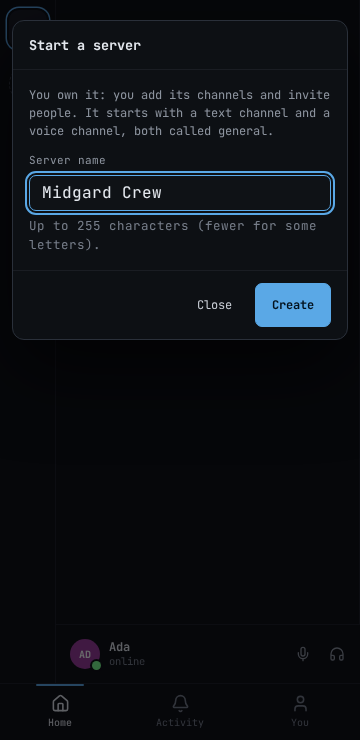

If the server is not created, the name field says why:

| The dialog shows | What to do |
|---|---|
| "Give the server a name." | Type a name; spaces alone are not a name |
| "That name is too long. A server name is up to 255 characters (fewer for some letters)." | Shorten it. The limit is counted in bytes: letters such as å or ü take two each, and an emoji four or more |
| "A name cannot hold control characters such as tabs or line breaks." | Take them out |
| "That name was refused. Try another." | The instance refused it; choose another |
| "Could not start the server ({code}). Try again." | Press **Create** again. After E_NETWORK the server may have been made anyway: the dialog reads your server list again, and if the server is there it carries on with it. **Create** with the same name reads the list again before it makes anything, so it never makes a second server |
| "{server} is ready, but #general was not added ({code}). Try again, or close this and add it from the channel list." | The server exists. **Try again** adds only what is missing; the same message names the voice channel general, or both channels, when those are missing. Closing the dialog keeps the server as it is. If you closed the dialog while the channels were still being added and one of them failed, the next time you open "Start a server" it shows this message once, with **Try again** |

## Invite people

Anyone whose roles allow it can make an invite link to a server; by default that is every member. Press **server
settings** under the server's name. It opens on the first section you may use, so a member who may only invite lands
on **invites**. Choose "Expires after" and "Max uses" (7 days and 10 uses to start with) and press **Make link**. The
dialog "Invite people to {server}" says "Making an invite link…", then shows the link and copies it for you:


- The dialog repeats what you chose ("Expires after: 7 days. Max uses: 10 uses.") and that "The server keeps only a
  fingerprint of each link, so a link cannot be shown again. Make a new one to share." Send the link only to the
  people you want in the server.
- "Invite link copied." means it is on your clipboard. If the browser did not let the page copy it, the dialog says
  "This browser did not copy the link. Press copy link to try again, or select the link and copy it yourself."
  Selecting the field selects the whole link.
- Each person who joins with the link uses it once, whether they sign up through it or already have an account. So
  a link of 10 uses brings in up to ten people. Every press of **Make link** makes a new link.
- "You cannot invite people to this server." or "Could not make an invite link ({code})." means no link was made;
  **Try again** asks again.

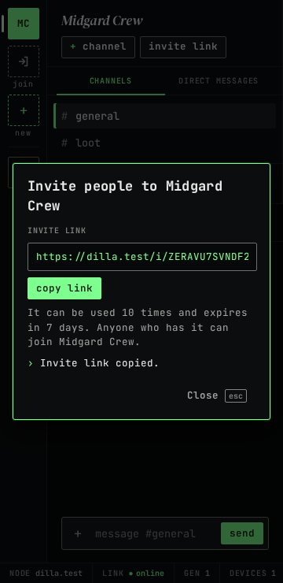

Your friend opens the link and sees the instance's invite page ([1. Open the invite](#1-open-the-invite)), signs
up in six steps, and lands in your server with its channels. They can message you from **direct messages**.

**Post your welcome after your friends have joined.** A friend does not see messages sent before their browser
joined: that is how the end-to-end encryption works, since their browser was not yet a member when those messages
were sent. Their `#general` starts at the moment they joined and says "nothing here yet. Messages sent before this
browser joined are not shown." Everything sent after that reaches them.

## Add a channel

The owner, and anyone whose roles let them manage channels, sees a **+** ("new channel") at the top of the channel
list while the server has no categories. Once it has categories, each category has its own **+** ("new channel in
{name}"), which shows when you point at the category or tab to it, and the new channel starts in that category. The
**+** is never on the direct messages list, and a person who may not manage channels has none. Press it.


1. Under "Kind", choose **text**, **voice** or **announcement** ([Announcement channels](#announcement-channels)). The
   arrow keys move between them. **private channel** keeps the channel to the owner, administrators and the roles you
   tick ([Private channels](#private-channels)).
2. Type a name under "Channel name". The line under the field shows how it will look: "Shown as #{name}. Up to 100
   characters (fewer for some letters)." for a text channel. A text channel's name is kept in lower case, with spaces turned into hyphens:
   "Fika på Fredag" becomes `#fika-på-fredag`. A voice channel keeps the name as you typed it.
3. Press **Create** or Enter ("Creating…"). A new text channel opens with the cursor in its message field and says
   "nothing here yet."; a new voice channel is listed among the others, in the server's order.

The dialog does not add a second channel of the same kind and name. If the name is taken, it says "There
is already a text channel called #{name}. Try another." (or "There is already a voice channel called {name}. Try
another.") and nothing is created.

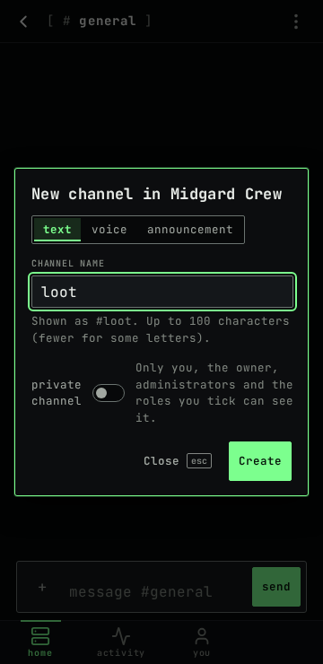

The others in the server see a new channel within about a second, in any dilla tab they have open; a renamed
server's new name shows the same way. The dialog says "Give the channel a name.", "That name is too long. A channel name is up
to 100 characters (fewer for some letters).", "A name cannot hold control characters such as tabs or line breaks.", "You cannot add channels to
this server.", "That name was refused. Try another." or "Could not add the channel ({code}). Try again." when the
channel was not added.

## Run your server

Once a server has people in it, you run it from **server settings** and from the member list. Both are for people
whose roles allow it; the owner can do everything here.

### Server settings

Press the gear (**server settings**) beside the server's name. The dialog "Server settings" has a list of sections
("server settings sections"). A section shows only to someone whose roles allow it: **overview** (manage the server),
**channels** (manage channels), **invites** (create invites) and **bans** (ban members). The dialog opens on the
first section you may see. The last section differs: a
non-owner sees only **leave server**; the owner sees **delete server** and **hand over server**. Leaving a server
lives here, not in the sidebar. Tab stops once on the list and once on the section; Escape closes the dialog and focus
goes back to the gear.

**Overview** renames the server. Type under "Server name" ("Up to 255 characters (fewer for some letters). Everyone in the server, and the host,
can read it.") and press **Save**: "Saving…", then "Saved." The field says why when it did not work: "Give the server
a name.", "That name is too long. A server name is up to 255 characters (fewer for some letters).", "That name was refused. Try another.", "You
cannot rename this server." or "Could not save ({code}). Try again." If "Someone else changed the server at the same
time. Check the name and save again.

Under the name, **Overview** holds the "inactive timeout": how long someone can sit idle in a voice channel on a computer
before the server disconnects them and lists them as away in the server's AFK channel ("Members idle in voice this long
are disconnected and listed as away in AFK. Phones are not disconnected."). Choose 1 minute, 5 minutes (the default), 15 minutes, 30 minutes or 1 hour, and press **Save**.
There is no AFK channel to pick: every server has one called "AFK" ([Voice, calls and media
files](voice.md#afk-channels)).

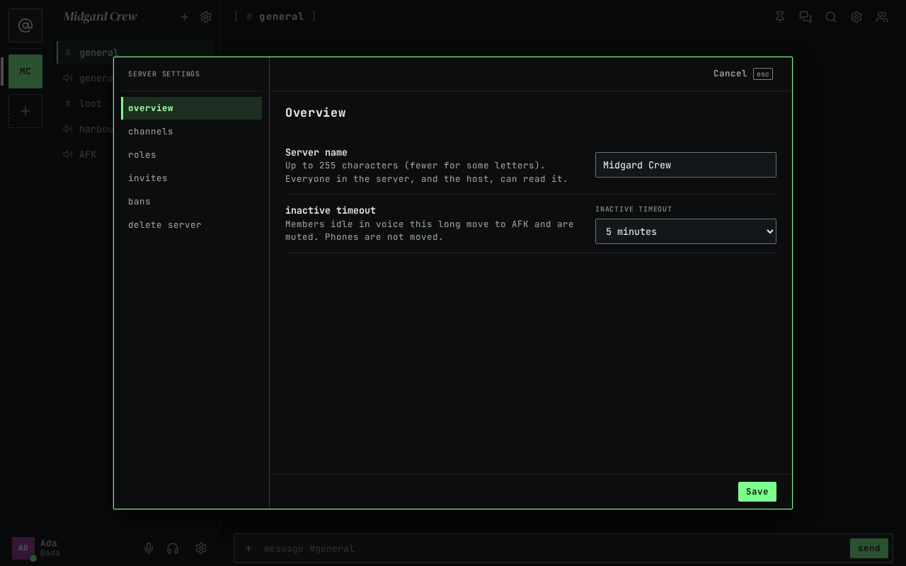

The field says why when saving did not work: "Someone else changed the server at the same time. Check the name and save
again." means you should look at the name that is there now and save again.

**Channels** lists the channels under their categories ("no category" holds the rest). Each row has **edit**, **move
up**, **move down** and **delete**; the screen announces "{name} moved." after a move.

- **new category** asks for a "Category name" ("Up to 100 characters (fewer for some letters). A category groups channels in the list; it holds no
  messages.") and **Create**.
- **edit** opens "Edit #{name}" (or "Edit {name}" for a voice channel, "Edit category {name}" for a category). You
  can change the "Channel name" ("Up to 100 characters (fewer for some letters)."), the "Topic" of a text channel ("Shown under the channel name.
  Up to 1024 characters (fewer for some letters). The host can read it.") and its "Category". A category has only a name. The header of an open
  text channel has the same **edit channel** for whoever may manage channels; it opens this dialog for that channel.
- The **AFK** channel is in the list too. It has **edit** (its name and category only, with "This is the server’s AFK
  channel. Nobody is connected here; people who are away are listed."), and no **delete** and no move up or down: it can be renamed and moved to another
  category, but it always stays last in its list.
- **delete** asks "Delete #{name}?". A text channel "is removed for everyone, with its messages and files. Copies
  someone already saved stay with them. This cannot be undone." A voice channel is removed too and a call in it
  ends. Deleting a category keeps its channels, without a category. Focus starts on **Cancel**.

**Invites** makes and lists invite links. Choose "Expires after" (30 minutes up to 30 days) and "Max uses" (1 use, or
a number), then **Make link**. "An invite lasts at most 30 days and admits at most 1000 people." The new link shows
as in [Invite people](#invite-people). The list under it has one row per live link: "by {name}, {used} of {max}
uses, expires {date}", with **revoke**. "Invite link revoked." means people can no longer join with it. An empty list
says "No live invite links." **Invites** is open to everyone whose roles allow them to invite, not only to the owner.

Invite links cannot be shown again. "The server keeps only a fingerprint of each link, so a link cannot be shown
again. Make a new one to share." Copy a link when you make it; if it is lost, revoke it and make another.

**Bans** lists who is banned from the server, with "banned by {name} on {date}", when it ends ("ends {date}" or
"until lifted"), and the reason or "no reason given". A ban that has run out says "ended {date}; can join again". A
moderator who has since left the server shows as "a former member", and an account the instance no longer names as
"a deleted account". **unban** asks "Unban {name}?": "{name} can join {server} again with an invite. This does not add them
back." An empty list says "Nobody is banned from {server}." If the list does not load, **Try again** loads it
again.

### Members

The **members** button in the channel header opens the list of "members of {server}", grouped by role: one group
for each role shown apart, highest first ("{name} — {count}"), then "members". A row is the avatar with its status
dot and the name, centred in the row; there are no "owner" or "you" tags in it, and a bot keeps a small "bot" tag after its name, as in Discord. A person's name is drawn in the colour of their highest
coloured role (in the normal text colour when that colour would be hard to read in your theme), and the owner has a small
crown after the name. A person who has set a status line shows it under the name, and then the row is two lines tall. On a
wide window the list is a column beside the conversation. On a phone, or any window narrower than 64 rem, it is a panel
over the screen: focus moves into it, and **close members**, Escape or a tap outside it closes it. Focus goes back to
**members**.


A whole row is one button. Click it, press Enter on it, right-click it, or press Shift+F10 or the ContextMenu key with the
row focused, and it opens that person's **profile card**. On a wide window the card is a popover beside the row; on a phone
it is a sheet from the bottom. The card shows a large avatar, the name, the @username, the status ("online", "idle", "do not
disturb" or "offline", then the person's status message if they set one), their bio under it, "owner" and "you" where they apply (these two words are only in
the card, never in the list), the person's roles as coloured chips, and the actions. Escape or **close** shuts the card and
puts focus back on the row; Tab stays inside it. Only one card is open at a time.

The actions are **message** and **compare safety numbers** (neither on your own card), **edit roles** if your roles let you
manage roles, and **kick** and **ban**. Kick and ban follow rank: they are offered only if your roles allow kicking or
banning and the person's highest role is below yours. The owner is never offered them, and you are not offered them on
yourself. The server still checks every kick and ban.

A mention of a person in a message, and a message's author name or avatar, open the same card, in channels and in threads
(on a phone, inside the thread sheet). The card sits under the mention or the name. Tab reaches the mention and the author name
inside the message, Enter opens the card and Escape closes it and returns to where you were. A mention of someone who has
left the server opens a card with no roles and no actions, titled "former member" because the server no longer tells us their name, and only while one of their messages is still
held in this browser. Role mentions and @everyone are not clickable. In direct messages a mention is plain text for now.

**kick** asks "Kick {name} from {server}?": "{name} leaves every channel and call of {server} at once. They can
join again with an invite. Messages they already received stay on their devices." Focus starts on **Cancel**. **Kick**
says "Kicking…", then "{name} was kicked."

**ban** asks "Ban {name} from {server}?": "{name} leaves every channel and call of {server} at once and cannot join
again until the ban ends or is lifted. Messages they already received stay on their devices." Choose "Ban length"
(1 hour, 1 day, 7 days, 30 days or until lifted) and, if you like, a "Reason" ("Optional. Shown to moderators in the
ban list, not to {name}. Up to 512 characters (fewer for some letters)."). **Ban** says "Banning…", then "{name} was banned." A refused kick or ban
says so in the dialog: "You cannot kick {name}. Their highest role is at or above yours, or your roles do not allow
kicking." (and the same for banning), or "{name} is no longer in {server}."

### Leave, hand over and delete

Anyone but the owner can leave: open the gear beside the server's name, then **leave server** in the list of sections. It asks "Leave {server}?", "You leave every channel and call of
{server}. To come back you need an invite." and says "You left {server}." The owner sees "You own {server}, so you
cannot leave it. Hand it to another member or delete it."

**hand over server** ("Hand {server} to another member") makes someone else the owner. Choose the "New owner", type
the server name under "Type the server name to confirm" and press **Hand over**. The new owner gets every permission
and you stay as a member who can no longer delete the server. You cannot undo it yourself. With nobody else in the
server it says "There is no other member to hand the server to yet." The page says "{name} now owns {server}."

**delete server** ("Delete {server}?") removes every channel, message and file for everyone and ends every call in
it. **Delete server** stays off until you type the server name under "Type the server name to confirm"; "That is not
the server name." shows while it differs. "{server} was deleted." Copies someone already saved stay with them. Only
the owner can do it, and it cannot be undone.

### What a removed person sees

A person who is kicked, banned, or whose server is deleted sees a banner, "You are no longer in {server}.", with
**dismiss**.

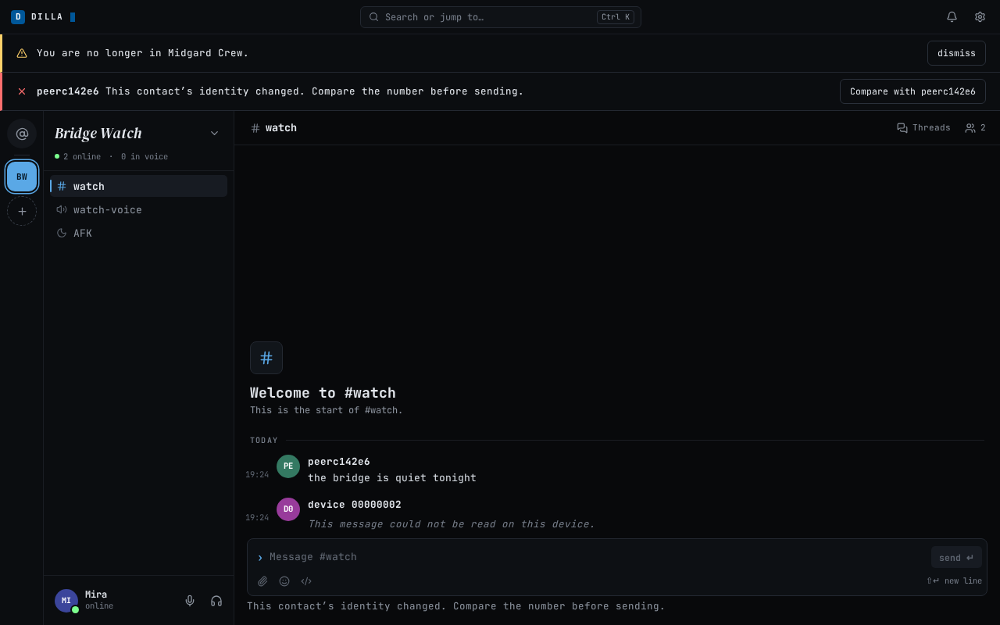

The server leaves their rail, the page moves to their first other server (or to the start page), and any
dialog open for that server closes. A banned person who tries an invite link again sees "This server does not let your account join."
until the ban ends or is lifted. See also
[You are no longer a member](#you-are-no-longer-a-member).

## Roles and private channels

Roles decide what people may do and, with private channels, who can see what. You need **manage roles** to make and
edit roles, and **manage channels** to change a channel. The owner can do everything here.

### Make and edit roles

In **server settings**, **roles** sits between **channels** and **invites**. It shows only to someone whose roles
include manage roles. The list is "Roles": "Roles group what people may do. A higher role outranks the ones below it,
and you can change only roles below your own highest role. Everyone in the server, and the host, can see every role,
its permissions and who holds it." Each row has the role's name and "{count} members" (no colour dot), with **edit**,
**move up**, **move down** and **delete**. "@everyone" is last: "Everyone in the server holds this role. Its
permissions are where every member starts." A role at or above your highest role says "above your highest role" and
has no buttons. The screen announces "{name} moved." after a move.

**new role** (or **edit** on a row) opens "New role in {server}" (or "Edit {name}"):

- "Role name": up to 100 characters (fewer for some letters). Everyone in the server, and the host, can read it.
- "Colour": a row of swatches (no colour, red, orange, amber, green, teal, cyan, blue, indigo, purple, pink, brown,
  grey). The colour shows on the names of people who hold the role in the member list, and on the role's chip in their profile card. The arrow keys
  move between swatches.
- **show separately in the member list** gives the role its own group in the member list, highest first.
- **anyone can mention this role** marks the role mentionable. Anyone can mention a role marked mentionable; other
  roles can be mentioned only by members allowed to mention @everyone. "People who may mention @everyone can mention
  any role."
- "Permissions": four groups (General, Members, Text, Voice), each permission with a hint. A permission you do not
  hold is switched off: "You do not hold this permission, so you cannot give or take it."

**Create** or **Save** says "Creating…" or "Saving…", then "{name} created." or "{name} saved." A refusal shows in the
dialog: "Give the role a name.", "That name is too long. A role name is up to 100 characters (fewer for some letters).", "You cannot change this
role. It is at or above your highest role, or it carries a permission you do not hold.", "Someone else moved this
role at the same time. Check it and save again.", "This server already has 250 roles, the most it can hold." or
"This role no longer exists."

**delete** asks "Delete {name}?": "Everyone who holds it loses it, and with it any channel it opened for them. This
cannot be undone." Focus starts on **Cancel**. **Delete** says "Deleting…", then "{name} deleted."

### Permissions that do nothing yet

Some permissions are in the editor so that a later version can use them. In this version these have no effect:
**manage messages**, **view audit log**, **mute members**, **move members** and **manage nicknames**. **add
reactions** has no effect in channels the host cannot read. The rest work, with two caveats:

- **send messages** and **bypass slow mode** now work, and the host checks them: it refuses a post from a person
  without **send messages**, and in a channel with slow mode it makes everyone without **bypass slow mode** wait. See
  [Slow mode, announcement channels and threads](#slow-mode-announcement-channels-and-threads). Pins and
  @everyone are still checked only by members' apps ([Who checks the rules](#who-checks-the-rules)).
- **read message history** opens the files sent in a channel. It never shows someone messages sent before they
  joined the channel.

**administrator** gives every permission in every channel, whatever the channel's settings say. Give it only to people
you would trust with the whole server.

### Give roles to people

Open the member list, open the person's profile card and press **edit roles**. The dialog "Roles of {name}" says "Tick a
role to give it to {name}, untick it to take it away. Each change applies at once." A role at or above your highest
role is switched off: "{role} is at or above your highest role." Each change is announced: "{role} given to
{name}." or "{role} taken from {name}." If there is nothing you can give, it says "There are no roles you can give
yet. Make one in Server settings, under roles." A refusal shows in the dialog and the box returns to how it was:
"You cannot give or take {role}. …", "{name} needs a second sign-in factor before they can hold a moderator role in
this server." or "{name} is no longer in this server." **Done** closes it. Between the opening text and the list of
roles, the dialog says "Roles decide who can see private channels. People who lose a channel keep the messages they
already have; people who gain one see only messages sent after they join it."

### Private channels

A private channel can be seen only by the owner, administrators, and the roles and people you name. The host still
knows who is in it.

- **When you make it.** In the new-channel dialog, turn on **private channel**: "Only you, the owner, administrators
  and the roles you tick can see it." Under "Roles that can see it" tick the roles to add; only roles below your own
  are listed, or it says "There are no roles below yours to add. You can add people later in the channel's
  permissions." A private channel can be opened to at most 98 roles at creation: "A private channel can be opened to
  at most 98 roles. Untick some and try again." You keep seeing a private channel you made until someone removes
  your entry, or you leave or are removed.
- **Later.** In the channel's settings (**edit channel**), "Permissions" has the **private channel** toggle. Turning
  it on asks "Make #{name} private?": "People who are not given access leave the channel now. They keep the messages
  they already have." Turning it off asks "Open #{name} to everyone?": "Everyone in {server} joins the channel. They
  see only messages sent after they join." Both confirms start on **Cancel**. In server settings, under **channels**, a
  private channel carries the tag "private"; the sidebar channel list does not show it.
- **A change that would hide the channel from you** is refused unless you are the owner or an administrator: "That
  change would hide the channel from you. Give access to a role you hold first."

People who lose a channel keep the messages they already have. Someone who gains one sees only messages sent after
they join it, whatever their roles. A channel that leaves your list, because it was hidden from you or deleted, is
announced as "{name} is no longer available to you." (with a # before the name of a text channel); the app cannot tell
which it was.

### Per-channel settings

"Permissions" in a channel's settings has "Who has settings here": the entries that change what the channel's
defaults allow, each a role (or "@everyone") or a person ("member"). **add a role or person** ("Role or person")
adds an entry; **remove** drops it ("No role or person has settings of their own here yet."). For each permission an
entry chooses **allow**, **default** or **deny**. It saves with "Saving…", then "Permissions of #{name} saved." A
refusal shows in the section: "You cannot change this. The role or person is at or above your highest role, or the
change names a permission you do not hold here.", "This channel no longer exists." or "Could not read who can see
this channel. Close this and open it again."

### A channel you cannot post in

Without **send messages** in a channel, the message box stays but is read-only, with the reason: "You cannot send
messages in #{name}." Your draft stays in the box.

### Role mentions

Type `@` and the start of a role's name: the list offers the roles you may mention, each with the note "role". A
role mention shows as the role's name. It notifies the people who hold the role. Anyone can mention a role marked
mentionable; other roles can be mentioned only by members allowed to mention @everyone.

### Pins, @everyone and @here

Who may pin, and who may notify everyone, follows the sender's rights **now**:

- **Pins** follow the pinner's current right to pin messages in that channel. A pin shows only while the person who
  pinned it may pin there: "A pin shows while the person who pinned it may pin in this channel." If someone loses the
  right, their pins and unpins stop counting, and an earlier pin by someone else can come back.
- **@everyone and @here** notify you only when the sender may mention them. A message that mentions you directly,
  by `@` and your name, notifies you unless the server or channel is muted or set to nothing (see
  [Notifications for a server](#notifications-for-a-server)).

### Who checks the rules

Who may **send messages**, and slow mode, are checked by the host: it refuses a post from a person without the
right, and makes everyone else wait in a channel with slow mode. To do this it learns whether something you send is a
new post or a change to one (an edit, a reaction, a pin); it does not read what the message says. Direct messages are
not checked. Pins and mentioning everyone are checked only by members' apps, and so is the view of who holds which
role. The host does not see your messages and cannot read or change them, but it carries each server's role
information. A host that behaves badly could hide pins and @everyone, or show different members different views of
who holds which role. Nothing in the group checks or signs the role view. The
[threat model](../../protocol/08-threat-model.md#residual-trust) describes what the host can still see and do.

### Notifications for a server

Under **notifications**, "Servers" has one row for each server: "A server's setting applies to its channels unless a
channel has its own." Choose **default**, **all messages**, **mentions** or **nothing**; **mute server** silences it;
**ignore @everyone and @here** stops the desktop notification for @everyone and @here in this server, whoever sent
them; the mention badge and the highlighted row still count an @everyone or @here the sender was allowed to send. A
direct `@` mention of you (by your name or one of your roles) is not affected by it. It notifies unless the server or
channel is muted, or the mode that applies is **nothing**; with **mentions** it notifies, and with **all messages**
every message does. A channel's own setting beats the server's.

### Upgrading from an earlier version

Before web-3.5 anyone could pin and anyone could write @everyone. In web-3.5 the default @everyone role has neither
**pin messages** nor **mention @everyone and @here**, and a server made earlier keeps that stored default. After the
upgrade, in an existing server:

- only the owner, administrators and members with a role that grants **pin messages** can pin and unpin;
- pins that other members made earlier are hidden until the owner grants the right through a role; they come back when
  it is granted, because a pin shows while the person who pinned it may pin;
- @everyone and @here from members without **mention @everyone and @here** do not notify.

To give everyone the old behaviour back, the owner opens
**server settings**, **roles**, **edit** on the "@everyone" row, switches on **pin messages** and **mention @everyone
and @here** under "Text" and chooses **Save**. To give them to some people only, make a role with them and give it
from the member list.

## Slow mode, announcement channels and threads

### Slow mode

Slow mode makes each person wait between their messages in one text channel. It is for a busy channel, and it does
not slow reactions, edits or deletes.

To set it, open **server settings** → **channels** → **edit** on a text channel (or **edit channel** in the channel's
header). Under the topic, **Slow mode** ("How long each person waits between messages. People who may bypass slow
mode do not wait.") offers off, 5 seconds, 10 seconds, 30 seconds, 1 minute, 5 minutes, 15 minutes, 1 hour and 6 hours.
It is off to begin with. You need the right to manage channels. A channel with slow mode shows the badge "slow mode" in
the channel list.

Who waits: everyone, except the owner, people with **administrator** and people whose role grants **bypass slow
mode**. They send as often as they like and see no countdown. In a channel with slow mode, after you send, the message
box says "Slow mode is on. You can send again in {time}." and counts down. If you send again before it reaches zero,
the message is kept and sent when the wait is over ("Waiting for slow mode, then sending."), so you need not come back
to it. Direct messages have no slow mode. The wait is the same on every device you use, because the host counts it.

### Announcement channels

An announcement channel is a text channel where only some roles can post. Everyone in the server can read it and react.

In **new channel**, choose **announcement** under "Kind". You are offered it only when you may manage channels and roles.
"Roles that can post" lists the server's roles ("Only the roles you tick can post. Everyone can read and react."); tick
the ones that may post. The owner and administrators can always post. If you are not the owner, tick a role you hold
that is below your highest role, so that you can post too, or the dialog says "Tick a role of yours that is below your
highest role, so that you can post here too." A server with no roles says "No roles yet. Make one in Server settings,
under roles." and you can still create the channel; then only the owner and administrators post. Everyone else sees
the channel with a read-only message box: "Only some people can post in #{name}." Change who can post later in the
channel's permissions ([Private channels](#private-channels)).

### Threads

A thread keeps the replies to one message together, out of the channel's main conversation.

- To start one, point at a message and choose **reply in thread** in its toolbar. To open a thread that exists, press
  the chip under its first message: "1 reply" or "{count} replies". Only a message that is not itself a reply can
  start a thread.
- On a wide screen the thread opens in the side column, where the member list was; closing it gives the member list
  back. On a phone it is a full-screen sheet over the channel. Opening a thread puts the cursor in its message box
  ("reply in thread") in the side column, and on **back** on the phone sheet and in the narrow overlay.
  A thread with no replies yet says "No replies yet." The first message is at the top; type your reply at the bottom.
- In a thread you can react to a message, and edit or delete your own. Pin and reply stay in the channel.
- **close thread**, **back** or Escape closes it, and the cursor returns to the message or chip you opened it from.
- **threads** in the channel header (on a phone: in the **channel menu**) lists every thread in the channel. A channel
  with none says "No threads in #{name} yet." If the list cannot be read it says "Threads could not be loaded." A
  thread whose first message is not available to you says "The message that started this thread cannot be shown here."
- Replies in a thread do not appear in the channel, but they still count as unread and as mentions. Opening the channel
  marks its thread replies read; a thread has no unread count of its own.

## Second factor

Every account on an instance has a second factor, and the instance enforces it: an account without one cannot use
dilla until it adds one. The factor is what a new browser has to show when it signs in to your account. It does
not guard your messages, and it is not your recovery key.

You choose one of two kinds, and can have both:

- **An authenticator app** on your phone, which shows a new six-digit code every 30 seconds. Signing in on a new
  browser then takes your password and a code from the app.
- **A passkey**: your phone, a security key or the computer confirms it is you with a fingerprint, your face or a
  PIN. A passkey signs you in on its own. Keep a passkey on a computer only if no one else uses it.
  A passkey works only at the address the instance is set up for; if it is not, the screen says "Passkeys do not
  work at this address of {instance}. Use an authenticator app, and tell the operator." An account that has no
  password can only use a passkey.

### Setting it up

At sign-up it is [step 5 of 6](#step-5-of-6-add-a-second-factor). The same screens appear when an account has none
(see [After the upgrade](#after-the-upgrade-to-web-36)) and in Settings → Sign-in.

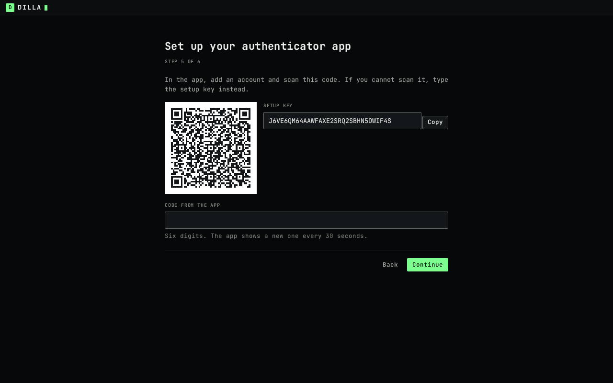

For an app: "In the app, add an account and scan this code. If you cannot scan it, type the setup key instead." The
**setup key** is the same secret as text, with a **Copy** button. Type the code the app shows now. A wrong one says
"That code did not match. Type the code the app shows now, and check that your phone sets its clock automatically."
(a phone whose clock is off by a minute or more makes every code wrong). For a passkey the button is **Add passkey**,
and a cancelled prompt says "No passkey was added. Try again, or use an authenticator app."

### Backup codes are not the recovery key

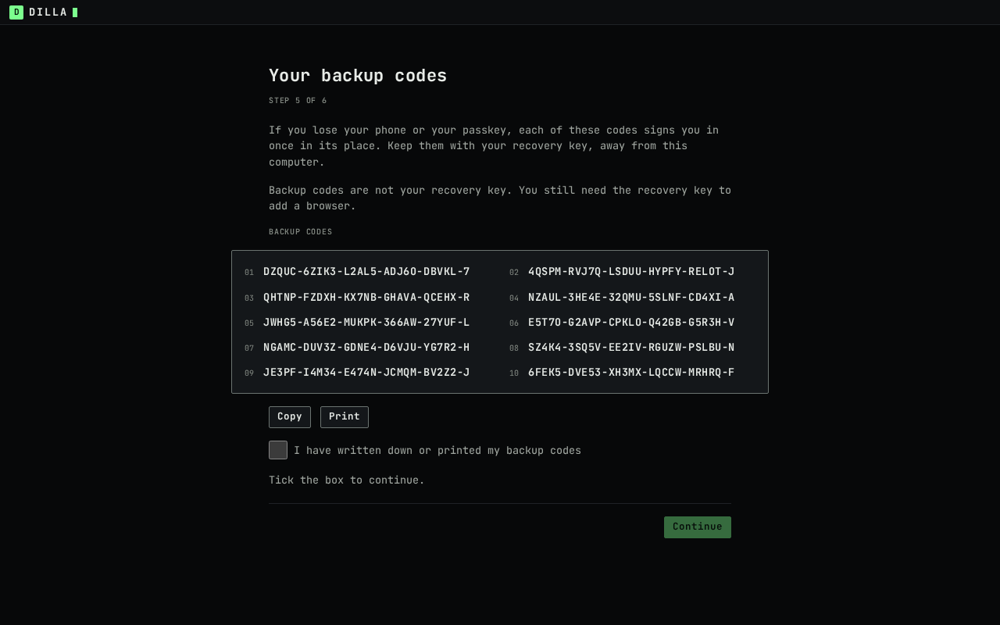

After the factor you get "Your backup codes", a list with **Print** and **Copy**. Each code signs you in once in
place of your second factor, which is what you reach for when you lose your phone or your passkey. "Backup codes are
not your recovery key. You still need the recovery key to add a browser." The recovery key (step 3 of the sign-up)
is what adds a browser to your account; a backup code never does. Keep both away from this computer. The codes are shown once. A code is 26 letters and digits; hyphens and spaces do not matter when you type one. The number of
codes is the instance's setting (10 unless the operator changed it).

### Signing in on a new browser

[Section 6](#6-use-your-account-in-a-second-browser) is the whole sign-in. In short, after your username and password,
step 2 asks for the factor you set up, and the recovery key comes last, as step 3:

- an authenticator app: the six-digit code;
- a passkey: the browser asks for it on **Use passkey**. Under the password field of step 1 there is also
  **Sign in with a passkey**, which takes a passkey instead of the password. If the passkey did not check that it is
  you, the instance also asks for your code;
- a backup code: **Use a backup code instead**, instead of the code or the passkey. It works once, and the last
  screen says how many you have left.

**Browsers that are already set up do not ask again.** A browser that has been added to your account signs in with
its own device key and does not ask for a code, so this browser is not asked again when you reload or come back.
The factor guards signing in on a **new** browser, not message content.

### Settings → Sign-in


Open **settings** in the server rail, then **sign-in**. "What {instance} asks for when you sign in on a new browser.
Browsers that are already set up, like this one, do not ask again." The rows are:

- **Password**: whether the account has one, with **change password** (or **set password** when it has none). "Password changed." or "Password set." confirms it.
- **Authenticator app**: **add authenticator app**, or **remove** when it is set up.
- **Passkeys**: one row per passkey with its name, when it was added and when it was last used, each with its own
  **remove**, then **add passkey**.
- **Backup codes**: how many are left ("{count} backup codes left."), and **make new backup codes**. New codes make
  the old ones stop working at once, so it asks "Make new backup codes?" first; the new list is shown once. When none
  are left it says "No backup codes left. Make new ones so you are not locked out."

Every change asks "Confirm it is you": type your password (or use a passkey, on an account without a password).
Adding or removing a factor asks it first; making new backup codes asks it after you said yes. **remove** is disabled while it is your only second factor: "This is your only second factor. Add another
one before you remove it." The instance refuses it as well.

### A lost phone or passkey

There are three ways back, in this order of ease:

1. **A browser that is still set up.** Open Settings → Sign-in there, add a new authenticator app or passkey, then
   remove the old one.
2. **A backup code.** On the new browser, step 2 of the sign-in has **Use a backup code instead**. Then add a new
   factor in Settings → Sign-in and make new backup codes.
3. **The operator.** Ask whoever runs {instance} to reset your second factor. They check that it is you before they
   do (by a means other than dilla), and the reset removes your authenticator app, passkeys and backup codes.
   You stay signed in where you were, and every browser then asks for a new factor before anything else. A new
   browser still needs your password and your recovery key.

### After the upgrade to web-3.6

Before web-3.6 a second factor was optional. After the upgrade an account that has none is not signed out, but it is
stopped at "Add a second factor" ("Your account needs a second factor before you can continue. {instance} asks every
account for one.") in every browser, before the app opens. The same screen shows after an operator resets your second
factor. There is no skip. The only other
thing that screen offers is **forget this browser**, which clears dilla’s data from the browser and is not a way
past it. An account that had an authenticator app before keeps it and its backup codes; **check Settings → Sign-in**
after the upgrade to see what the account holds, and make new backup codes if you did not keep the old ones.

## 1. Open the invite

An invite is a code or a link. A link to an instance looks like `https://chat.example.org/i/<code>`.
Opening it shows a page from the instance, in the light or dark scheme your browser asks for:


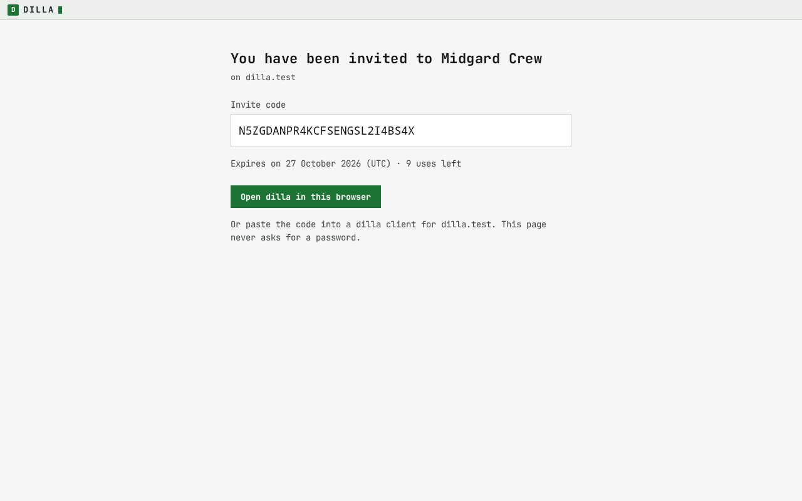

It names the server the invite is for (the page calls it a community) and the instance, and shows the code, when the
invite expires and how many more times it can be used ("Expires on {date} (UTC) · {n} uses left"). The page has no
form and no script; it never asks for a password ("This page never asks for a password."). Opening the page does not
use the invite. **Open dilla in this browser** starts the sign-up with the code filled in. "Or paste the code into a
dilla client for {instance}." You can also go to the instance's address and paste the code or the whole link in the
first step.

## 2. Sign up: six steps

All six steps happen in the same tab. **Continue** (or Enter in a field) moves forward, **Back** goes back
one step, and nothing is created on the instance until step 4.

### Step 1 of 6: Join

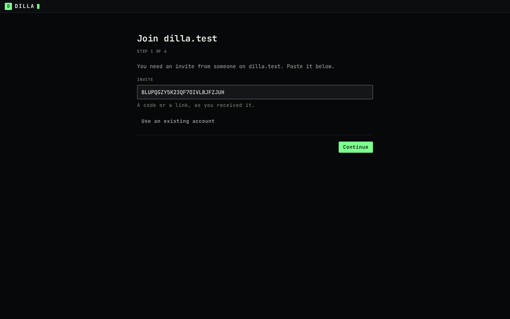

"You need an invite from someone on {instance}. Paste it below." The field takes "A code or a link, as you
received it." If the invite is refused when the account is created, you are brought back here with "This
invite is expired, used up or unknown. Ask for a new one." An instance that takes no new accounts shows
"{instance} is not taking new accounts" instead of this step.

### Step 2 of 6: Choose your name

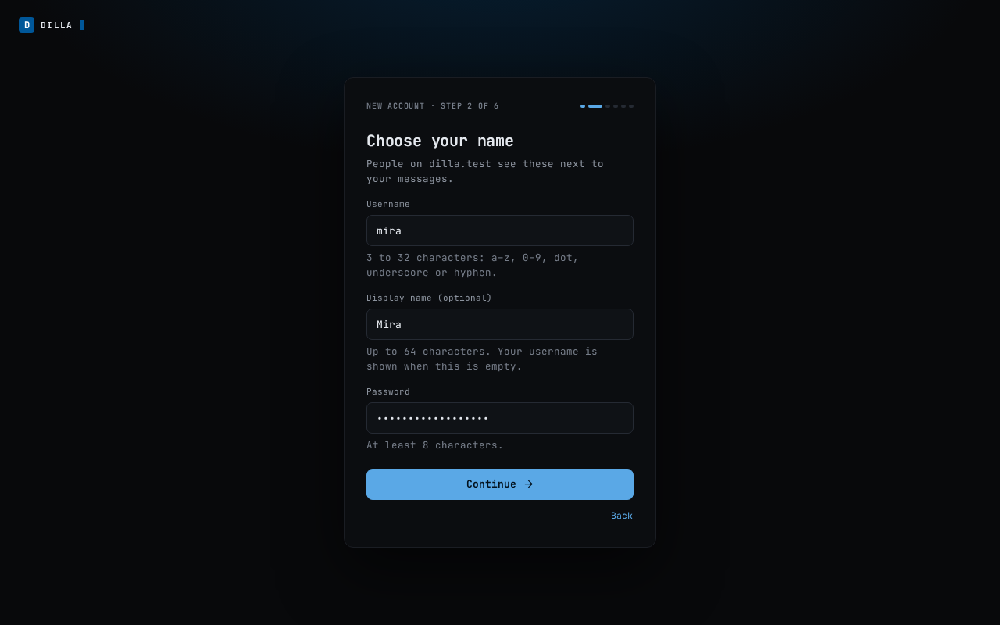

"People on {instance} see these next to your messages."

- **Username**: "3 to 32 characters: a–z, 0–9, dot, underscore or hyphen." Capital letters are turned into
  lower case. If someone has it already: "That username is taken. Try another."
- **Display name (optional)**: "Up to 64 characters. Your username is shown when this is empty." This is
  the name shown on your messages.
- **Password**: only when the instance offers passwords. "At least 8 characters." Keep it: a second browser
  asks for this password, the code of your second factor and, last, your recovery key.

Going forward from this step makes your keys. That can take a moment ("Making your keys").

### Step 3 of 6: Your recovery key


The key is 13 groups of 4 characters. "This key is shown once and is kept nowhere. Write it down or print
it, and keep it away from this computer." **Print** opens the browser's print dialog; the printed page holds
the key and the two paragraphs, not the rest of the screen. There is no copy button, on purpose: the
clipboard is readable by other programs. You can still select the text yourself.

The screen says: "This key is the only way to get your account back or to add another browser. If every browser you use loses its data and you do not have the key, the account and its history are gone, and the host cannot bring them back." It cannot be shown again after you leave this step.

Tick "I have written down or printed my recovery key" to continue ("Tick the box to continue.").

### Step 4 of 6: What this browser keeps

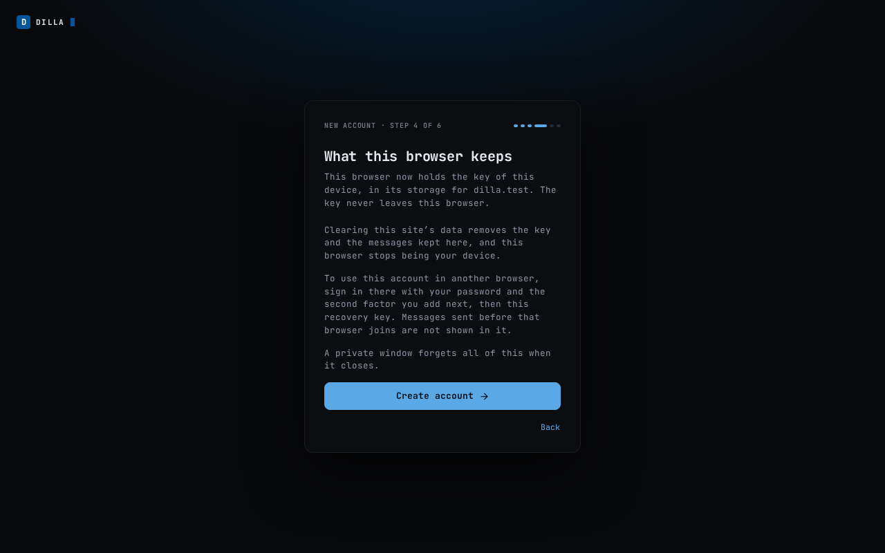

- "This browser now holds the key of this device, in its storage for {instance}. The key never leaves this
  browser."
- "Clearing this site’s data removes the key and the messages kept here, and this browser stops being your
  device."
- "To use this account in another browser, sign in there with your password and the second factor you add next, then this recovery key. Messages sent before that browser joins are not shown in it."
- "A private window forgets all of this when it closes."

**Create account** creates the account on the instance ("Creating your account on {instance}…").

### Step 5 of 6: Add a second factor

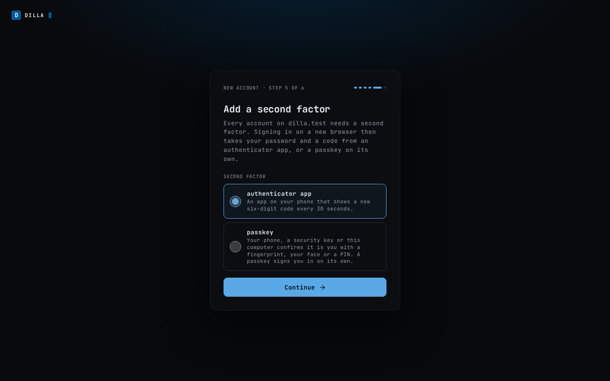

"Every account on {instance} needs a second factor. Signing in on a new browser then takes your password and a code
from an authenticator app, or a passkey on its own." Choose **authenticator app** or **passkey** and then
**Continue**. The step is described in full under [Second factor](#second-factor). In short:

- **authenticator app**: scan the QR code with an authenticator app, or type the setup key, then type the code the
  app shows ("Code from the app").
- **passkey**: your browser asks where to keep the passkey. You can name it ("Passkey name").
- Then comes "Your backup codes". Write or print them, tick "I have written down or printed my backup codes" and
  choose **Continue**.

There is no way to skip this step. The account exists already (step 4 made it); if you close the tab here, the
next time you open dilla in this browser it asks for the second factor before anything else.

### Step 6 of 6: You’re in

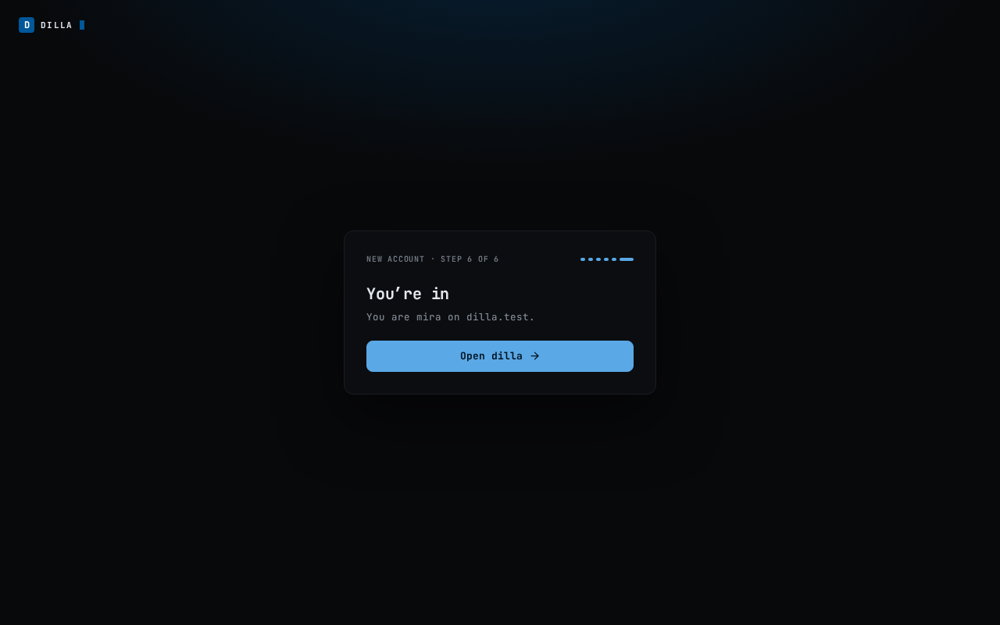

"You are {username} on {instance}." **Open dilla** opens the app.

If the invite was for a server, you land in that server. Creating the account uses the invite once and
joining the server uses it a second time, so an invite that can be used only once creates the account and
then shows the join dialog with "This invite is expired, used up or unknown."; ask for a new server invite.
If the invite was for the instance only, the app shows "You are not in a server yet" with **Start a server**
([Start a server](#start-a-server)) and **Join a server**.

## 3. What "this browser holds your key" means

Each browser you add is a device of your account. When you sign up, the browser makes a key for itself (a
"device" key) and keeps it in its storage for the instance's address. The messages of a text channel are
encrypted end to end with MLS (RFC 9420) between the members' devices, and the instance stores and forwards
them encrypted. This browser decrypts them and keeps a copy in that same storage, itself encrypted with a key
that only this browser can unwrap. The next time you open the instance's address, the browser signs in with
its device key, without a password. (Nothing here has had an independent security review yet. Each device of
a contact is checked against that person's signed device list, but the first key this browser sees for a person
is only "first seen", not verified, until you compare safety numbers; see [section 10](#10-privacy-search-and-settings).)

What follows from that:

- **Clearing the site's data** (the browser's "clear cookies and site data" for the instance, or removing
  the browser profile) deletes that browser's device key and kept messages. You can add a fresh browser with
  your password and recovery key, but messages from before it joins are not shown there.
- **If only the key is gone** and the stored data is still there, the app says "This browser can no longer
  open its saved data" and offers **Reset this browser**, which, after "Reset this browser?", deletes dilla's
  data for this site so you can sign up again.
- **Private windows.** Firefox's private window cannot keep the data at all; the app stops at "This window
  cannot keep dilla’s data" and creates no account. A Chromium incognito window lets you sign up, and the
  account is gone when the window closes. Use a normal window.
- **Browsers that clean up storage.** The app asks the browser once to keep its storage, and some browsers
  decline. Safari removes a site's storage after seven days without interaction, and the account goes with
  it.
- **Another tab.** Only one tab runs dilla at a time. A second tab shows "dilla is open in another tab" and
  takes over when the first one closes, or at once with **Use this tab**; see [Two tabs](#two-tabs).
- **Signed out by the account.** If the account no longer accepts this browser (another browser removed it
  in Settings → Devices), the app says "This browser was signed out". See [Devices](#7-devices).

## 4. The app


From left to right:

- **The server rail.** It is 72 pixels wide. At the top is the **@** tile, "direct messages" ([Home and direct
  messages](#home-and-direct-messages)); under a line come your servers, one tile each with its initials, and under
  them one dashed **+** tile, "add a server". The **+** opens "add a server" with two choices: **join a server**, where
  you paste a server invite ("A server invite, as a code or a link.") and press **Join**, and **new server**
  ([Start a server](#start-a-server)). A number on a server tile counts its unread channels, and on the **@** tile your
  unread direct messages. The rail has no settings button: settings are behind the gear in [the user
  panel](#the-user-panel).
- **The channel list.** The server's name with a gear beside it, **server settings** (leave server is a section in
  there; see [Run your server](#run-your-server) and [Invite people](#invite-people)), and under it the channels, in
  [categories](#servers-and-categories), with a **+** at the top for people who may manage channels ([Add a
  channel](#add-a-channel)). Text channels open here. Voice channels sit in the same list ([One channel
  list](#one-channel-list)), and one click joins one ([Voice, calls and media files](voice.md)). Channels the
  server can read ("Readable by this server") are listed, and selecting one shows "This channel does not open here
  yet". An unread channel has a badge, and mentions have their own count. Opening a channel marks it read.
- **The conversation.** The channel's name at the top, with a row of icons at the right ([The header](#the-header)), the messages, and the message field
  ("message #general") with **send**. Each message shows the author's display name, a small `web` tag whenever it
  was sent from a browser (always shown, so pointing at a message never moves it), and the time. Click the author's name or
  avatar to open their profile card ([Members](#members)). A message is at most 4000 bytes; in the last 400 the field shows
  how many are left. While a message is on its way it shows "sending…"; one that could not be sent shows "not sent" with
  **retry** and **discard**.
- **The side panel.** The member list, a thread or the pins, in a column on the right while the window is wide.
- **There is no status bar.** The instance, the connection and the generation number are in [Settings →
  Diagnostics](#diagnostics). When the connection drops, a line at the top of the app says "Offline. Reconnecting…",
  or "Connecting to {node}…" while it comes back, and goes away when the link is back.


At phone width the app is arranged differently, with a tab bar at the bottom ([On your phone](#on-your-phone)):

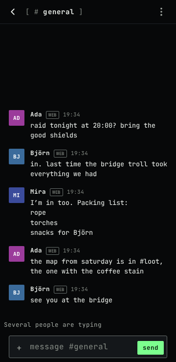

### Home and direct messages

The **@** tile at the top of the rail opens your direct messages, on a computer and on a phone. The sidebar then lists
your direct messages instead of a server's channels, and the **@** tile stays selected until you pick a server. A badge
on the **@** tile counts your unread direct messages. A link to a direct message opens it with **@** selected too. On a
phone, the app has three tabs, **home**, **activity** and **you** ([On your phone](#on-your-phone)), and the direct
messages are behind the **@** tile of **home**.

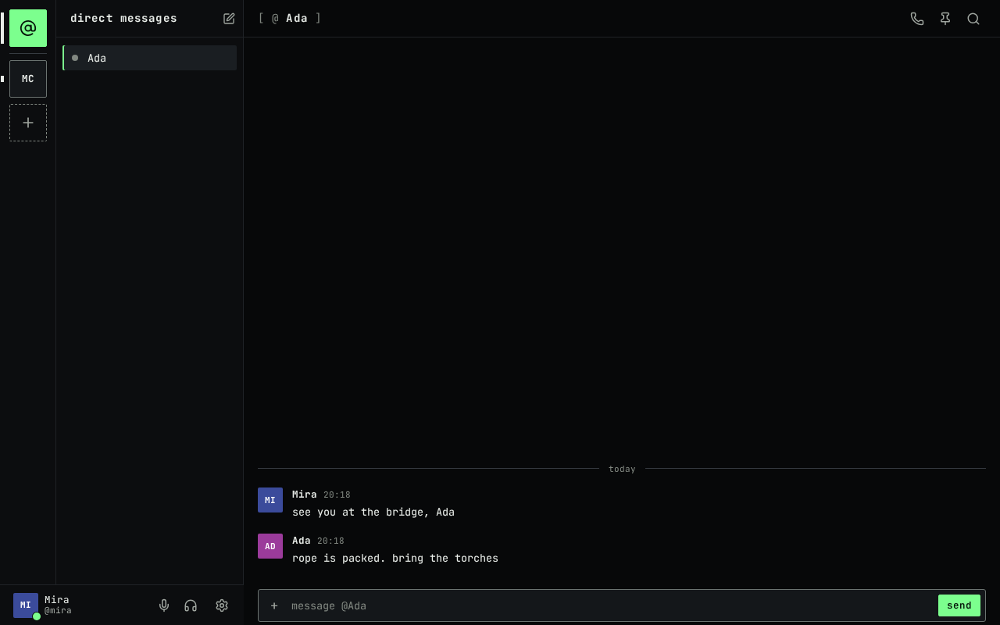

### Servers and categories

Channels sit in categories. Click a category's name to collapse it, and again to open it. A collapsed category still
shows the channel you are in, channels with new messages and the voice channel you are in, so nothing you need is hidden.
Which categories are collapsed is remembered in this browser only, not in your account. People who manage channels add a
channel to a category with the **+** at its right ("new channel in {name}"); make categories in server settings → channels
([Run your server](#run-your-server)).

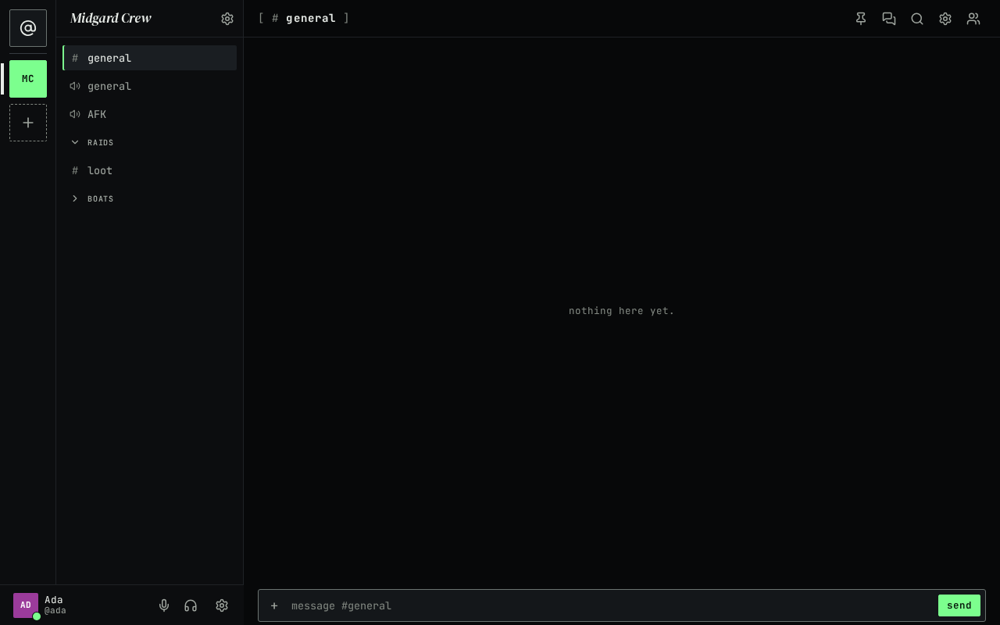

### The header

The top of a conversation has icons for **pins**, **threads**, **search**, **edit channel** (for people who manage
channels) and **members**. Point at an icon, or Tab to it, to see its name and its shortcut. In a narrow window some of
them fold into **more**.

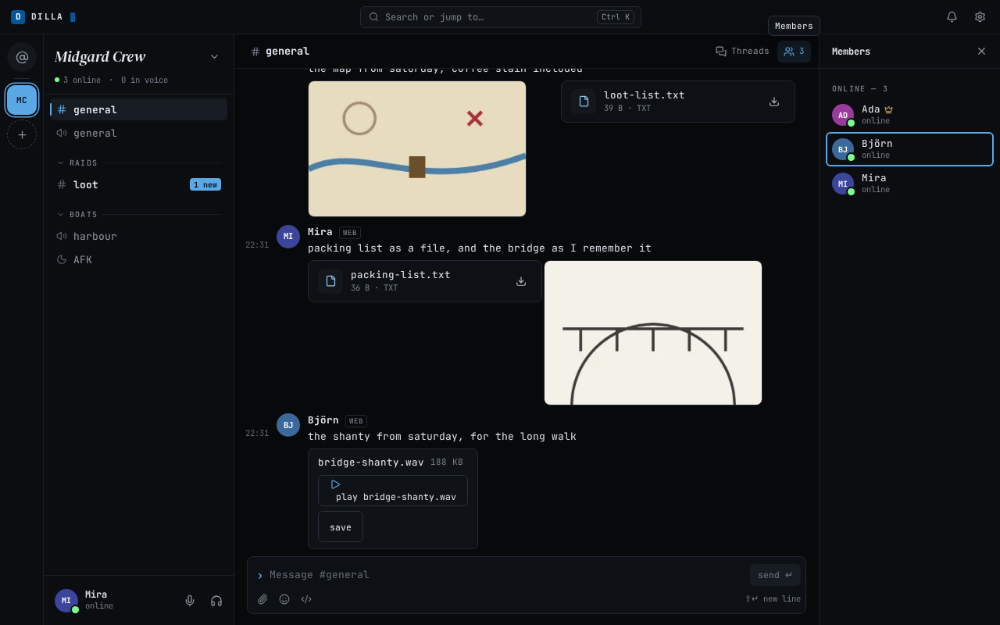

A long conversation groups messages from one person within a few minutes under one name and time, and puts a divider at
each new day ("today", "yesterday", then the date). When you have scrolled up, "viewing older messages" shows with **jump
to present**; Control+End does the same.

### Desktop layout


Drag the borders between the channel list, the conversation and the side panel to give a pane more room. The same
works with the keyboard: Tab to a border (it is named "resize the channel list" or "resize the side panel"), then
press Arrow Left or Arrow Right (1 rem a press, 4 rem with Shift), Home or End for the smallest or largest width, or
Enter to reset it. A double-click on a border resets it too. The border between the channel list and the conversation runs the full height of
the window, beside the call panel and your user panel as well, and you can drag it from anywhere along that line. The conversation never gets narrower than 24 rem. The
side panel has a border only while it is a column, which is when the window is at least 64 rem wide; narrower than
that it opens over the conversation. The widths are kept in this browser only, not in your account.

### One channel list


Text and voice channels are in one list, in the order the server gives them (and its categories). A voice channel has
a speaker icon. While people are in it, it shows how many, and the people in the call are listed under it, each with
small icons for what they are doing (muted, deafened, camera, screen share; point at an icon for its name) and a ring
around the avatar of whoever is speaking. There is no separate "voice" section and no "active voice" list. On a computer,
one click on a voice channel joins it; on a phone, tap it to see who is there, then join ([Voice, calls and media
files](voice.md)). The server's "AFK" channel is in the list too, always the very last row, below every category ([AFK channels](voice.md#afk-channels)).

### The user panel

The bottom left of the app is yours, across the rail and the channel list:

- your name and username;
- **mute** and **deafen**. Outside a call they decide how your next call starts: press **mute** and you join muted,
  press **deafen** and you join deafened. In a call they act on the live microphone and on what you hear
  ([Mute, deafen and push to talk](voice.md#mute-deafen-and-push-to-talk)). Control/⌘+Shift+M and Control/⌘+Shift+D
  press them, in a call or out of one;
- **user settings**, behind the gear: Settings opens there, and closing it returns focus to the gear;
- **your status**: a small dot on your avatar shows it. Click your name (or Tab to it and press Enter) to open the status menu and choose online, idle, do not disturb or invisible; there is no status select in the sidebar. It follows your account to your other devices. online
  becomes idle after ten minutes without activity on any of your connected devices (a status you chose yourself
  stays). do not disturb stops desktop notifications and the ring sound on every device; messages, badges and the
  in-app banner for a call still show. invisible hides your status from other members, though not that you are typing
  or in a call. The member list groups people by role and shows who is online; offline and invisible people sit
  together at the bottom, and the headings of roles shown apart carry the role's colour.

While you are in a call, [the call panel](voice.md#the-call-panel) sits above the user panel.

### Keyboard

| Key | What it does |
|---|---|
| Enter | Sends the message |
| Shift+Enter | Starts a new line in the message |
| Alt+Arrow Up, Alt+Arrow Down | Opens the previous or next channel, from anywhere in the app |
| Escape | In the message list: back to the message field. In a dialog: closes it |
| Tab, Shift+Tab | Moves between the regions: "skip to messages", the server rail, the server's actions (each its own stop), the channel list, the border between the channel list and the conversation, the user panel (with the call panel above it, in a call), the channel header, the messages, the message field |
| Arrow keys | Move within the server rail (the @ tile, your servers, then add a server) and the channel list, which are one Tab stop each. On a border between panes they resize it ([Desktop layout](#desktop-layout)) |
| Ctrl+End | In a conversation: jumps to the newest message |
| Control+K (⌘+K on a Mac) | Opens search across everything this browser holds |
| Control+/ | With a conversation open: opens search in this conversation (Control on a Mac too) |
| Control/⌘+Shift+M, Control/⌘+Shift+D | Mute or unmute, deafen or undeafen: in a call, or before one to set how the next call starts ([Voice, calls and media files](voice.md#mute-deafen-and-push-to-talk)) |

Settings uses Arrow Up, Arrow Down, Home and End to move between sections; Escape closes it.

Every step of the sign-up works with the keyboard alone: Tab to a field or button, Space ticks the
recovery-key box, Enter submits a step.

### Reloading

Reload the page, or close the browser and come back: the app opens without the sign-up, with your servers,
your channels and the messages this browser has received. They are read back from this browser's storage,
not from the instance, and the newest 100 messages of a channel are shown first; **load earlier** shows more.
"nothing here yet. Messages sent before this browser joined are not shown." is what an empty channel says:
a channel's history starts when this browser joined it.

## On your phone

On a screen as narrow as a phone's (under about 770 pixels wide), and on a phone held sideways, the app shows one thing
at a time, with three tabs at the bottom. It works in the phone's browser; there is no separate app.


### The three tabs

The tab bar ("sections") has **home**, **activity** and **you**. A number on a tab counts what is new there ("{name}, {count} new"
for a screen reader).

- **home** holds the **@** tile and your servers in a column at the left, and beside it the channels of the one you
  chose. The **search** (a magnifier) and the gear for **server settings** sit beside the server's name; there is no
  menu. A member leaves a server from the gear, under **leave server**. The **+** for a new channel is at the top of the
  channel list for people who may manage channels, and invite links are made in server settings, under invites. Tap a
  voice channel to see who is in it, then join.
- The **@** tile on **home** shows your direct messages beside the rail. They are not a tab of their own.

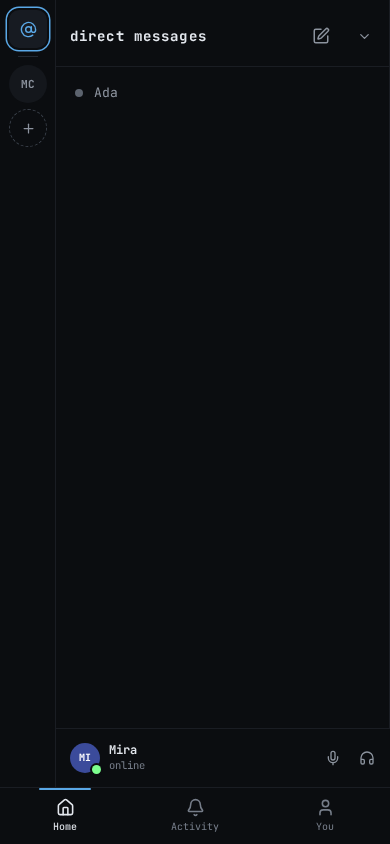

- **activity** lists the mentions and direct messages that came in, and "unread elsewhere" for channels with
  something new. It lists what arrived since you opened dilla in this tab, and says so: "Since this tab opened."
  Nothing new says "Nothing new. Mentions and direct messages show up here."
- **you** holds this device's facts, the connection and the number of devices (what Settings → Diagnostics shows on
  a wide screen), your status, **settings** and **sign out and remove this browser**.

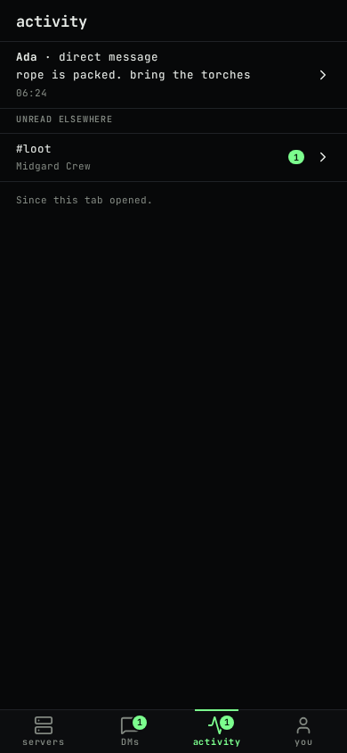

### Opening a channel and going back

Choosing a channel or a direct message opens it over the whole screen, with the three tabs still at the bottom. When
you tap the message box (or any other field), the tabs step aside so that the message box sits right above the keyboard,
and they come back when you leave the field. Tapping the tab you are already in takes you to that tab's list, and tapping
another tab takes you to where you were in it. At the top, **back** (the arrow at the left) returns to the list you came from, and the phone's own back
button or swipe does the same. The **channel menu** at the right holds the channel's other actions, such as pins and
**threads**. Each tab remembers where you were in it. If you reload the page on a channel, back still takes you to its list.

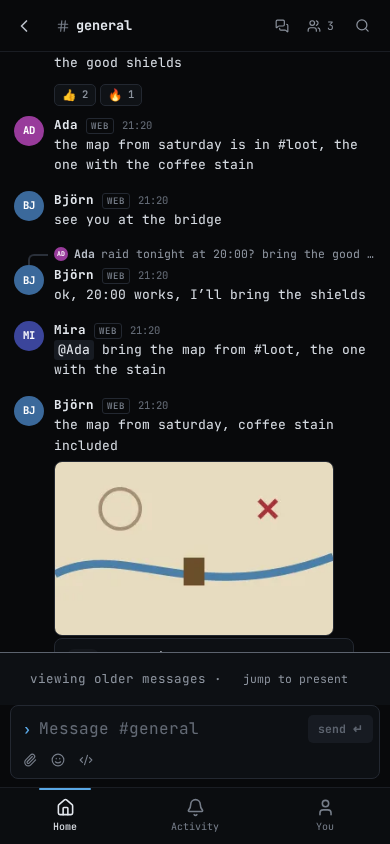

On a phone, tap a message to show what you can do with it (**react**, **reply** and **reply in thread**); tap it again, or scroll, to hide them.

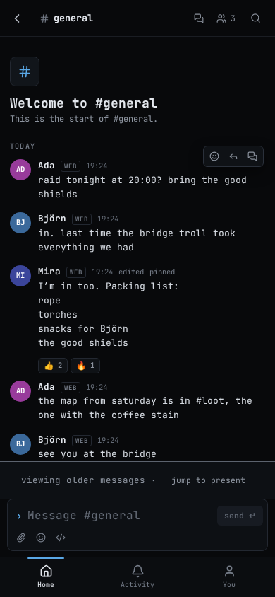

Sheets (the member list, a thread, a pin list) open over the screen too, above the tabs, and the phone's back button
closes the sheet first. Tapping a tab closes the sheet and opens that tab. Escape closes a sheet with a keyboard.
User and server settings fill the window and hide the tabs. Choose a section from the grouped settings index; **Back to settings** returns to that index, and **Close settings** returns to the screen you came from. An ongoing voice session continues, with incoming-call controls and **Return to call** inside settings.

### The call bar

While you are in a call, a bar sits above the tab bar on every screen except the call itself. It shows where the
call is, and three buttons: the wide one **open the call in {where}**, **mute** and **leave**. Each is at least 44
pixels tall and wide. See [Voice, calls and media files](voice.md#on-a-phone).

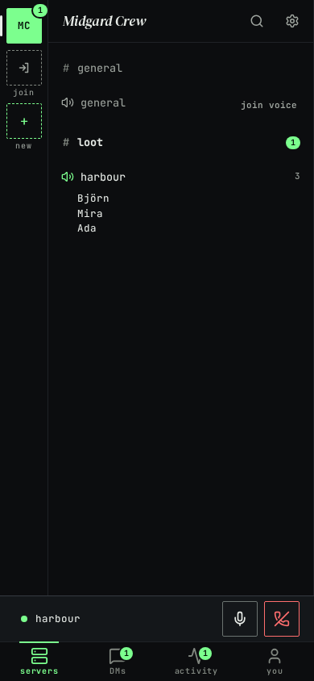

### Sideways, Safari and sharing

- **A phone held sideways** gets the phone layout too: one thing at a time, the three tabs, and the same 44-pixel
  controls. Tablets and short desktop windows keep the desktop layout.
- **A Safari private window** cannot keep dilla's data, so the app says so instead of failing: "This window cannot keep
  dilla’s data". "dilla needs storage that lasts. Private windows and some privacy settings turn it off. Open this
  address in a normal window." No account is made there.
- **Share screen** has no button on a phone whose browser cannot share a screen (iPhones and Android phones cannot).
  Share from a desktop browser.

### Typing, zooming and the home screen

- The message box and every other field are large enough that the page does not jump closer when you tap one. You can
  still pinch to zoom the page whenever you want to read something small.
- When the connection drops, a banner at the top says "Offline. Reconnecting…", or "Connecting to {node}…" while it
  comes back.
- Your browser's "add to home screen" puts a shortcut to your instance on your home screen. It opens dilla in the
  browser the way a link does; it is not an installed app and does not give notifications, which need an open tab.

## 5. When something is wrong

### You are no longer a member

If you were removed from the server while the tab was open, the page moves to your first other server and shows
"You are no longer in {server}." ([What a removed person sees](#what-a-removed-person-sees)). If the page stays on
the channel instead, the next message you send is "not sent" and the message field is blocked with "you cannot post in
this channel and new messages will not arrive. Reload, or ask the host." Ask whoever runs the server for a new invite. Once you have joined again,
reload the page: the channel opens again and new messages arrive. Messages sent while you were out are not
shown.

### A message could not be read

A message this browser could not decrypt is shown as "This message could not be read on this device." with
a short code (for example `E_CORE_MLS`) instead of its text. Nothing in this version can recover it.

### Other messages

| The app shows | What to do |
|---|---|
| "This channel did not open" | **try again**; the code in brackets says what failed |
| "This server did not load ({code})." | **try again** in the channel list |
| "That did not work ({code}). Try again, or reload the page." | Dismiss it and try again, or reload |
| "This server needs a newer client. Reload the page." | A tab left open from before the instance was upgraded shows this with a **reload** button. It keeps your draft: the page saves what you were typing and where you were, reloads, and puts them back. Tabs from before web-3.8 need it once |
| "dilla could not start" | **Reload** |
| "Too many attempts from this network." | Wait as long as it says, then try again |

## 6. Use your account in a second browser

You need three things: your username, your password and the recovery key you wrote down at sign-up. The
sign-in has four steps, in this order: your username and password, then your second factor (a code, a passkey or a
backup code), then your recovery key, then done. The recovery key comes last on purpose: the password and the code say
who you are, and the key is what adds this browser to your account, so nothing is added until you give it. The key is
never written to the browser's storage.


On the new browser, open the instance's address and choose **Use an existing account** under the invite
field. The instance offers it only when it takes password logins. An instance that takes no new accounts
still shows the button.

### Step 1 of 4: Sign in to {instance}

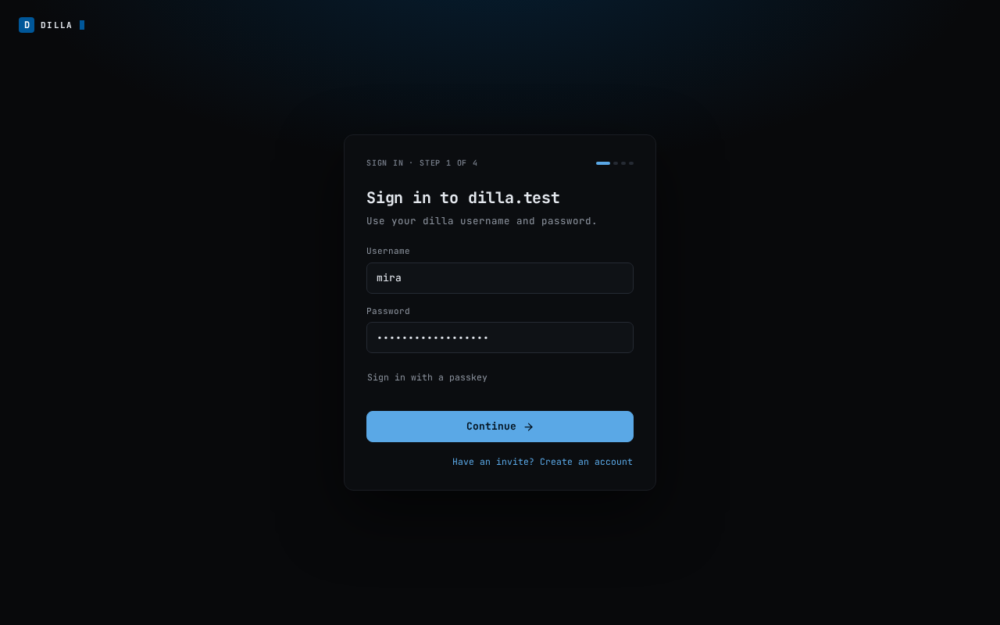

"Use the username and password of your account on {instance}." **Continue** checks them ("Checking…"). A
wrong pair says "That username and password did not work." and empties the password field. **Create a new account
instead** goes back to the sign-up.

Under the password, **Sign in with a passkey** (shown when this browser and the instance can use passkeys) signs in
with a passkey instead of the password; it goes to step 3, the recovery key, or to step 2 when the passkey did not
check that it is you.

An account that has no second factor (one from before web-3.6, or one reset by the operator) goes from step 1 to
the recovery key, as step 2, and then to "Add a second factor" as step 3; see [Second factor](#second-factor). There is
no skip.

### Step 2 of 4: Your second factor

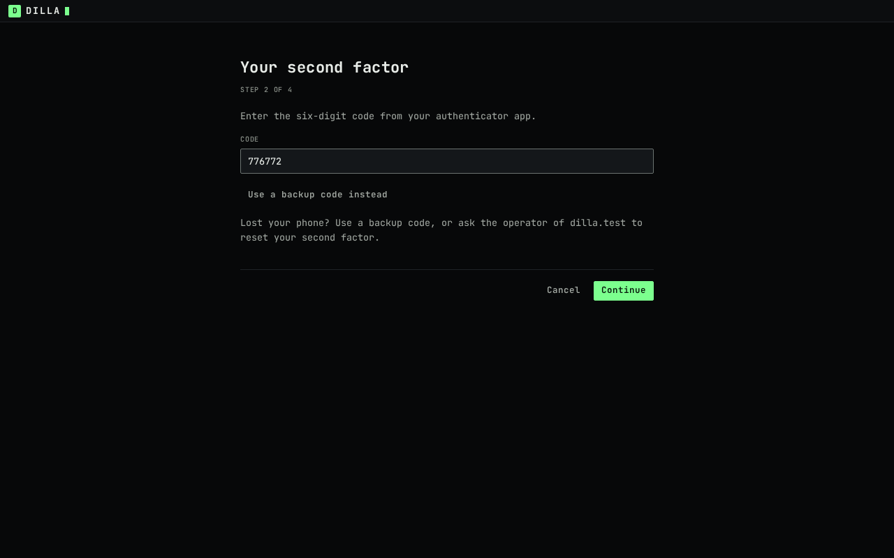

For an authenticator app: "Enter the six-digit code from your authenticator app." A wrong code sends you back to
step 1 with "That code did not work. Sign in again with a fresh code.", because the instance has used up that login;
type the password again and then a new code. A right code goes on to the recovery key.

For an account whose factor is a passkey, step 2 is "Use your passkey": "This account signs in with a passkey. Your
browser asks for it when you continue." The button is **Use passkey**. If the passkey did not check that it is you,
the screen asks for your code as well: "This passkey did not check that it is you, so {instance} also asks for your
code." A passkey the instance does not know says "{instance} does not know this passkey. It may belong to another
account or another server."

**Use a backup code instead** replaces either with one of your backup codes: "Type one of the backup codes you saved
when you added your second factor. Each code works once." The page keeps the code until the last step and does not
use it up before: it is checked, and spent, when you give the recovery key. A backup code does not replace the
recovery key. A code that did not work says "That backup code did not work. Sign in again and try another one." and
takes you back to step 1. Under the code form: "Lost your phone? Use a backup code, or ask the operator of {instance}
to reset your second factor." After a backup code, step 4 says "You have {count} backup codes left. Make new ones in
Settings, under sign-in."

### Step 3 of 4: Your recovery key

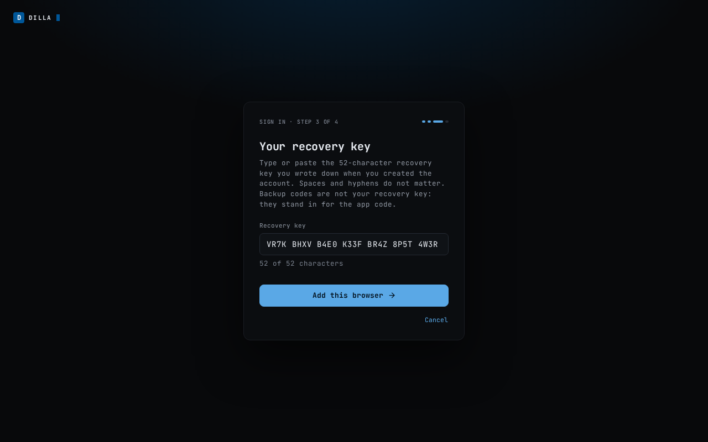

"Type or paste the 52-character recovery key you wrote down when you created the account. Spaces and hyphens do not
matter. Backup codes are not your recovery key: they stand in for the app code." The line under the field counts
what you typed ("{n} of 52 characters"); **Add this browser** works once it reads 52 ("A recovery key has 52
characters."). A key that cannot be a recovery key is refused before anything is added to your account, and a key of
another account once the instance has answered; either way this step shows again with what you typed and "This is
not the recovery key of this account. Check every character." Adding the browser says "Adding this browser to your
account…". **Cancel** goes back to the sign-up.

If you type a backup code here, the step recognises it: "That looks like a backup code, not the recovery key. This
step needs the 52-character recovery key you saved when you created the account." A backup code is not the recovery
key ([Backup codes are not the recovery key](#backup-codes-are-not-the-recovery-key)).

You have five minutes from the second factor to give the key. If reading it off paper takes longer, the sign-in runs
out: "Adding this browser took longer than 5 minutes, so the sign-in ran out. Sign in again." You land on step 1, and
nothing was used up, not even a backup code.

### Step 4 of 4: You’re in

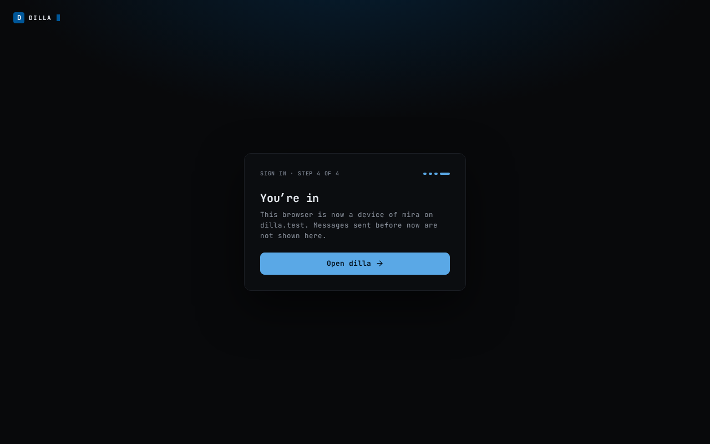

"This browser is now a device of {username} on {instance}. Messages sent before now are not shown here."
**Open dilla** opens the app. The new browser sees new messages, not what was said before it joined.

### If the sign-in stops

| The page shows | What it means and what to do |
|---|---|
| "This is not the recovery key of this account. Check every character." | The key is wrong (a typo, or another account's key). Correct it and continue |
| "Adding this browser took longer than 5 minutes, so the sign-in ran out. Sign in again." | The five minutes after the second factor ran out while you read the key. Sign in again from step 1; nothing was used up |
| "Someone else is signing in to this account. Change your password from a device you still have, or ask the operator." | Another sign-in with your password took this browser's place before it was added. If that was not you, someone else has your password. The web client cannot change a password yet, so tell whoever runs the instance; meanwhile your other browsers keep working, and a device that signed in with the password alone cannot read anything. You land on step 1 or on the first page; sign in again once it is sorted out |
| "The account’s devices changed while you were signing in. Sign in again." | Another of your browsers changed the account's devices meanwhile. This browser's data was cleared; start again from **Use an existing account** |
| "This account already has as many devices as {instance} allows. Remove one in Settings on another device first." | Remove a device in Settings → Devices on a browser you still have, then continue |
| "Too many sign-in attempts. Try again in {seconds} s." | Wait that long, then continue |
| "This browser cannot use passkeys here. Use a backup code instead, or sign in from a browser that can." | The account's factor is a passkey and this browser cannot run one at this address. Type a backup code, or use another browser |
| "This account has no backup to recover from on {instance}. Sign in on a device that still holds this account and open dilla there; it repairs the backup. Then try again." | Open dilla in a browser that already holds the account and let it connect; then sign in here again |
| "The connection dropped. Check it and try again." | Check the network and continue |

## 7. Devices

Open **settings** in the server rail, then **devices**. "Every browser and app signed in to your account.
Removing a device needs your recovery key." Each row is a device, named by the name you gave it or, without one, by the first eight characters of its
id, with the tag "browser" or "app" and when it was last seen. The row marked "this browser" is the one you
are using. "not yet in the device list" marks a device that signed in with your password but was never
added; "removed" marks one that was removed. **refresh** reads the list again.


- **remove** on another device: "Remove this device?" "The device is signed out everywhere and leaves every
  conversation. Enter your recovery key to confirm." **Remove** does it. A wrong key says "This is not the
  recovery key of this account." A device that is "not yet in the device list" is removed without the key:
  "This device signed in with your password but is not in the device list, so it cannot read anything.
  Removing it needs no recovery key."
- **rename**: every device that is not removed has one. "Name this device" starts this browser on a suggestion such as
  "Firefox on Linux" and another device on its current name. Under the field, "The server can change it, so check a
  device by its id before you remove it." and a quiet line "The server can read this, like your display name."
  **Save** stores it (up to 64 characters), and saving an empty field clears the name. A named device shows its name
  with the first eight characters of its id beside it, and the remove dialogs show both. Your other devices see the
  new name after **refresh**.
- **sign out and remove this browser**: "This browser is removed from your account and its data here is
  cleared. You can sign in again later with your password and recovery key. Enter the key to confirm."
  **Sign out** removes it and reloads to the first page.
- **forget this browser**: "This clears dilla’s data from this browser and signs it out. The device stays in
  your account’s device list until you remove it from another device." No key is needed. Remove the row from
  another browser afterwards.

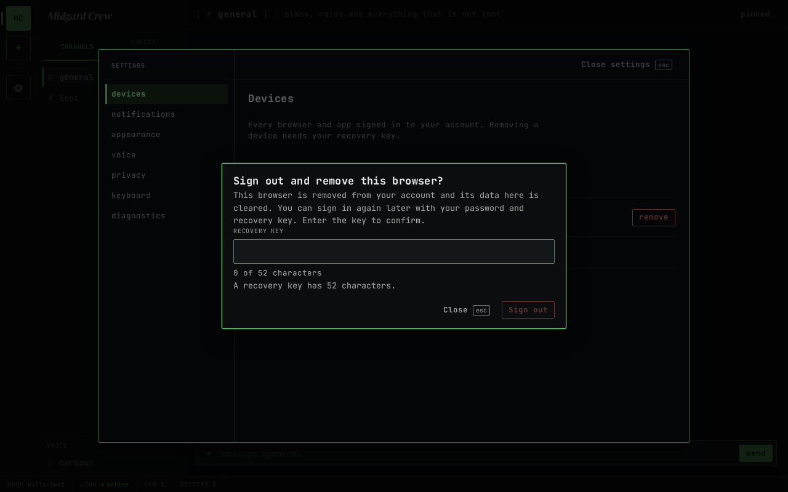

**If the recovery data is not yours.** If the instance holds recovery data that this account did not make,
a red warning stays at the top of the app and of Settings → Devices: "The recovery data stored for this
account on {instance} is not this account’s. The recovery key will not work until the operator resets it."
It cannot be dismissed. Until it goes away, removing a device with the key and adding a browser will fail;
keep using the browsers you have and ask whoever runs the instance to reset the account's recovery data.

**If a device you don't know uses your account.** Your own devices are checked like a contact's. If a device in
one of your conversations uses your account but is not on your device list, a red warning stays at the top of the
app and of Settings → Devices: "A device that is not on your device list is using your account in some
conversations. Sending is paused there. Remove it in Devices." If it presents a different identity for your
account: "A device using your account under a different identity is in some of your conversations. Sending is
paused there. Open Devices and remove any device you don’t recognise." Neither can be dismissed; **Open devices**
goes to this list. There is nothing to compare for your own account: the warning ends when that device is removed.
If you changed your account's identity key from another device, a device still on the old key must sign in again
(section 6).

Settings uses a grouped index on phones and at narrow layouts. Selecting a section opens its page, with **Back to settings** above it. On desktop, the sidebar and content scroll independently. Save/Reset stays reachable above the software keyboard.

## 8. Badges, direct messages and notifications


A channel with unread messages shows a count, and mentions have their own count. The server's tile in the
rail counts its unread channels, and the **@** tile counts your unread direct messages: here #loot is unread and Ada has
answered a direct message. Opening a channel or a direct message marks it read. Your own messages, from any
of your browsers, never count as unread.

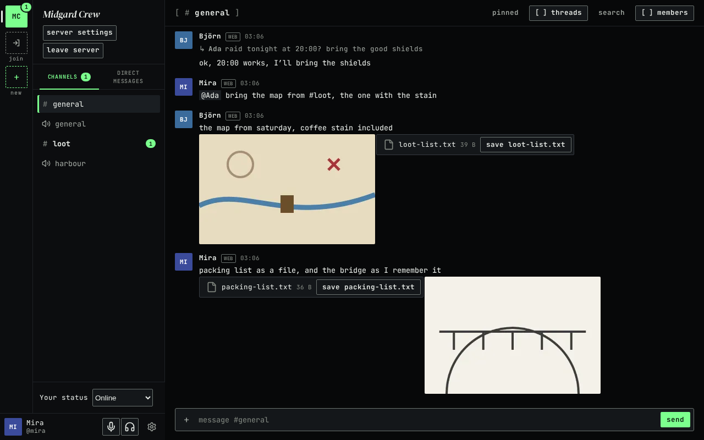

Under the **@** tile, choose **message someone** ("Pick a member of this server."), choose **message** next
to a person and write. A direct message someone else starts appears without reloading. Direct messages stay
reachable when you are in no server, or when a server did not load: the **@** tile is still
there, and the channel list says what is wrong. Starting a new one needs a server, because the list of
people comes from it.

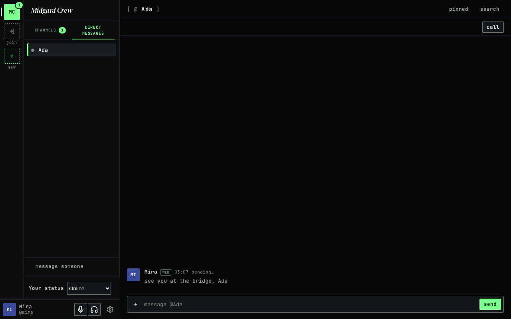

Under **notifications**, "Desktop notifications show while a dilla tab is open. Nothing is shown when every
tab is closed." Choose **turn on** to ask the browser for permission. The default "notify me about" choices
are "direct messages and mentions", "every message" and "nothing". "Per channel" lets you choose "default",
"all", "mentions" or "nothing", and "mute" a channel. A muted channel still shows its mention badge. "Servers" sets
the same for a whole server ([Notifications for a server](#notifications-for-a-server)).

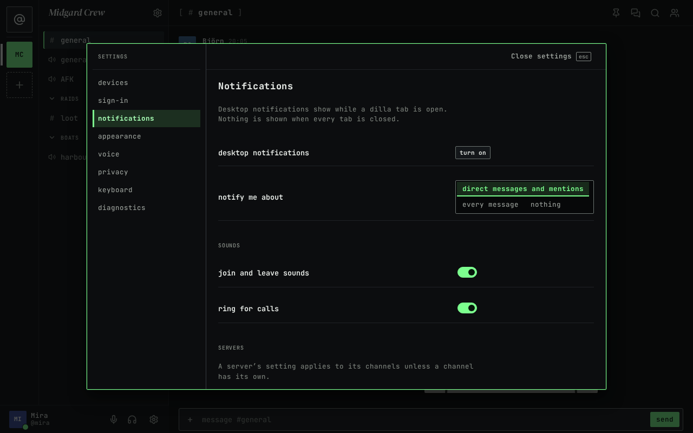

## 9. Saying more

A message can be edited, deleted, answered, reacted to and pinned, it can mention people, and it can carry images
and files. This works the same in channels and in direct messages.

### The message toolbar


Point at a message, or move to it with the keyboard, and its toolbar appears ("actions for this message"):
**react**, **reply** and **pin** (**unpin** on a pinned message), and on your own messages also **edit** and
**delete**. A change shows once it has gone through; until then the message says "saving…", and a change that
could not be made says "not saved" with **retry** and **discard**.

### Edit

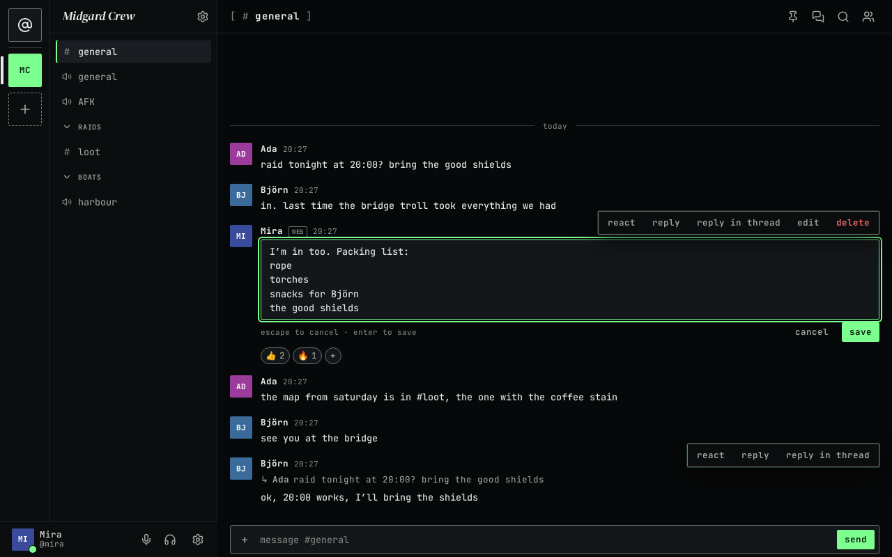

**edit** opens the message in place ("edit your message"); Arrow Up in an empty message field does the same for
your last message. Enter saves, Shift+Enter starts a new line, Escape cancels ("escape to cancel · enter to save").
An edited message shows "edited". Only the latest version is shown; there is no history of earlier ones. An edit
never notifies anyone, even when it adds a mention. You can edit your messages from any of your browsers, and
nobody else can edit them.

### Delete for everyone

**delete** asks first: "Delete this message?" "It is removed for everyone in this conversation, with its reactions
and files. Copies someone already saved stay with them. This cannot be undone." **Delete** removes the message
from every device in the conversation, also from devices that come online later, and the instance deletes its copy
of the message and the message's files. Where the message was, the conversation shows "message deleted". A delete
cannot reach a copy that someone saved or a screenshot someone took. Only the author can delete a message; there is
no moderator delete in this version. If the browser you deleted from leaves the conversation before it has asked
the instance to delete its copy, the instance keeps that copy until the browser rejoins or the instance's
retention removes it.

### Replies

**reply** puts "replying to {name}" and the start of that message above the message field; **cancel reply** or
Escape takes it away. The reply is shown with a line that names the original's author and its first words.
Selecting that line ("go to the original message") scrolls to the original and highlights it for a moment (with
reduced motion, an outline instead of the animation). When the original is further back than what is loaded:
"The original message is further back. Load earlier messages to reach it." When this browser never had it or
cannot read it: "the original message cannot be shown here". When it was deleted: "the original message was
deleted".

### Formatting a message

A message can use a few markdown marks. They are shown when you read the message; the box where you write, and
the editor, always show what you typed.

- `**bold**`, `*italic*` or `_italic_`, and `~~struck through~~`.
- `` `code` `` inside a line, and a block between two lines of three backticks.
- `> ` at the start of a line makes a quote.
- A web address that starts with `http://` or `https://`, or an email address written `mailto:name@example.com`, becomes
  a link. It shows the address it opens (a name with letters outside a to z is shown in its `xn--` form, so a lookalike
  cannot pass for the real site) and opens in a new tab. dilla never loads the page by itself. A `mailto:` link is the
  bare address; anything after a `?` is not linked.
- A backslash before a mark (`\*`) shows the mark as it is. A mark that is never closed is shown as typed.
- Anything else stays as typed, including raw HTML and `[text](address)`. Other kinds of address, such as
  `javascript:`, are never links.

Mentions still work inside bold or a quote, and not inside code.

### Reactions

**react**, or **add a reaction** under a message that already has reactions, opens "pick a reaction": 32 emoji in
a grid. The arrow keys move, Enter picks, Escape closes. Each reaction shows its emoji and how many people chose
it; yours is highlighted, and selecting it again takes yours back. Each person counts once per emoji, whichever of
their browsers they use.

### Pins


**pin** pins a message for everyone in the conversation, and it shows "pinned". **pinned** in the channel header
opens "Pinned in #{channel}" ("Pinned with {name}" in a direct message): each pinned message with its author, its
time, its first words and "pinned by {name}", with **go to message** and **unpin**. With nothing pinned it says
"Nothing is pinned here yet." In a channel, who may pin follows the pinner's current right ([Pins, @everyone and @here](#pins-everyone-and-here)); the
list says who pinned each one.

### Mentions

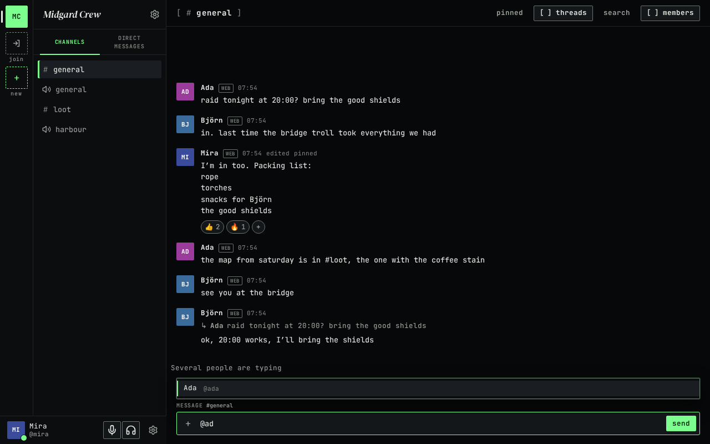

Type `@` and the first letters of someone's username or display name: the list ("people to mention") offers up to
eight members who match and, in a channel, "everyone in this channel". Arrow Up and Arrow Down move, Enter or Tab
picks, Escape closes the list. Typing a member's whole `@username` works too. The message carries the person, not
the text you typed, so it always shows their current name. A message that mentions you is marked, counts in the
mention badge and notifies you as your notification settings say (section 8). `@everyone` mentions everyone in the
channel; typing `@here` does the same (the client does not know who is online, so it offers no separate entry);
direct messages offer neither. A mention of a role shows as the role's name and counts as a mention of you once this browser has loaded the
server's member list ([Role mentions](#role-mentions)). A mention of a person is a button: click it, or Tab to it and press Enter, to open
their profile card ([Members](#members)); role mentions and @everyone are not.

### Images and files


**attach files** next to the message field, dropping files on the conversation ("Drop to attach", "Up to 4 files,
25 MB each.") or pasting them into the message field adds them to "files to send". Each file goes through
"reading", "preparing", "uploading" and "ready", or shows "failed ({code})"; **remove {name}** takes it off the
list. A message carries at most four files ("A message carries at most 4 files."), each at most 25 MB
(26,214,400 bytes) in a browser ("{name} is over 25 MB and cannot be sent from a browser."). The message goes when
every file is ready ("Wait until every file is ready, or remove it."), with or without text. Files are uploaded
as soon as you add them and become part of the conversation only when the message is sent; a file that is never
sent is removed by the instance after a while (after 24 hours, unless the instance is set otherwise). If a file
you attached is no longer on the server when the message is sent (an upload left for more than a day), the
message says so and offers only discard; attach the file again.

PNG, JPEG, WebP and GIF images show as a small preview made by the sender's browser ("open {name}"). Audio and
video files of the common types play in the conversation with **play {name}** ([Audio and video
files](voice.md#audio-and-video-files)). Every other file, SVG included, shows as a card with its name, its size and
**save**.

A GIF plays in the conversation for five minutes after you first see it; open it to watch it again. With reduced
motion, GIFs stay still until you open them. A GIF that is standing still carries a small "GIF" mark.

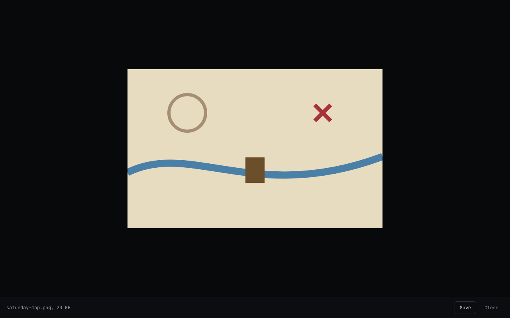

Opening an image shows it full size: **previous image** and **next image** (Arrow Left and Arrow Right) move
between the images of the same message, **Save** saves it, **Close** or Escape closes it. A received file over
25 MB shows "too large to open in a browser"; one that could not be opened shows "could not open ({code})". The
browser downloads a file each time you open or save it and keeps no copy of opened files; the small previews come
with the message. When a message with files is deleted, its files are deleted from the instance too.

### GIFs

When the server's managers have entered a Giphy key (server settings → GIFs, "GIFs (Giphy)"), a **gif** button
(named "add a gif") sits next to **attach files** in that server's channels. It opens a small picker above the message
field: type to search (or leave it empty for what is trending), use the arrow keys or Tab to move over the results, and
press Enter, Space or click to pick one. **more** loads the next page. The footer says "Powered by GIPHY". Escape closes
the picker and puts focus back on the **gif** button.

The results are a grid of three columns (two on a phone), each GIF shown whole at its own proportions, so tall and wide ones sit
side by side without being cropped. Arrow Left and Arrow Right go through them in reading order, Arrow Up and Arrow Down to
the one above or below.

Picking a GIF adds it to "files to send" like any file you attach, named `giphy-{id}.gif`, and puts focus in the message
field; press Enter to send it, with or without text, or **remove** it. Nothing is sent until you do.

Known limits: there are no GIFs in direct messages, and a thread's reply box has no **gif** button.

For a server manager: in server settings → GIFs, the "GIFs (Giphy)" row takes the server's Giphy API key (get one at
developers.giphy.com). Type it, press **save**, and it shows as dots from then on: the key is never shown again, only
**replace** (type a new one) or **remove**. The **rating** select (pg-13 by default) limits what search returns.

Two things to know about privacy. Your searches go to {instance}, which asks Giphy for you using the server's key, so
Giphy sees the instance and not you; the instance itself sees what you search for and which GIF you pick. The GIF is
downloaded by the instance and sent to the conversation as an ordinary file, protected like any other, so the people who
read it never contact giphy.com.

### Keys in the conversation

| Key | What it does |
|---|---|
| Arrow Up, Arrow Down | In the messages: move to the previous or next message; the toolbar of that message appears |
| Home, End | In the messages: the first or last loaded message |
| Tab | From a message: its toolbar, its reply line, its files and its reactions, in that order |
| Arrow Left, Arrow Right | In a toolbar or in the reactions: the previous or next button. In a full-size image: the previous or next image |
| Escape | In a toolbar, the reactions or a file: back to the message. On a message: to the message field. In the message field: closes the mention list, or else cancels the reply |
| Arrow Up | In an empty message field: edits your last message |
| Enter, Shift+Enter, Escape | While editing: save, new line, cancel |

## 10. Privacy, search and settings

### Profile

Settings → **profile** is the first section. It has three fields: **display name** (up to 64 characters, and never empty),
**status message** (one line, up to 190 characters) and **bio** (up to 500 characters, with line breaks). **save** is
disabled until something changes, and it sends only what you changed; emptying the status message or the bio and saving
clears it, and spaces at either end are dropped. Text the server would refuse is named under its field as you type or paste:
"That has characters dilla can’t show." (a tab, an invisible or direction-changing character, or a line break in the status
message), "Too long.", or "Write something, or leave it empty." for only spaces; **save** stays disabled until it is fixed,
and again after a save until you change something. "Profile saved" confirms it, and your name, status and bio change at once in the member list and on your
profile card. If the save fails, "Could not save your profile. Try again." shows and what you typed stays.

The status message shows on your profile card after the presence word, and the bio shows under your name, with its line
breaks. Both show to everyone who shares a server with you. They are stored readable by the server, like your display name,
and are not end-to-end encrypted: do not put anything in them that the host should not read. A quiet line under each
of the two fields says so: "The server can read this, like your display name." There is no picture yet.
Other people's changes show in your member list the next time it is read, which is when you reload or open the server.

### Contacts and safety numbers

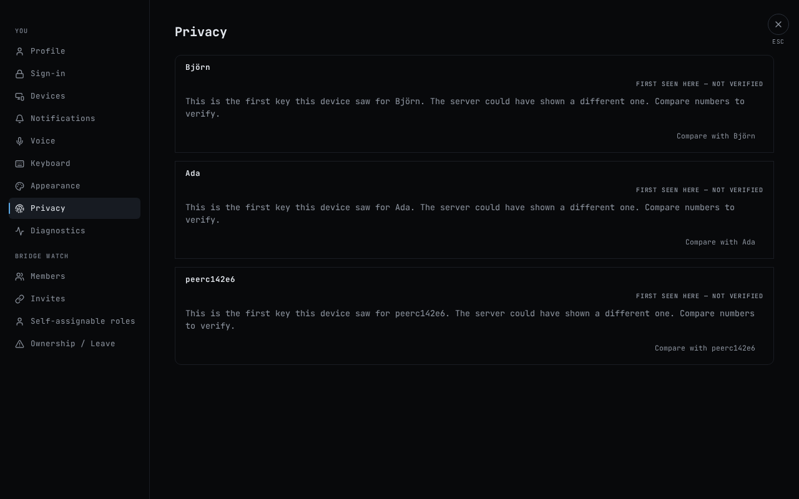

Before this browser shows a message, it checks that the device which sent it is on its owner's signed device list.
The first key it sees for a person is kept as that person's key. **Settings → privacy** lists the people you share
a conversation with:

- "First seen here — not verified": "This is the first key this device saw for {name}. The server could have shown
  a different one. Compare numbers to verify." First sight is not verification: an instance can show this browser a
  different key, or hold back a newer device list, the first time it meets a person, and nothing here can tell.
- "verified": you compared numbers with this person.
- "This device is not on the contact’s list.": a device of this person is not on their list, or their list could
  not be read yet. Its messages are not shown, and there is no **Compare** until the list is read.

Verification belongs to this browser: a second browser of your account keeps its own list and starts again at
"First seen here — not verified".

To verify someone:

1. Open **Settings → privacy** on your device, and ask the other person to do the same on theirs.
2. Press **Compare with {name}**. "Compare safety numbers" shows a number of 12 blocks of five digits ("Working out
   the number…" while it is worked out). The person's exact public key is behind "public key", closed at first; the
   12 blocks are what you compare.
3. Read the 12 blocks to each other "in person or on a call you started yourself": a voice call that one of you
   started independently, not a link or a message the instance delivered. **Copy number** only copies it; copying
   approves nothing.
4. Only when all 12 blocks match, tick "Yes, all 12 blocks match" and press **All 12 blocks match**. The dialog
   closes and the person shows as "verified" with the key you compared. **Close** leaves without approving.

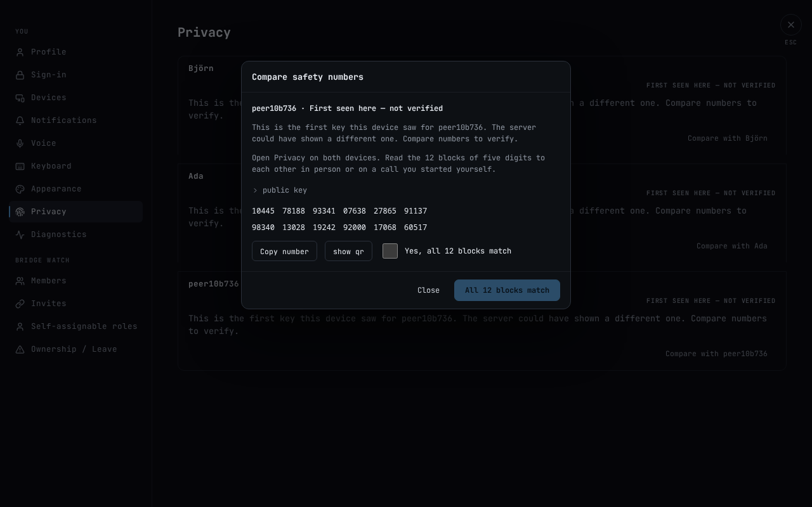

If the key changes while the dialog is open, it says "The key changed while you compared. Close this and compare
the new number." and approves nothing.

A number needs a conversation you share: for someone you share none with, Privacy says "Open a conversation with
this person to compare numbers." and shows no number.

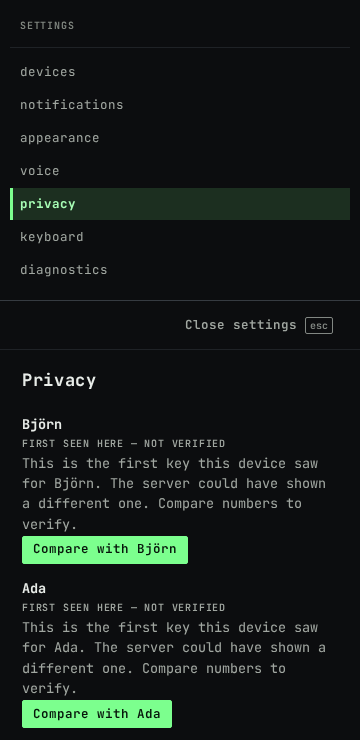

### When a contact's identity changes

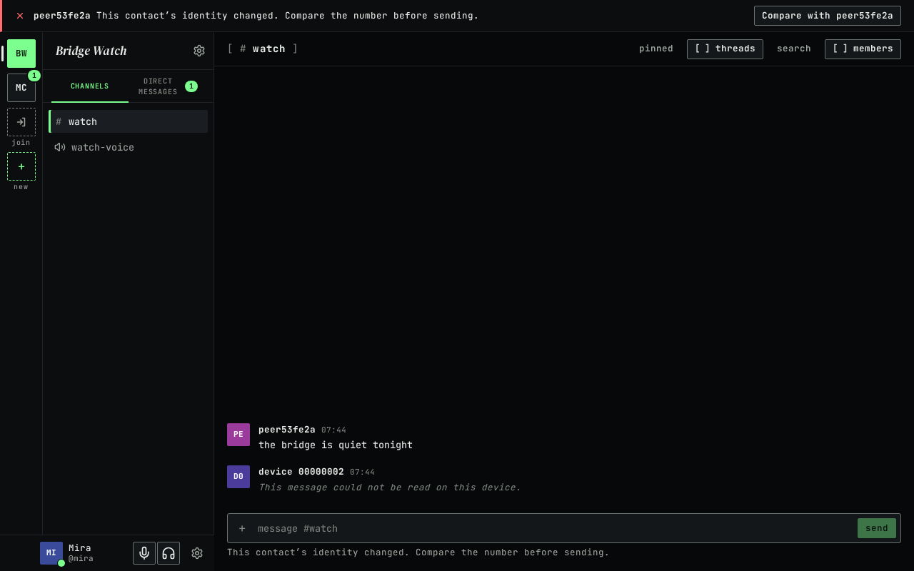

When a contact's identity key changes, the conversation shows the alert "This contact’s identity changed. Compare
the number before sending." and the message field (and attaching files) is blocked with the same words in every
conversation you share with that person. Nothing you received before is removed. What they send under the new key
waits, and shows once you compare the new number and approve it. Sending in a conversation starts again when you
compare the new number (the steps above), or, in that one conversation only, when that person's changed device is
removed from it ("You can send in this conversation after this member leaves. Their changed identity is still
unverified elsewhere."). The alert's button opens Settings → privacy; pick **Compare with {name}** there.

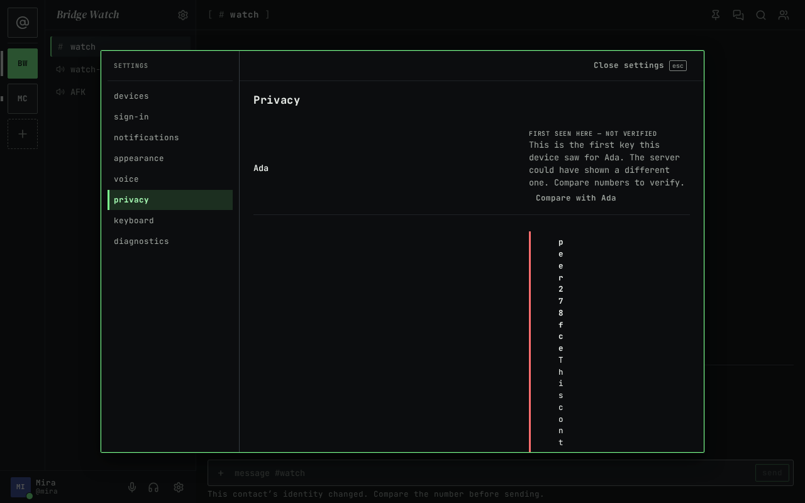

If no device list shows the new key, there is nothing to compare yet: the alert says "This contact’s identity
changed, but no device list shows the new key, so there is nothing to compare yet. Sending is paused where their
changed device is a member until it’s removed." and has no **Compare**.

A device that fails the checks pauses sending in the conversations that hold it: the message field says "A device in
this conversation failed the identity check. Sending is paused here until it’s removed."

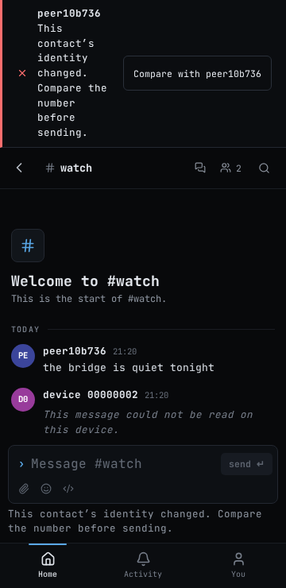

### Search

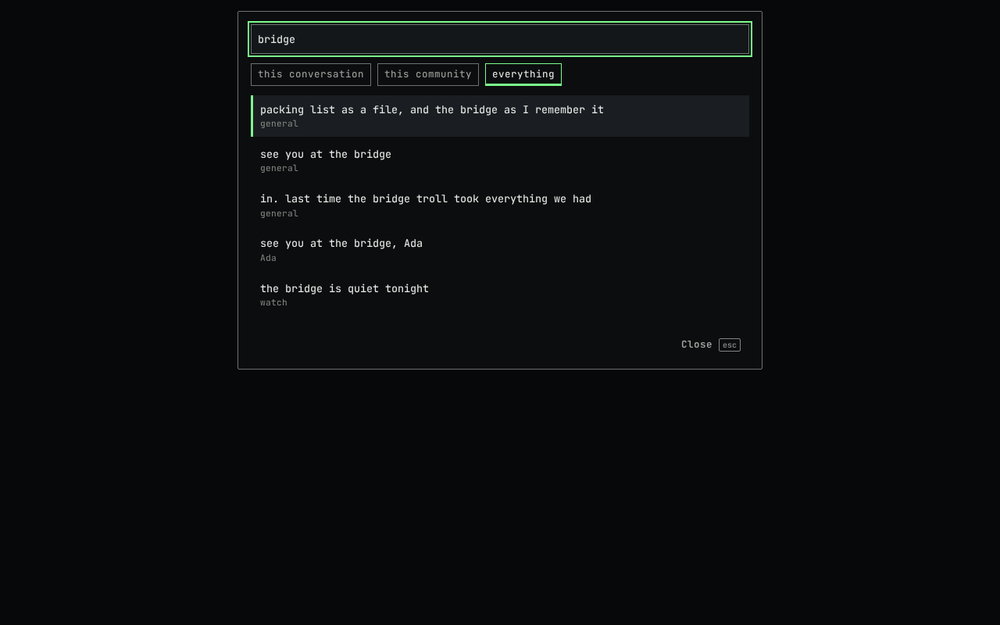

Search opens as a window over the app. It looks only through the messages this browser holds and has decrypted; nothing is
sent to the instance. Each result shows the #channel (or the person, in a direct message), the author and the time, with
the message under them.

1. Press **Control+K** (⌘+K on a Mac) for "everything", or **Control+/** in a conversation for "this conversation".
2. Type into "Search your messages". The scope buttons are "this conversation", "this community" and "everything".
3. Arrow Down and Arrow Up move through the results while the cursor stays in the field; Enter or a click opens the
   message and puts the focus on it. The window's footer reminds you: arrows to move, Enter to open, Escape to close. Escape
   closes search from anywhere in it, and gives the focus back to where it was. While search is open, the rest of the app cannot be reached with Tab.

"Searching your messages" shows while it searches, "No results in this scope" when nothing matched, and "That
message is no longer available" when the message was deleted or its conversation is gone. On a computer the **search** icon
in the channel header opens it too, and on a phone the magnifier beside the server's name does.

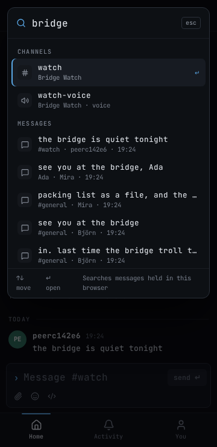

### Appearance

**Settings → appearance** sets the theme: "system", "mesh", "light" or "high contrast". The choice applies at once
and this browser keeps it.

### Keyboard

**Settings → keyboard** ("Keyboard") lists the four shortcuts: "Control/⌘+K" opens search, "Control+/" searches this
conversation, "Control/⌘+Shift+M" mutes or unmutes and "Control/⌘+Shift+D" deafens or undeafens in a call.
There are no single-key shortcuts.

### Diagnostics

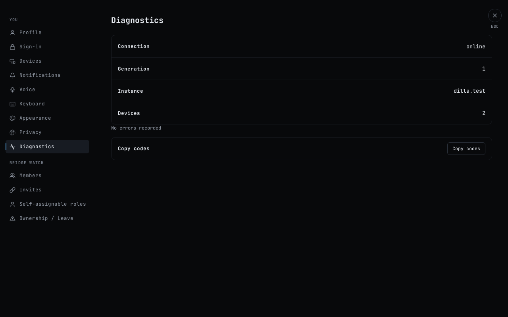

**Settings → diagnostics** shows the connection (online, connecting or offline), the instance's generation, the
instance's name and the number of your devices. A wide screen has no status bar, so these facts live here, and the line
at the top of the app tells you when the link drops. Under them come the codes of the last 20 errors with the time each happened ("No errors recorded" when there are
none). **Copy codes** copies those codes, one per line, and nothing else: no message, key or name, so you can paste
them into a report.

`E_MEDIA_MISROUTE` among them means a person's audio in a call was briefly lost in Firefox and was reconnected
automatically: you heard them again about four seconds after they joined or came back.

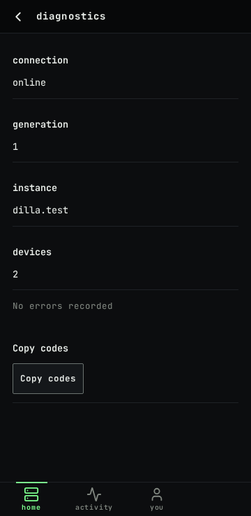

### Typing

While you type in a conversation, the others in it see "{name} is typing", or "Several people are typing". Only the
members of that conversation get it, and it stops a few seconds after you stop typing.

### Two tabs

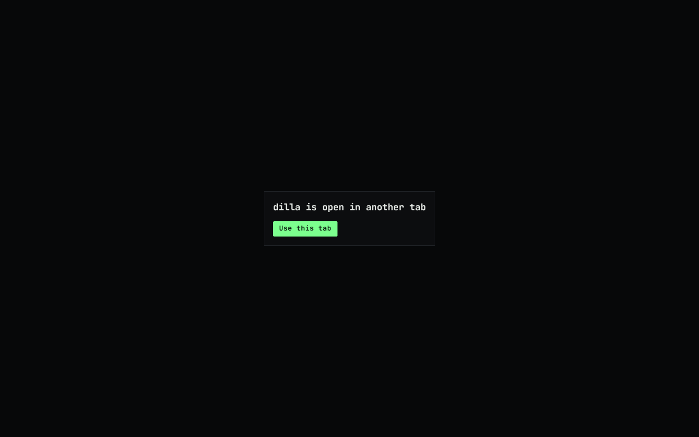

dilla runs in one tab per browser and instance. A second tab says "dilla is open in another tab" and offers **Use
this tab**:

1. Press **Use this tab**. It says "Moving to this tab…" while the first tab finishes its work.
2. The first tab shows "This tab is paused" and "dilla moved to another tab. This tab takes over when that one
   closes, or you can use it here now.", and the app opens in the new one.
3. If the first tab does not let go, the new one says "Close the other tab, then try again." and its button tries
   again (it is labelled **Use this tab** too).

If the first tab is in a voice channel or a call, **Use this tab** asks first: "You are in a call in the other tab.
Using this tab ends that call." **Keep the call** leaves everything as it is; **Leave the call and use this tab** moves
the app here, and the call in the first tab ends.

The paused tab shows nothing of your conversations. Its own **Use this tab** moves the app back to it the same way,
and when the other tab closes it takes over by itself.

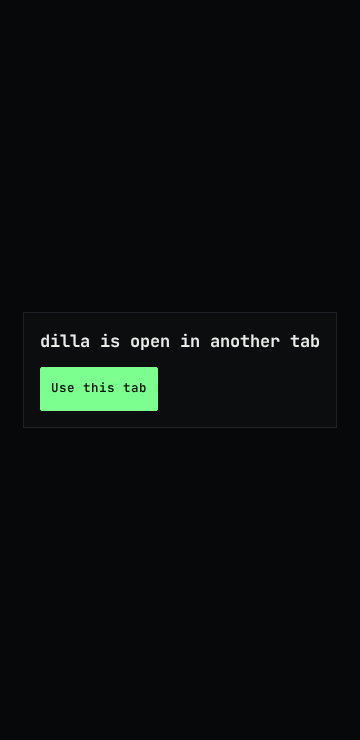

## 11. Known limits (2026-10-21)

- No native phone or desktop app (on a phone, the web client has [its own layout](#on-your-phone)). A second browser needs the recovery key and the password, and the second factor
  every account has (a code, a passkey or a backup code). The factor guards signing in on a new browser, not message
  content, and a browser that is already set up is not asked again. A new browser does not get messages from before it joined. A device name is stored readable by the server,
  which could change it (see [Devices](#7-devices)).
- A profile is a display name, a status message and a bio, with no picture, and the server reads all three
  ([Profile](#profile)). In direct messages the profile card offers only message and compare safety numbers. A former member's mention opens a card only while one of their messages is held in this browser. Invite links are made under server settings → invites, with the expiry and
  uses you choose ([Run your server](#run-your-server)). A ban cannot be changed once made, only lifted, and a kick or
  ban gives no way to tell the person why.
- Roles and private channels: the host refuses posts from people without **send messages** and enforces slow mode, but
  pins and mentioning everyone are checked only by members' apps, and the role view is not verified by the group
  ([Who checks the rules](#who-checks-the-rules)). People who gain a channel see only messages sent after they join
  it. Five permissions have no effect yet ([Permissions that do nothing yet](#permissions-that-do-nothing-yet)).
- Tabs open from before web-3.9 must reload: they show "This server needs a newer client. Reload the page." with a
  **reload** button that keeps your draft ([Other messages](#other-messages)).
- Threads show their first 200 replies, a thread cannot start on a reply, and there is no unread count for a thread on
  its own.
- Voice, calls and audio and video files have limits of their own: see [Voice, calls and media
  files](voice.md#known-limits).
- No link previews, custom emoji or emoji in the message text; reactions use a fixed set of 32.
  Only the latest version of an edited message is shown. A browser sends and opens files of at most 25 MB, and
  plays only the listed audio and video types. Received link previews are not shown.
- Pins and mentions are checked only by members' apps ([Who checks the rules](#who-checks-the-rules)). Five
  permissions have no effect yet. Only the author can delete a message.
- Your status is shared only inside the servers you are in. Notifications require an open tab and browser permission.
- Search finds only text this browser holds, never files.
- Messages from before this browser joined a channel are not shown.
- The first key seen for a person is trusted as first seen until you compare numbers, and an instance can hold back
  a newer device list at that moment. Numbers are compared by reading them aloud (the QR code is shown for reading, nothing scans it), and there is no number for
  someone you share no conversation with. Privacy shows no date for a verification. Verifications belong to the
  browser that made them: your other browsers start again at "First seen here — not verified".
- If your account's identity key changes on another device, a device still on the old key shows the "different
  identity" warning in your conversations and must sign in again (section 6); it cannot be compared.
- After a reload, Privacy forgets that a changed contact left a conversation (the contact still shows as changed
  until you compare), and the changed-identity alert opens Privacy rather than the comparison itself.
- No Electron desktop app, no server-readable channels, and no settings shared between your browsers (each keeps
  its own). A second tab never shows the first tab's conversations.
- If the page is reloaded while the account is being created, the account is finished but the server the
  invite named is not joined; paste the invite into **Join a server**.
- Tested with Chromium and Firefox, and with WebKit for sign-up and reload; Safari itself has not been
  verified.

## Re-shooting these screenshots

The screenshots are real: `e2e/scripts/shoot-docs.mjs` starts a `dilla-testhost` that serves the built
client, with no account, server or channel in it. Ada signs up with the host's bootstrap invite and, through the
client alone, starts the server "Midgard Crew", adds #loot and the voice channel "harbour" and makes an invite link;
those screens are shot at 1280×800 and at 360×740. Björn and mira sign up through that link in two more Chromium
profiles, and the three
reply, react, edit, pin, mention and share images and files in #general; the script signs mira into a fourth browser (username and password, then
her code, then the recovery key), and photographs the flows. For section 10 a native test peer (the `dilla-testkit`
binary) makes the server "Bridge Watch", which mira joins, and later changes its identity key; Privacy, the comparison,
the changed contact in the conversation, search, diagnostics and a second tab are shot at 1280×800 and at 360×740.
The test peer has no display name of its own (the testkit driver cannot set one), so it shows as its username
"peer…". For [Voice, calls and media files](voice.md), ada calls mira in their direct message, björn shares an
audio file, the three join the voice channel "harbour" with Chromium's fake microphone, and the test peer's changed
identity refuses mira's join to "watch-voice"; those six states are shot at both sizes too (the call panel on the desktop only: a phone has the call bar instead). For web-3.9 ada makes the categories Raids and Boats and sets the inactive timeout (server settings), mira opens Home, taps a
message on the phone, goes AFK (the AFK row then lists her as away) and shoots the dock, the member list and a header tooltip. For web3.10 mira then opens Björn's profile card from the member list, and the dock and the member list are re-shot with the new rows. For web-3.8 ada also shares her screen, and mira's stage is shot with it large and as a grid at 1440×900; the channel list is dragged wider and reset, and the browser goes offline for a moment to show the link line, both at 1280×800. The images of [On your phone](#on-your-phone) are shot at 390×844, a
common phone size, from the same session: the home tab, a channel, the activity tab and the call bar. The own-account
warnings of section 7 need a device of mira's account that no browser can make, so they are
quoted, not shown. Every name and
message is made up, and the accounts are deleted with the test host. Every person sets up an authenticator app at sign-up, with codes computed for the test host's clock, and
mira's second browser takes her code at step 2 of the sign-in; the passkey screens, the forced "Add a second factor"
screen and the dialogs of Settings → Sign-in need a passkey or a reset account and are quoted, not shown. The two
warnings of sections 6 and 7 that need a second sign-in at the same moment or foreign recovery data are quoted, not shown. For "What a
removed person sees" the script removes mira on ada's authority through the instance's own route (the test host's
`/debug/kick`), not through the member list. To re-shoot them (not part of CI):

```sh
cargo build -p dilla-testkit --release --locked
bash core/dilla-core-wasm/build-wasm-pkg.sh
npm run build -w @dilla/web
npm run build:harness -w @dilla/client-core
GO=/path/to/go npm run docs:shots -w @dilla/e2e
```

It needs `internal/mlswasi/testdata/dilla_core_wasi.wasm`, `target/release/dilla-testkit` (`cargo build -p
dilla-testkit --release --locked`, or `DILLA_TESTKIT=/path`) and Playwright's Chromium, uses
127.0.0.1:8471 and 8472 (`node e2e/scripts/shoot-docs.mjs --port P --control C` picks others), with the host's
LiveKit on 7888 and 7890, and writes
`docs/user/screenshots/*.png`.

Chromium keeps sockets in its profile directories, so the script needs a short temporary directory: when
`TMPDIR` is a long path, run it with `TMPDIR=/tmp`.


## Fullscreen settings and drafts

Open the gear beside your account on desktop, or **You → Open settings** on a phone.
Search within settings by setting name or a related word such as microphone, password
or Spotify. Search only lists sections you are allowed to use; it does not search
member names, account data or configuration values.

Theme, density, reduced motion, notifications, voice preferences and personal roles
apply immediately. Configuration forms use **Save** and **Reset**. If you leave a
changed form, choose **Keep editing** or **Discard changes**. Reset uses the latest
confirmed values. If part of a server save fails, only the failed part remains to
save. A pending bot request can continue after you leave; acceptance is not a
confirmation that the bot has applied it.

Server settings group server configuration, people, automation and moderation.
Music contains DJ roles, Spotify application configuration and linking, and provider
status. **Authorization received; waiting for the bot** means the authorization
was delivered. **Linked** appears only when the bot reports valid stored credentials
for this installation. It does not confirm Spotify Premium, current token acceptance
or successful playback. Spotify and YouTube playback setup separately report
**Configured**, **Missing requirements** or **Unknown**. Refresh reads the runtime;
observations older than a minute are stale. An older or offline bot may leave status
unavailable while configuration and linking remain usable.

Participant volume and screen-share volume remain beside the participant/share.
Channel collapse and conversation-search scope remain in their contextual controls.
