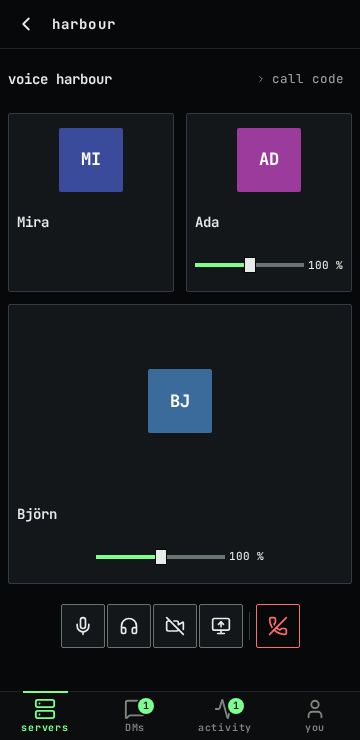
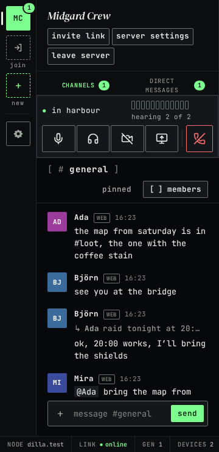
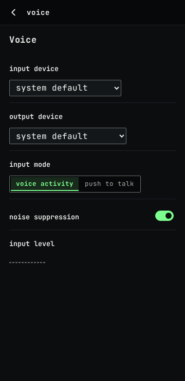
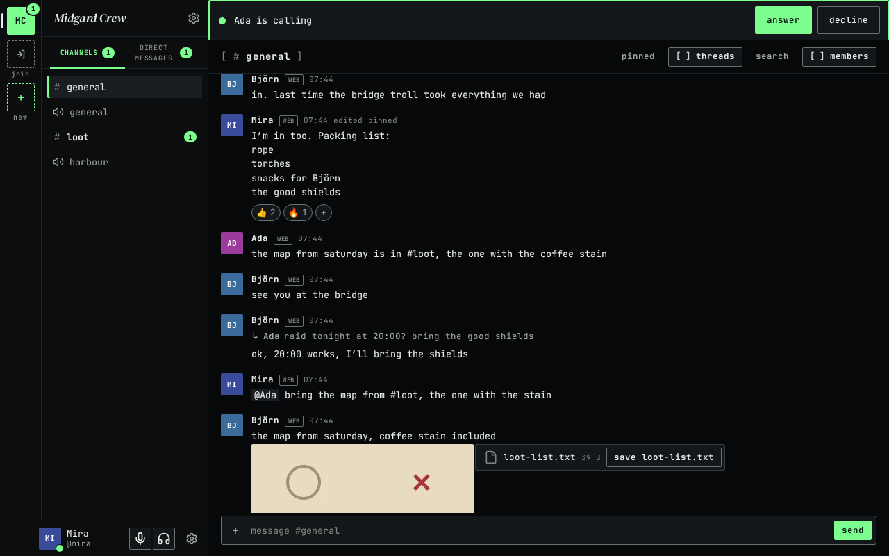
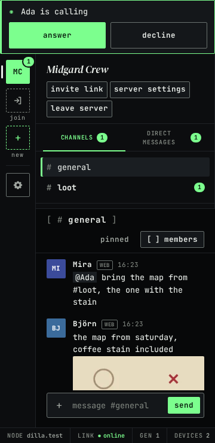
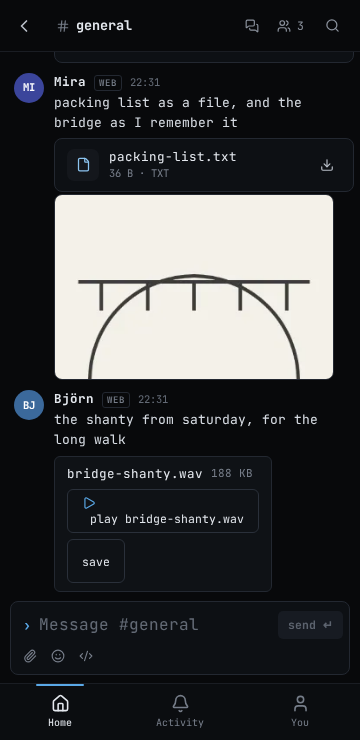
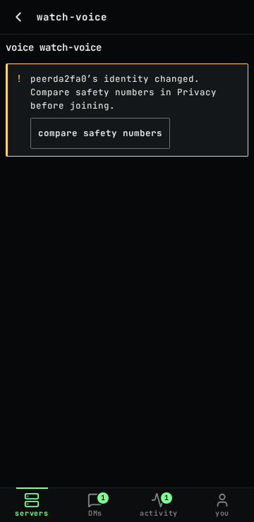

# Voice, calls and media files

This page continues [Getting started](getting-started.md). It describes voice channels, calls in direct messages,
camera and screen share, push to talk, sounds, and audio and video files in the web client as it is in "web-3".
Every quoted line is the text the screen shows; `{name}` stands for a person's display name (or username), and
`{where}` for the voice channel or the direct message the call is in.

Voice works in a current Chromium-based browser and in Firefox, in one tab at a time, and needs a microphone only to
talk: without one you can still listen.

## Join and leave a voice channel

A server's voice channels are listed under "voice" in the channel list. While people are in one, it also shows under
"active voice" at the top of the list, with "{n} in voice" and one line per person and what they are doing
("speaking", "muted", "deafened"). People who joined the server after you opened the page are shown by name too.

Select a voice channel to open it. An empty one says "Nobody is in voice yet." Press **join voice**: the dock above
your user panel says "connecting", then "in {where}", and the screen announces "You joined {where}." Each person in
the call has a tile with their name and their state:

| The tile says | What it means |
|---|---|
| "connecting" | They are joining; nothing of theirs is played yet |
| "not heard yet" | They are in the call, and nothing from their device has been checked yet |
| "speaking", "muted", "deafened" | You hear them, and this is what they are doing |
| "camera on", "sharing screen" | Their camera or their screen shows in the tile |
| "unverified stream" | Something arrives in their name that is not one of the call's devices; nothing of it is shown or played |

A tile with no state word is someone you hear who is quiet right now.

Each tile has "volume for {name}": it changes how loud that person is for you only.

**leave**, in the dock or under the tiles, leaves the call ("You left {where}."). If you were the only one left in
the call, leaving ends it. If you join again right after leaving, the dock can stay at "connecting" for up to 30
seconds while the instance finishes your earlier leave; a screen reader hears "Rejoining {where}. This can take up to
30 seconds."

You can keep talking while you read: open any text channel and the dock stays above your user panel, with the input
level, **mute**, **deafen** and **leave**.

At phone width the tiles take the full width, one above the other, every control is at least 44 by 44 pixels, and
the dock sits with the channel list above the conversation.

An open voice channel's call setup that nobody has used for 10 minutes is renewed by the instance the next time
someone joins. You do not have to do anything.

## Mute, deafen and push to talk

**mute** turns your microphone off ("Microphone muted.") and, pressed again, on ("Microphone on."). **deafen** turns
off everything you hear, and mutes you too ("Sound off."); pressed again, it turns it back on ("Sound on."). These
buttons keep their names: while one is on it shows `[x]` before its name, and a screen reader says "pressed".

| Key | What it does |
|---|---|
| Control/⌘+Shift+M | Mutes or unmutes, from anywhere in the app while you are in a call |
| Control/⌘+Shift+D | Deafens or undeafens, from anywhere in the app while you are in a call |
| Arrow Left, Arrow Right, Home, End | Move between the buttons of the dock or the stage's controls |

Control or ⌘ works on every system. There are no single-key shortcuts. Settings → keyboard lists both, next to the
search shortcuts.

**Voice activity** is the default: the microphone sends while you speak. To use **push to talk** instead:

1. Open **Settings → voice**, and under "input mode" choose "push to talk". The microphone closes at once.
2. Press **set key**: "Press the key to use. Escape cancels. It works only while dilla is the active tab."
3. Press one key on its own: F13 to F24, Pause or Scroll Lock. Any other key, and any key held with Control, Alt, ⌘,
   Shift or AltGr, is refused with "That key types text, moves the focus or needs another key. Use one key on its own,
   such as Pause, Scroll Lock or F13 to F24." Insert works too, but screen readers use it as their own key, so it
   is not suggested.

There is no key until you set one ("no key set"). Hold it to talk. It works only while the dilla tab is the active
tab, never while you type in a text field, and the dock says "push to talk" while it is in force.

Settings → voice also holds:

- **input device** and **output device**, or "system default". A browser that cannot choose where sound plays says
  "This browser plays voice on the system default device."
- **noise suppression**, on by default: it removes steady background noise from your microphone.
- **input level**: a meter of what your microphone hears.

## Camera and screen

**camera** shows your camera in your tile for everyone in the call, and pressed again ends it. **share screen**
lets the browser ask which screen, window or tab to share, and pressed again ends it. The only sound a share
carries is a tab's, when you share a browser tab in a Chromium-based browser; a whole screen or window is shared
without sound. If too many people already show a camera or a screen: "Too many people are sharing. Try again when
someone stops."

## Calls in direct messages

In a direct message (or a group direct message), the strip under the header has **call** when nobody is in a call
there, and **join call** when someone is. Pressing **call** joins the call and rings the others; the strip says
"ringing {name}" while it rings, "{name} declined." when someone declines, and "No answer." when every ring ended
without an answer. There is no ringback tone. During the call the tiles sit above the conversation, which stays
usable below them; at phone width, **messages** switches between the call and the conversation.

A ring shows as a banner at the top of the app, "{name} is calling", with **answer** and **decline**, and the ring
sound. With the keyboard, Tab from the start of the main area reaches **answer** and **decline** first. A ring:

- lasts 30 seconds from when it arrives on your device, and ends earlier when you answer or decline on any of your
  devices, or when the call ends;
- reaches only a browser where a dilla tab is open. With no open tab there is no ring; the call is still there to
  join from the direct message;
- shows a desktop notification, "{name} is calling", "Open dilla to answer.", only while the tab is hidden and only if
  you turned notifications on. The notification itself has no buttons: open the tab to answer;
- of a muted direct message shows the banner only: no sound and no notification;
- while you are already in a call says "{name} is calling. Answering leaves {where}." and plays nothing.

The same person rings you at most once every 15 seconds (and 20 times an hour); a call they start more often still
opens, it just does not ring you. In a group direct message, each person is rung on their own.

## The call code

**call code**, closed at first, shows a code of 6 groups of 5 digits: "The code changes whenever someone joins or
leaves. Read it aloud: if every screen shows the same code, everyone is hearing the same set of devices." Enter or
Space opens and closes it, Escape closes it. It is the one thing to compare during a call; comparing safety numbers
with each person (Settings → privacy) is still how you know who they are.

## Sounds

dilla makes three short sounds of its own: a tick when someone else joins the call you are in, another when someone
leaves it, and the ring (a short double ping every 2 seconds while a ring lasts). They are on by default. They never
play for your own join, leave, mute or deafen, nor while you are deafened, and a muted direct message rings without
sound. A browser plays nothing on a page you have not clicked or typed in yet.

To turn them off, open **Settings → notifications** and, under "sounds", switch off "join and leave sounds", "ring
for calls", or both.

## Audio and video files

Audio and video files of these types play in the conversation: audio as MP3, MP4 or M4A, AAC, Ogg, Opus, WebM, WAV
or FLAC, and video as MP4, WebM or Ogg. Press **play {name}** ("loading" while it downloads): the browser's own
player shows and you start it yourself; nothing plays on its own. A video shows no picture until you play it (there
are no preview frames), and there are no captions. Every other type, and a file over 25 MB, is a card with **save**.

"This browser cannot play this file." means the browser does not know how to play what is inside: **save** it and
play it with another program.

## When voice stops or pauses

### A contact's identity changed

If someone in the call has a changed identity that you have not compared yet, the join is refused before anything is
sent: "{name}’s identity changed. Compare safety numbers in Privacy before joining." Compare the number with them
(Settings → privacy, [Contacts and safety numbers](getting-started.md#contacts-and-safety-numbers)); once you have
verified them, **join voice** is offered again without a reload.

If the identity of someone changes while you are in the call, the call pauses for you: "{name}’s identity changed, so
this call is paused for you: nothing you say is sent and nothing is played. Compare safety numbers in Privacy to
continue, or wait until {name} leaves." The dock says "paused in {where}" and **compare safety numbers** opens the
comparison. Nothing you say is sent and nothing is played until you verify them or they leave; then "The call
continues." The call goes on for the others.

If a device in the call cannot be checked yet (its owner's device list could not be read), the call holds for you the
same way: "A device in this call could not be checked yet, so this call is paused for you: nothing you say is sent and
nothing is played. It continues once the check is done." It continues by itself once the check succeeds.

### A device failed the check

If a device in the call is not on its owner's signed device list, you leave at once: "A device in this voice failed
the identity check, so you left. Joining stays paused until it is removed." Before you join, the same says "A device
in this voice failed the identity check. Joining is paused until it is removed." A call in a direct message is also
refused while sending in that direct message is paused.

### Other messages

| The app shows | What it means and what to do |
|---|---|
| "The microphone is blocked. You can listen; allow the microphone in the browser to talk." | The browser has refused the microphone to dilla. Allow it in the browser's site settings, then leave and join again |
| "No microphone found. You can listen." | Connect a microphone, then leave and join again |
| "The microphone could not be connected. You can listen." | The microphone is there but could not be used; leave and join again, or pick another input device |
| "Voice does not work in this browser" | "This browser lacks a feature dilla needs for voice. Use a current Chromium-based browser or Firefox." Safari is not supported yet |
| "Voice is open in another tab of this browser." | Voice runs in one tab at a time: use the tab that has it, or close it |
| "This voice is full." | The call has as many people as the instance allows |
| "Could not join voice. Try again." | Press **join voice** again |
| "You were removed from voice." | Your device was taken out of the call; join again if you can still open the channel |
| "The connection to voice was lost. Join again to continue." | The connection dropped and did not come back; press **join voice** again |
| "Voice ended for everyone." | The call was closed for everyone in it |
| "reconnecting" in the dock | The connection dropped; the call comes back by itself |

## Known limits

- Voice only in a browser tab: no desktop app yet, and voice is not supported in Safari.
- Screen sound only from a browser tab shared in a Chromium-based browser.
- No ring without an open dilla tab, and no answering from the notification itself.
- No preview frames and no captions for videos; only the listed types play.
- You cannot block a person so that their calls never ring.
