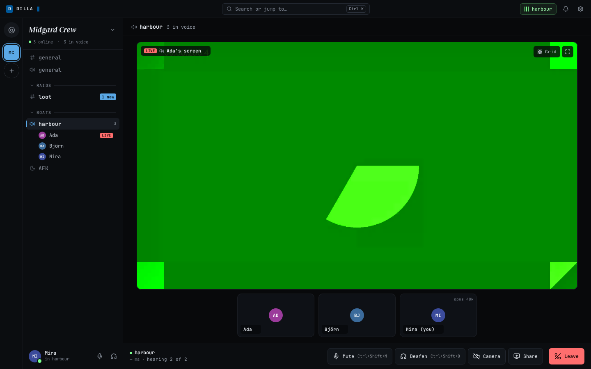
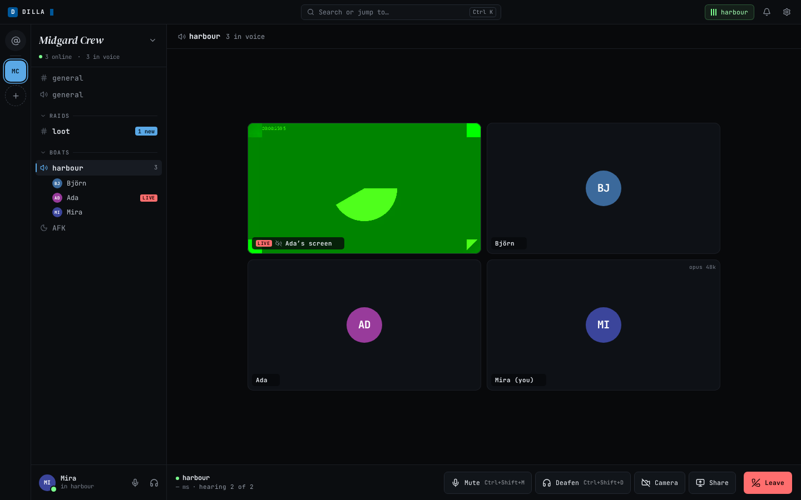
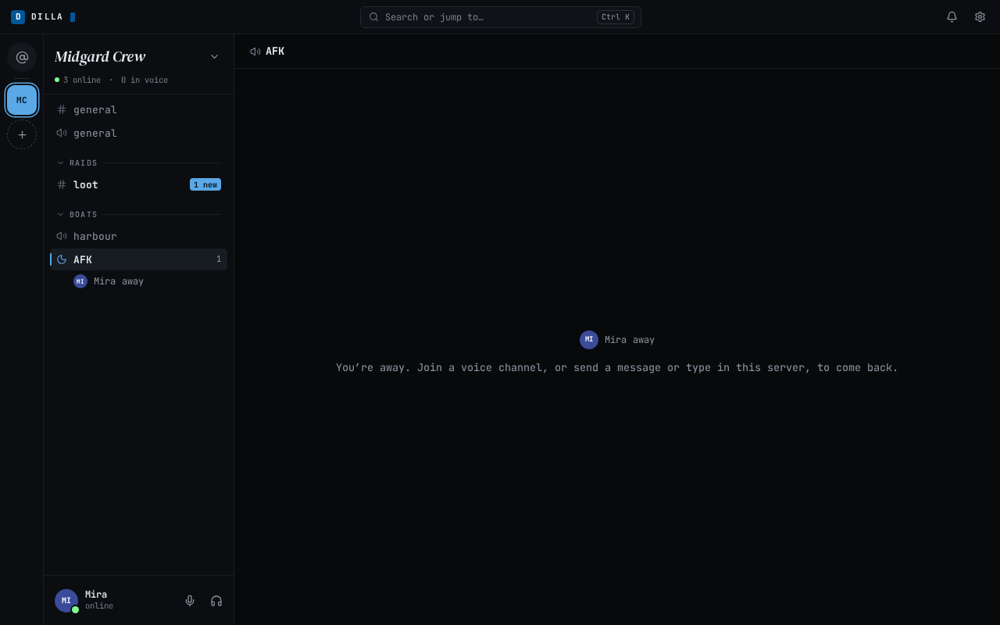

# Voice, calls and media files

This page continues [Getting started](getting-started.md). It describes voice channels, calls in direct messages,
camera and screen share, push to talk, sounds, AFK channels, and audio and video files in the web client (updated
2026-10-21, web-3.9).
Every quoted line is the text the screen shows; `{name}` stands for a person's display name (or username), and
`{where}` for the voice channel or the direct message the call is in.

Voice works in a current Chromium-based browser and in Firefox, in one tab at a time, and needs a microphone only to
talk: without one you can still listen.

## Join and leave a voice channel

A server's voice channels sit in the channel list among its text channels, in the server's order, each with a speaker
icon ([One channel list](getting-started.md#one-channel-list)). A new server starts with one called general, and its
owner can add more with the **+** at the top of the list ([Add a channel](getting-started.md#add-a-channel)); here Ada
added "harbour". While people are in one, it shows how many are in it, and the people are listed under it, one line
each, with the same small icons the tiles have ([the participant icons](#the-participant-icons)). People who joined
the server after you opened the page are shown by name too.

On a computer, one click on a voice channel joins it. The call panel above your user panel shows the channel name over "connecting", then your ping,
and the screen announces "You joined {where}." Each person in the call has a tile with their name and
their state. On a phone, tap the voice channel to see who is there, then press **join voice**.

**leave**, in the call panel or on the stage's controls, leaves the call ("You left {where}."). If you were the only
one left in the call, leaving ends it. If you join again right after leaving, the call panel can stay at "connecting"
for up to 30 seconds while the instance finishes your earlier leave; a screen reader hears "Rejoining {where}. This
can take up to 30 seconds." Leaving puts focus back on the voice channel's row in the list.

### The participant icons

On a tile, and on a person's line under the channel in the list, what they are doing is shown by small icons on one
line after the name, in this order: muted (a crossed-out microphone), deafened (crossed-out headphones), camera,
screen and speaking (a green dot). None has a visible word: each has its name, such as "muted", "deafened", "camera on",
"sharing screen" or "speaking", as a tooltip when you point at it and for a screen reader. A person with none of them
is quiet and unmuted.

Three states keep their words, because they are about trust and what you can hear:

| The tile says | What it means |
|---|---|
| "connecting" | They are joining; nothing of theirs is played yet |
| "not heard yet" | They are in the call, and nothing from their device has been checked yet. It is not shown for someone who is muted or deafened and sends no camera or screen: their device sends nothing to check, so you see "muted" (or "deafened") and the glyph |
| "unverified stream" | Something arrives in their name that is not one of the call's devices; nothing of it is shown or played |

The `web` and `bot` tags stay as words after the name. Whoever is speaking has a green ring around their avatar, in the
list and on their tile.

**Speaking lights within a beat.** Your browser reads the level of the audio it plays (and, for yourself, of your own
microphone) and lights the dot as soon as someone speaks, without waiting for the instance to say so. Your own dot
never lights while you are muted, deafened or paused, or while push to talk is up, and no dot lights for anyone while
the call is paused for you. When a person's audio is not playing for you (you are deafened, or their volume for you is
0 %), the dot follows the instance's own report instead, which is about a second behind.

Each person's tile has "volume for {name}": it changes how loud that person is for you only, from 0 % to 200 %. The
value shows beside it, and the mark in the middle is 100 %, the volume they arrive at. The volume sits at the foot of the
tile (under the name on a phone), never over the face. Your own tile has no volume.

### The call panel

At the bottom left, above your user panel, the call panel shows the channel name (hover it for the server) over your ping and data rates, like "24 ms · ↑48 ↓96 kb/s" (or "connecting", "reconnecting" or "paused
in {where}" in place of the rates when that is so), and then three icon buttons: **camera**,
**share screen** and **leave**. Press the channel name to open Settings → Diagnostics, which shows the connection. The
panel has no microphone meter: the level of your microphone is in Settings → Voice. It has no mute or deafen either:
those are in the user panel under it, which is always there ([the user panel](getting-started.md#the-user-panel)). It
stays on screen while you read other channels, so you can turn your camera or a share on and off, or leave, from
anywhere. Point at an icon, or reach it with Tab and the arrow keys, and its name shows above it; Escape hides the name
again.

The stage has a toolbar of its own, pinned at the bottom centre of the stage: **mute**, **deafen**, **camera**,
**share screen** and **leave**, with a thin line before **leave**. Its mute and deafen are the same ones as in the user
panel, shown again where your hands are, and their tooltips show the shortcut. Beside it, "hearing N of M" counts the audio streams you hear.

### The stage

The stage has one tile for each camera or screen, filling the stage. A person has one tile for themself (their camera,
or their initials without one), and, while they share, one more for the screen, named "{name}’s screen". With no one
sharing it is a grid.

- **Focus.** Click a tile to make it large; the others sit in a strip below it. Click it again, or press Escape, for
  the grid. Each tile has a button that covers its picture, named by the tile and pressed while it is focused, so Tab
  and Enter or Space do the same.
- **A new screen share** from someone else comes to the front on its own, when no tile is focused. It happens once
  for a share: if you unfocus it, it stays a tile. Your own screen never takes the focus.
- **Full screen** for one tile: the button in its top right corner, or a double-click on the picture. Only a tile that
  shows a camera or a screen has it (not an avatar), and only where the browser allows full screen. Escape leaves it.
- Nothing restarts when you change the focus: the pictures keep playing.

At phone width the tiles take the full width, one above the other (two columns once there are more than two), the call's buttons sit under them, and every
control is at least 44 by 44 pixels. The call panel is replaced by [the call bar](#on-a-phone).

### On a phone

On a phone, while you are in a call, a call bar sits above the tab bar. It shows where the call is, and has three
buttons, each at least 44 by 44 pixels: **open the call in {where}** (the wide one, which opens the call's screen),
**mute** and **leave**. It stays on the home, activity and you tabs and over a channel you are reading. It goes
away on the call's own screen, which has all the call's controls, and when you leave. The other buttons of the call panel
(**deafen**, **camera** and, where the browser can, **share screen**) are on the call's screen. The call bar's dot shows
connecting, reconnecting or paused as the call panel does. A phone has no user panel, and a phone browser that cannot
share a screen has no **share screen** button at all (iPhones and Android phones cannot; share from a desktop
browser).

An open voice channel's call setup that nobody has used for 10 minutes is renewed by the instance the next time
someone joins. You do not have to do anything.

## Mute, deafen and push to talk

There is one **mute** and one **deafen** at the bottom left, in the user panel, in a call and out of one. **mute**
turns your microphone off ("Microphone muted.") and, pressed again, on ("Microphone on."). **deafen** turns off
everything you hear, and mutes you too ("Sound off."); pressed again, it turns it back on ("Sound on."). These buttons
keep their names: while one is on its icon changes (a crossed-out microphone, crossed-out headphones) and is drawn in
red with a line under it, and a screen reader says "pressed". The stage's toolbar has a copy of each.

**Mute is enforced from the first frame.** A call you join muted starts with the microphone closed, and a mute you
press while the call is still starting takes effect at the press: nothing of you is sent before the call is up.

Outside a call the two buttons set how your next call starts, and this browser keeps them: press **mute** and you join
muted (pressed again, you do not); press **deafen** and you join deafened. If you were muted when you left a call, you
join muted. If you join deafened, pressing **deafen** again turns your sound back on but leaves you muted; press
**mute** to talk.

Reloading the page, or closing it, leaves the call; the others see you leave. Press **join voice** (or **join call**)
to come back.

| Key | What it does |
|---|---|
| Control/⌘+Shift+M | Mutes or unmutes, from anywhere in the app, in a call or out of one |
| Control/⌘+Shift+D | Deafens or undeafens, from anywhere in the app, in a call or out of one |
| Arrow Left, Arrow Right, Home, End | Move between the buttons of the call panel, the user panel or the stage's controls |

Control or ⌘ works on every system. There are no single-key shortcuts. Settings → keyboard lists both, next to the
search shortcuts.

When push to talk is on, the mute button in the user panel carries a small "PTT" tag.

**Voice activity** is the default: the microphone sends while you speak. To use **push to talk** instead:

1. Open **Settings → voice**, and under "input mode" choose "push to talk". The microphone closes at once.
2. Press **set key**: "Press the key to use. Escape cancels. It works only while dilla is the active tab."
3. Press one key on its own: F13 to F24, Pause or Scroll Lock. Any other key, and any key held with Control, Alt, ⌘,
   Shift or AltGr, is refused with "That key types text, moves the focus or needs another key. Use one key on its own,
   such as Pause, Scroll Lock or F13 to F24." Insert works too, but screen readers use it as their own key, so it
   is not suggested.

There is no key until you set one ("no key set"). Hold it to talk. It works only while the dilla tab is the active
tab, never while you type in a text field. While push to talk is in force the call panel says "hold {key} to talk" (for
example "hold Pause to talk"), or "push to talk: no key set" with **set a key**, which opens Settings → voice. The
microphone test and its level meter are on the same page.

Settings → voice also holds:

- **input device** and **output device**, or "system default". Choosing the output device works in Chrome and Edge,
  and the call follows it: change the output device during a call and the sound moves at once. If the browser
  refuses, the call panel says "The output device did not change. Call sound plays where it did before." Firefox plays call
  sound on the system default device. A browser that cannot choose where sound plays says "This
  browser plays voice on the system default device."
- **noise suppression** has **Automatic (beta)**, **Lightweight** and **Off**. Lightweight uses RNNoise locally and remains the default, including existing On preferences. Automatic (beta) ships in every release, and Lightweight leaves the beta. It currently also uses Lightweight while enhanced suppression is evaluated. The screen shows the effective processor and explains fallback during a call. Off disables both application and browser noise suppression where supported; echo cancellation stays enabled. Browser suppression is disabled for neural processing, avoiding duplicate processing. Switching the setting during a call applies at once.
- **Test microphone** records up to ten seconds locally. Capture stops before playback; **Close and discard** releases the recording. Testing is disabled during calls. It uses the selected input and suppression setting. No recording is uploaded.
- **input level**: a meter of what your microphone hears.

## Camera and screen

**camera** sends your camera to everyone in the call, and pressed again ends it; it and **share screen** are in the
call panel as well as on the stage's toolbar, and show in green while they are on. Your own tile shows what you send:
your camera, mirrored as a mirror shows you (the others see it the right way round). **share screen** lets the browser
ask which screen, window or tab to share, and pressed again ends it. A share is its own tile, "{name}’s screen",
beside the person's own tile, so with the camera and a share both on, a person has two tiles
([The stage](#the-stage)). A share carries sound from:

- A browser tab in Chrome or Edge (all platforms).
- A screen or window on Windows and ChromeOS in Chrome and Edge (when you tick "Also share system audio" in the browser's picker); on macOS 14.2+ with Chrome 141+ too.
- A browser tab on Linux (no screen or window audio).
- No sound from Firefox or Safari by themselves; there you can pick an audio input as the stream's sound (see [Share sound from Firefox or Linux](#share-sound-from-firefox-or-linux)).

A game or app's own sound without a virtual device needs the desktop app (planned). dilla asks the browser to leave the call's own sound out of a shared screen. If a share has no sound, dilla tells the person sharing what their browser can do, and shows "no sound" on the screen tile for everyone watching. Each person's stream also gets its own volume and mute.

The notice to the person sharing depends on the browser:

- In Firefox (and browsers built on it) and Safari: "This browser can’t share sound; Chrome or Edge can share a browser tab with its sound."
- In Chrome or Edge on Linux: only a browser tab can carry sound, so share a tab and keep "Also share tab audio" ticked.
- In Chrome or Edge on Windows, ChromeOS or macOS: share a browser tab, or tick "Also share system audio" when you pick a screen.

When the browser lists an audio input you can pick, the notice also says "You can also pick a sound source for the stream." and offers a **pick a sound source** button.

### Share sound from Firefox or Linux

A browser cannot capture your computer's sound by itself on Linux, and Firefox cannot at all. dilla lets you choose any
audio input as the stream's sound instead. While you share and the share has no sound of its own, a **sound from** list
appears under the call controls: **none**, then every audio input the browser lists, except the microphone the call uses.
Pick one and it is sent as the stream's sound, encrypted like the rest; everyone watching can set its volume or mute it.
Choose **none** or stop sharing and it goes. A tab's or a screen's sound from the browser always wins, and then the list is not shown.
If the list says "Allow the microphone to see sound sources.", the browser hides device names until the microphone is allowed.

- **A monitor** ("Monitor of …") carries everything your computer plays, including this call, so the others will hear
  themselves. Firefox lists these devices directly, and dilla warns when you pick one. Chrome and Edge on Linux do not list
  monitors at all; use the recipe below there.
- **One app only, and you still hear it** (Chrome, Edge and Firefox): give that app its own output, send a copy of it to
  your speakers, and turn the output's monitor into an ordinary input. Each `pactl load-module` prints a number: note it,
  because it is how you undo the step.
  1. The output: `pactl load-module module-null-sink sink_name=dilla-share sink_properties=device.description=dilla-share`
  2. A copy to your speakers, so you still hear the app: `pactl load-module module-loopback source=dilla-share.monitor`
  3. An input made from the output's monitor: `pactl load-module module-remap-source master=dilla-share.monitor source_name=dilla-share-input source_properties=device.description=dilla-share-input`
  4. Move the app's output to `dilla-share` in pavucontrol (Playback tab) or qpwgraph.
  5. Start the share, and in **sound from** pick "dilla-share-input". The call keeps playing on your normal speakers and is not in the stream.

  On PipeWire, `pw-loopback --capture-props='media.class=Audio/Sink node.name=dilla-share node.description=dilla-share'`
  replaces steps 1 and 2 in one command (leave it running; Ctrl+C stops it); steps 3 to 5 stay the same.
  To undo, run `pactl unload-module <number>` for each number you noted, last one first. Do not unload by module name: that
  would also remove loopbacks and sinks you made for something else.

If too many people already show a camera or a screen: "Too many people are sharing. Try again when someone stops."

## Calls in direct messages

In a direct message (or a group direct message), the strip under the header has **call** when nobody is in a call
there, and **join call** when someone is. Pressing **call** joins the call and rings the others; the strip says
"ringing {name}" while it rings, "{name} declined." when someone declines, and "No answer." when every ring ended
without an answer. If nobody answered, you leave the call by yourself 5 seconds later, and the strip keeps saying why.
A call someone answered never ends by itself. There is no ringback tone. During the call the tiles sit above the conversation, which stays
usable below them, in the compact grid of the call box (no focus, strip or full-screen buttons: those are for the
stage of a voice channel); at phone width, **messages** switches between the call and the conversation. In a direct
message's call the call panel and what is said name it
"the call with {name}": "in the call with {name}", "You joined the call with {name}."

A ring shows as a banner at the top of the app, "{name} is calling", with **answer** and **decline**, and the ring
sound. With the keyboard, Tab from the start of the main area reaches **answer** and **decline** first. A ring:

- lasts 30 seconds from when it arrives on your device, and ends earlier when you answer or decline on any of your
  devices, or when the call ends;
- reaches only a browser where a dilla tab is open. With no open tab there is no ring; the call is still there to
  join from the direct message;
- shows a desktop notification, "{name} is calling", "Open dilla to answer.", only while the tab is hidden and only if
  you turned notifications on. The notification itself has no buttons: open the tab to answer;
- of a muted direct message shows the banner only: no sound and no notification;
- while you are already in a call says "{name} is calling. Answering leaves {where}." and plays nothing.

The same person rings you at most once every 15 seconds (and 20 times an hour); a call they start more often still
opens, it just does not ring you, and the caller's strip says "{name} not rung: called too recently." instead of
"ringing {name}". In a group direct message, each person is rung on their own.

## The call code

**call code**, closed at first, shows a code of 6 groups of 5 digits: "The code changes whenever someone joins or
leaves. Read it aloud: if every screen shows the same code, everyone is hearing the same set of devices." Enter or
Space opens and closes it, Escape closes it. It is the one thing to compare during a call; comparing safety numbers
with each person (Settings → privacy) is still how you know who they are.

## AFK channels

Every server has a voice channel called "AFK". It is made with the server, and a server's owner or anyone who manages
channels can rename it and move it into a category (it always stays last in its list), but nobody can delete it.

- **Anyone can join it**, like any voice channel. Everyone in it is muted: you can hear the others, but you cannot
  speak, share your screen or turn on a camera, and nobody else can either.
- **After the inactive timeout**, a computer that has sat in a voice channel with no keyboard, pointer, touch or
  speech is moved to the AFK channel, and the screen announces "Moved to AFK for inactivity". If the join fails, the dock
  shows that line with a **join** button. Quiet listening counts as idle, and activity on another of your devices does not
  count. The owner or a manager sets the timeout (1, 5, 15, 30 minutes or 1 hour) in server settings → overview
  ([Run your server](getting-started.md#run-your-server)).
- **A phone is never moved.**
- **To leave**, join another voice channel, or press **leave**.

## Sounds

dilla makes three short sounds of its own: a tick when someone else joins the call you are in, another when someone
leaves it, and the ring (a short double ping every 2 seconds while a ring lasts). They are on by default. They never
play for your own join, leave, mute or deafen, nor while you are deafened, and a muted direct message rings without
sound. A browser plays nothing on a page you have not clicked or typed in yet.

To turn them off, open **Settings → notifications** and, under "sounds", switch off "join and leave sounds", "ring
for calls", or both.

## Audio and video files

Audio and video files of these types play in the conversation: audio as MP3, MP4 or M4A, AAC, Ogg, Opus, WebM, WAV
or FLAC, and video as MP4, WebM or Ogg. Press **play {name}** ("loading" while it downloads): the browser's own
player shows and you start it yourself; nothing plays on its own. A video shows no picture until you play it (there
are no preview frames), and there are no captions. Every other type, and a file over 25 MB, is a card with **save**.

"This browser cannot play this file." means the browser does not know how to play what is inside: **save** it and
play it with another program.

## When voice stops or pauses

### A contact's identity changed

If someone in the call has a changed identity that you have not compared yet, the join is refused before anything is
sent: "{name}’s identity changed. Compare safety numbers in Privacy before joining." **compare safety numbers**,
next to it, opens the comparison. Compare the number with them (Settings → privacy, [Contacts and safety numbers](getting-started.md#contacts-and-safety-numbers)); once you have
verified them, **join voice** is offered again without a reload.

If the identity of someone changes while you are in the call, the call pauses for you: "{name}’s identity changed, so
this call is paused for you: nothing you say is sent and nothing is played. Compare safety numbers in Privacy to
continue, or wait until {name} leaves." The call panel says "paused in {where}" and **compare safety numbers** opens the
comparison. Nothing you say is sent and nothing is played until you verify them or they leave; then "The call
continues." The call goes on for the others.

If a device in the call cannot be checked yet (its owner's device list could not be read), the call holds for you the
same way: "A device in this call could not be checked yet, so this call is paused for you: nothing you say is sent and
nothing is played. It continues once the check is done." It continues by itself once the check succeeds.

### A device failed the check

If a device in the call is not on its owner's signed device list, you leave at once: "A device in this voice failed
the identity check, so you left. Joining stays paused until it is removed." Before you join, the same says "A device
in this voice failed the identity check. Joining is paused until it is removed." A call in a direct message is also
refused while sending in that direct message is paused. When only the call's own setup held the device (nothing in the
channel itself is paused), **join voice** shows again and the notice says "… so you left. You can try to join again."
(or, before you join, "A device in this voice failed the identity check. You can try to join again."); a new join
checks every device again.

### Other messages

| The app shows | What it means and what to do |
|---|---|
| "The microphone is blocked. You can listen; allow the microphone in the browser to talk." | The browser has refused the microphone to dilla. Allow it in the browser's site settings, then leave and join again |
| "No microphone found. You can listen." | Connect a microphone, then leave and join again |
| "The microphone could not be connected. You can listen." | The microphone is there but could not be used; leave and join again, or pick another input device |
| "Voice does not work in this browser" | "This browser lacks a feature dilla needs for voice. Use a current Chromium-based browser or Firefox." Safari is not supported yet |
| "Voice is open in another tab of this browser." | Voice runs in one tab at a time: use the tab that has it, or close it |
| "You are in a call in the other tab. Using this tab ends that call." | You pressed **Use this tab** while the other tab is in voice: **Keep the call**, or **Leave the call and use this tab** |
| "This voice is full." | The call has as many people as the instance allows |
| "Could not join voice. Try again." | Press **join voice** again |
| "You were removed from voice." | Your device was taken out of the call; join again if you can still open the channel |
| "You were removed from this server, so you left its voice." | The server's owner removed you while you were in its voice; there is nothing to join there any more |
| "The connection to voice was lost. Join again to continue." | The connection dropped and did not come back; press **join voice** again |
| "Voice ended for everyone." | The call was closed for everyone in it |
| "reconnecting" in the call panel | The connection dropped; the call comes back by itself |

### You see people speaking but hear nothing

If the call panel says "Your browser paused call audio.", press **turn on audio**: the browser holds call sound back until
you press something on the page. The line and its button sit above the call panel's buttons; one press
starts the call's sound and the line goes. Nothing else about the call changes. This happens when the browser did not
let the call start its sound, for example when the browser or your system suspended audio, or a stricter autoplay
setting in the browser held it back.

If there is no such line, check that you are not deafened, the output device in Settings → Voice, and the person's
volume. The stage's toolbar also says "hearing {attached} of {expected}", for example "hearing 2 of 3": it counts audio streams,
not people. {expected} is how many audio streams should reach you, and {attached} how many you hear (a shared
screen's sound is its own). A person whose volume you set to 0 counts as not heard. When the two numbers differ for
more than a moment, ask the missing person to leave and join again.

If you hear no one on any call, ask whoever runs your instance to update it to v0.1.0-web3.3 or later.

## Known limits

- Voice only in a browser tab: no desktop app yet, and voice is not supported in Safari.
- On Windows, Chrome and Edge before version 141 may send the call's own sound back through a shared screen or window (an echo); update the browser.
- No ring without an open dilla tab, and no answering from the notification itself.
- No preview frames and no captions for videos; only the listed types play.
- You cannot block a person so that their calls never ring.
